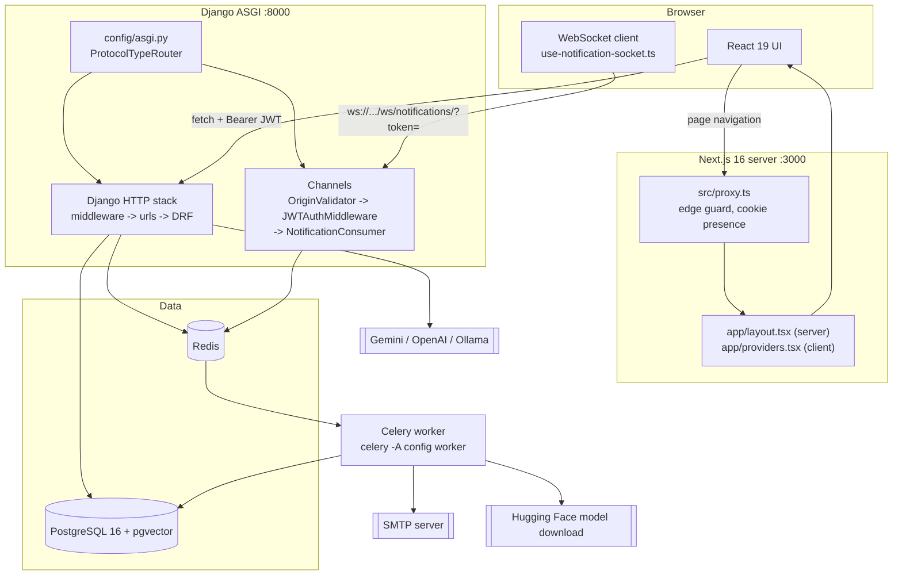
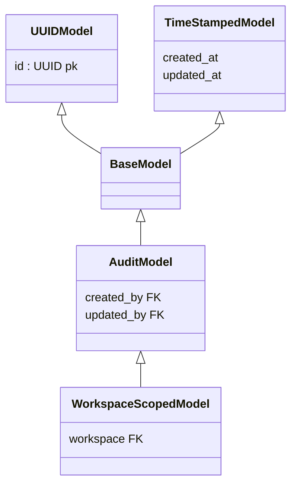
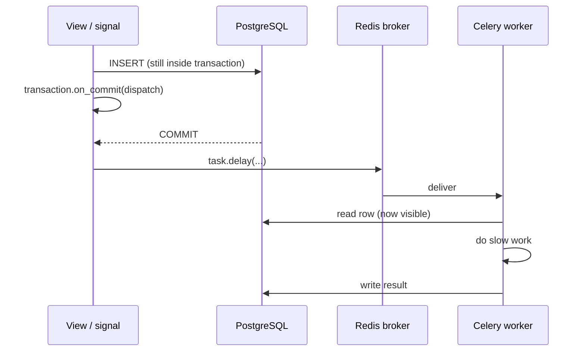
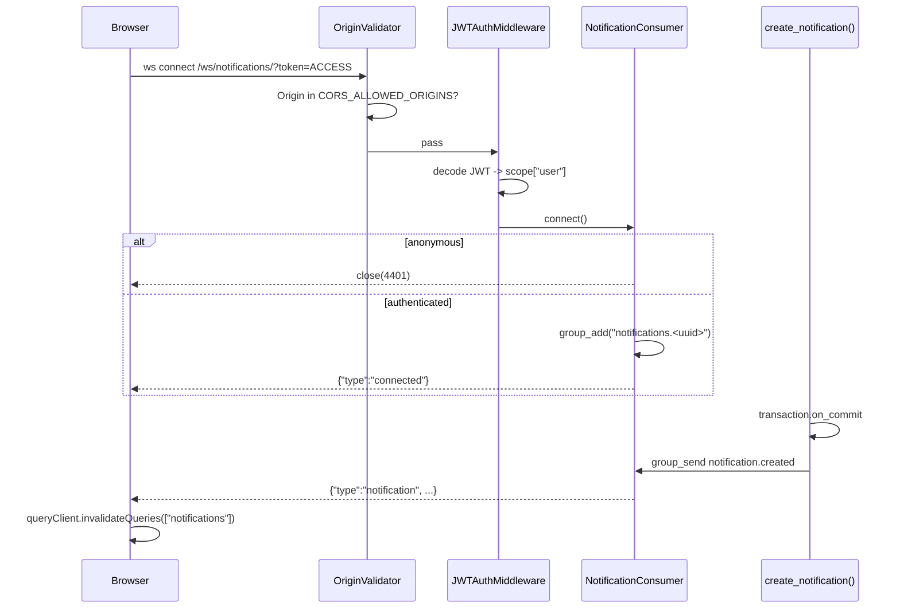
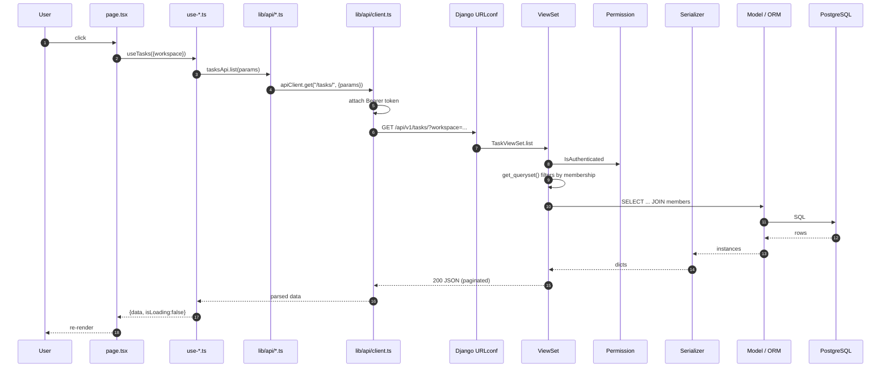

# 02 — System Architecture

[← Back to index](README.md)

---

## 1. The whole system



Two protocols reach Django, and `config/asgi.py` splits them:

```python
application = ProtocolTypeRouter({
    "http": django_asgi_application,
    "websocket": OriginValidator(
        JWTAuthMiddleware(URLRouter(websocket_urlpatterns)),
        settings.CORS_ALLOWED_ORIGINS,
    ),
})
```
`backend/config/asgi.py:30-46`

---

## 2. Layer by layer

### Layer 1 — Edge route guard

| | |
|---|---|
| **File** | `frontend/src/proxy.ts` |
| **Responsibility** | Redirect before a page renders. Nothing else. |
| **Input** | An incoming `NextRequest` matching `/dashboard/:path*`, `/workspaces/:path*`, `/login`, `/register` |
| **Output** | `NextResponse.redirect(...)` or `NextResponse.next()` |
| **Depends on** | `STORAGE_KEYS` from `lib/constants.ts` |
| **Depended on by** | Nothing imports it; Next.js calls it by convention |

It checks only that an access **or** refresh cookie *exists* — it never verifies
the JWT. The file's own comment explains why: verification at the edge would be
slow, and the API client already handles expiry via silent refresh while the
protected layout handles a truly dead session.

Two deliberate details worth knowing:
- Password-reset pages are **absent** from `AUTH_PAGES`, so someone already
  signed in can still open a reset link from their email
  (`frontend/src/proxy.ts:18-22`).
- The matcher does **not** cover `/projects`, `/tasks`, `/handovers`,
  `/documents`, `/ai`, `/activity`, `/settings`, `/search`, `/notifications` or
  `/invitations`. Those routes are protected by Layer 3 only. See
  [18-security.md](18-security.md).

> **File naming note.** In Next.js 16 this file is `proxy.ts`; earlier versions
> called it `middleware.ts`. The root `README.md` still says `middleware.ts`, and
> the comment inside `app/(app)/layout.tsx:28` still says "Middleware guards
> routes at the edge". Same mechanism, old name.

---

### Layer 2 — Next.js app shell

| | |
|---|---|
| **Files** | `app/layout.tsx` (Server Component) → `app/providers.tsx` (Client) |
| **Responsibility** | Mount the provider tree exactly once for the whole app |
| **Provides** | `QueryClientProvider` → `ThemeProvider` → `AuthProvider` → children, plus `<Toaster/>` and React Query devtools |
| **Depends on** | `lib/query-client.ts`, `providers/auth-provider.tsx`, `components/theme-provider` |

`getQueryClient()` in `app/providers.tsx:19-27` makes a fresh `QueryClient` on
the server for every request and a singleton in the browser, so server-rendered
data is never shared between users while client-side cache survives re-renders.

---

### Layer 3 — Authenticated application shell

| | |
|---|---|
| **File** | `frontend/src/app/(app)/layout.tsx` |
| **Responsibility** | The real client-side auth gate + the sidebar chrome |
| **Input** | `useAuth()` state |
| **Output** | A spinner while loading, a redirect if unauthenticated, otherwise `WorkspaceProvider > SidebarProvider > AppSidebar + SidebarInset` |

Because every route under `app/(app)/` inherits this layout, **all** of them are
protected client-side even though `proxy.ts` only matches two prefixes.

---

### Layer 4 — Pages and components

| | |
|---|---|
| **Files** | 37 `page.tsx` files; `components/{ui,shared,layout,ai,comments,...}` |
| **Responsibility** | Render; collect input; call hooks |
| **Never does** | Talk to `fetch` directly (one exception: `lib/api/download.ts` for blobs) |

---

### Layer 5 — Hooks (server-state cache)

| | |
|---|---|
| **Files** | `frontend/src/hooks/use-*.ts` (16 files) |
| **Responsibility** | Wrap the API layer in TanStack Query; own query keys and invalidation |
| **Input** | Params from the page (usually including `workspace`) |
| **Output** | `{data, isLoading, error}` or a mutation object |

Every list hook is gated on a workspace: `enabled: !!params.workspace`
(`hooks/use-tasks.ts:21`). No workspace selected means no request fires.

Invalidation is where cross-module coupling is expressed. Example — reviewing a
handover can reassign a task, so the mutation invalidates the task cache too:

```ts
onSuccess: () => {
  qc.invalidateQueries({ queryKey: KEYS.all });
  qc.invalidateQueries({ queryKey: KEYS.detail(id) });
  // Approval reassigns the underlying task.
  qc.invalidateQueries({ queryKey: ["tasks"] });
}
```
`frontend/src/hooks/use-handovers.ts:69-74`

---

### Layer 6 — API service layer

| | |
|---|---|
| **Files** | `frontend/src/lib/api/*.ts` (16 files) |
| **Responsibility** | One typed function per endpoint; no React, no caching |
| **Depends on** | `lib/api/client.ts`, `lib/constants.ts` (`API_ROUTES`) |

Every path string in the app lives in `API_ROUTES` (`lib/constants.ts:18-92`).
Nothing hard-codes URLs.

---

### Layer 7 — Transport (`lib/api/client.ts`)

The single most important frontend file. 142 lines. Responsibilities:

1. **Build the URL** — `API_BASE_URL + path + buildQuery(params)`; empty, `null`
   and `undefined` params are dropped (`client.ts:25-37`).
2. **Attach the JWT** — unless `skipAuth` is set (login, register, refresh).
3. **Handle FormData** — when the body is `FormData`, it does *not* set
   `Content-Type`, so the browser can add the multipart boundary
   (`client.ts:83-88`).
4. **Silent refresh** — on `401`, call `getRefreshedToken()` and retry once.
   `_isRetry` prevents infinite loops (`client.ts:106-111`).
5. **Single-flight refresh** — `refreshPromise` is a module-level variable, so
   ten concurrent 401s trigger exactly one refresh call (`client.ts:64-72`).
6. **Normalise errors** — every non-2xx becomes
   `{status, message, details}` and is thrown (`client.ts:116-126`).

---

### Layer 8 — Django URL routing

`config/urls.py` mounts everything under a version prefix:

```
/admin/                       Django admin
/api/v1/                      -> api_v1_patterns (13 app URLConfs)
/api/schema/  /api/docs/  /api/redoc/   OpenAPI
/media/...                    only when DEBUG (config/urls.py:54-55)
```

Each app then registers a DRF `DefaultRouter` at its own prefix, so
`apps/tasks/urls.py` registering `""` under `path("tasks/", ...)` produces
`/api/v1/tasks/` and `/api/v1/tasks/{id}/`.

---

### Layer 9 — Views (controllers)

Three shapes exist in this codebase:

| Shape | Used when | Examples |
|---|---|---|
| `WorkspaceScopedViewSet` | Standard workspace-owned resource | `ProjectViewSet`, `TaskViewSet`, `DocumentViewSet`, `HandoverViewSet`, `PromptTemplateViewSet` |
| Plain `ModelViewSet` / `ReadOnlyModelViewSet` with a custom `get_queryset` | Scoping rule differs from "member of the workspace" | `WorkspaceViewSet`, `CommentViewSet`, `InvitationViewSet`, `NotificationViewSet`, `ActivityViewSet`, `MentionViewSet` |
| `APIView` | Not a CRUD resource, or the workspace arrives in the body | `LoginView`, `MeView`, `DashboardView`, `AnalyticsView`, `ChatView`, `SearchView`, `AISettingsView` |

---

### Layer 10 — Permissions

`backend/apps/common/permissions.py` holds five reusable classes. All of them
resolve the workspace the same way (`_resolve_workspace`, line 18): if the object
*is* a `Workspace` use it, otherwise use `obj.workspace`. That one helper is why
a single permission class protects both a workspace and everything nested in it.

Important limitation, by design: these are all `has_object_permission` only —
they do **not** implement `has_permission`. List-level safety comes from
`get_queryset()` filtering, not from the permission class. See
[08-authentication-authorization.md](08-authentication-authorization.md).

---

### Layer 11 — Serializers

Validation in, shaping out. Three patterns recur:

- **Nested read, id write.** `TaskSerializer` exposes `assignee` as a full
  `UserSerializer` but accepts `assignee_id` as a write-only UUID
  (`apps/tasks/serializers.py:11-23`).
- **Derived tenant.** `Task.workspace` and `Handover.workspace` are read-only and
  derived from the parent object inside `validate()`, so a client can never place
  a task in one workspace and a project in another
  (`apps/tasks/serializers.py:76`, `apps/handovers/serializers.py:86`).
- **Cross-field membership checks.** `_resolve_member()` refuses an assignee who
  is not a member of the workspace (`apps/tasks/serializers.py:59-68`).

---

### Layer 12 — Models / ORM

Four abstract bases in `apps/common/models.py` generate most columns:



`WorkspaceScopedModel` uses `related_name="%(class)ss"`, so each concrete model
gets `workspace.projects`, `workspace.tasks`, `workspace.documents` for free
(`apps/common/models.py:77-81`).

---

### Layer 13 — Signals (the invisible wiring)

Registered in each app's `AppConfig.ready()`:

| App | Handler module | What it does |
|---|---|---|
| `activities` | `handlers.py` | Writes an `Activity` row on save/delete of Project, Task, Document, Handover, Comment, Workspace, WorkspaceMember |
| `mentions` | `handlers.py` | On every `Comment` save, re-syncs `Mention` rows from the comment text |
| `notifications` | `handlers.py` | Listens for the custom `user_mentioned` signal and for comment replies, and creates notifications |
| `knowledge` | `handlers.py` | On `Document` **create** with a supported file type, enqueues an embedding job |

This is why the domain apps stay clean: `apps/tasks/views.py` is 25 lines and
knows nothing about audit logging.

---

### Layer 14 — Background jobs



Both queueing helpers defer with `transaction.on_commit` for the same reason,
stated in their own comments: queueing *before* the commit races the worker,
which could read a row that is not visible yet, or act on a transaction that
rolled back. See `apps/knowledge/services/processor.py:54-57` and
`apps/common/email.py:95-102`.

Both also fall back to running inline if the broker is unreachable, rather than
losing the job.

---

### Layer 15 — Realtime



The socket is **push-only and carries no authoritative data**: the client uses
the message purely as a signal to invalidate the React Query cache and refetch
over REST (`hooks/use-notification-socket.ts:74-78`). One source of truth, no
cache drift. When the socket is live, polling switches off entirely
(`hooks/use-notifications.ts:37`).

---

### Layer 16 — Data

| Store | What lives there | Failure behaviour |
|---|---|---|
| PostgreSQL | Everything durable, including the 384-dim embedding vectors | Health endpoint returns 503; AI retrieval returns a clean 503 instead of a 500 (`apps/ai/views.py:58-70`) |
| Redis | Celery broker + results, Channels layer, throttle counters | All three degrade: inline tasks, in-memory channel layer, per-process throttle cache |

---

## 3. Request lifecycle, end to end



Seven concrete traces with real function names: [11-data-flow.md](11-data-flow.md).

---

## 4. Dependency direction

```
proxy.ts ─────────────────► lib/constants.ts
page.tsx ─────────────────► hooks/ ──► lib/api/ ──► lib/api/client.ts ──► lib/constants.ts
page.tsx ─────────────────► providers/ ──► hooks/
components/ ──────────────► providers/, hooks/, lib/

config/urls.py ───────────► apps/*/urls.py ──► apps/*/views.py
apps/*/views.py ──────────► apps/common/viewsets.py ──► apps/common/permissions.py
apps/*/views.py ──────────► apps/*/serializers.py ──► apps/*/models.py
apps/*/models.py ─────────► apps/common/models.py ──► apps/workspaces/models.py
apps/*/handlers.py ───────► apps/*/services.py  (signal side, no reverse edge)
```

Three deliberate cycle-breakers exist in the backend:

1. `apps/common/permissions.py` imports `Workspace` **inside** each function, not
   at module level — `workspaces` depends on `common`, so a top-level import
   would be circular (`permissions.py:20-21`).
2. `apps/notifications/services.py` imports the consumer and serializer inside
   `_push()` so the module stays importable without Channels loaded (line 62-64).
3. `apps/knowledge/services/processor.py` imports `tasks` inside `dispatch()`
   because `tasks` imports `processor` (line 44).

---

## 5. What the system does NOT have

Confirmed absent from the codebase:

- No GraphQL, no tRPC, no gRPC — REST + WebSocket only.
- No Redux/Zustand/Jotai — React Context + TanStack Query.
- No ORM alternative or raw SQL layer — one `.raw()`-free codebase.
- No API gateway, service mesh or microservices — one Django process.
- No feature flags, no A/B framework.
- No server-side rendering of authenticated data: every `(app)` page is
  `"use client"` and fetches after hydration.

---

**Next:** [03 — Folder Structure](03-folder-structure.md)
