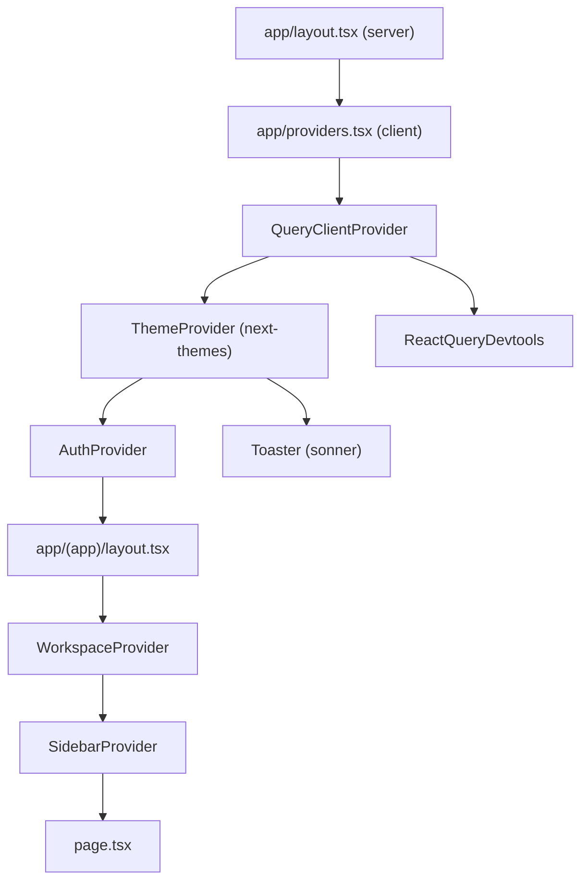

# 04 — Frontend Architecture

[← Back to index](README.md)

---

## 1. What runs first

`pnpm dev` → `next dev --turbopack` (`frontend/package.json:7`).

There is no `index.html` and no `main.jsx`. Next.js App Router owns the document.
The real boot order for a request to `/dashboard`:

```
1. src/proxy.ts                     runs at the edge, before anything renders
       │  cookie present? → continue.  absent? → 307 /login?next=/dashboard
       ▼
2. src/app/layout.tsx               Server Component: <html>, fonts, metadata
       │  renders <Providers>
       ▼
3. src/app/providers.tsx            "use client"
       │  QueryClientProvider → ThemeProvider → AuthProvider → children
       │  AuthProvider's mount effect fires: GET /auth/me/
       ▼
4. src/app/(app)/layout.tsx         "use client" — the real auth gate
       │  isLoading?     → full-page spinner
       │  !authenticated? → router.replace("/login")
       │  else → WorkspaceProvider → SidebarProvider → AppSidebar + content
       │         WorkspaceProvider fires: GET /workspaces/
       ▼
5. src/app/(app)/dashboard/page.tsx
       │  useWorkspaceContext() → activeWorkspaceId
       │  useDashboard(id)      → GET /dashboard/?workspace=<id>
       ▼
6. Skeletons render, then real data
```

Note the **three sequential round trips** before the dashboard has data:
`/auth/me/` → `/workspaces/` → `/dashboard/?workspace=`. This is a real
first-paint cost, discussed in
[19-performance-scalability.md](19-performance-scalability.md).

---

## 2. The provider tree



Why the split matters: `AuthProvider` wraps **everything**, including the login
page, because the login form calls `useAuth().login()`. `WorkspaceProvider` wraps
only the authenticated group, because fetching `/workspaces/` requires a token.

---

## 3. `AuthProvider` — the session owner

`frontend/src/providers/auth-provider.tsx`

**State it owns**

| Field | Type | Meaning |
|---|---|---|
| `user` | `AuthUser \| null` | The signed-in user, or null |
| `isLoading` | `boolean` | True until the initial "am I logged in?" check resolves |
| `isAuthenticated` | `boolean` | Derived: `!!user` |

**Bootstrap** (`lines 36-56`)

```ts
if (!tokenStorage.getAccess() && !tokenStorage.getRefresh()) {
  setIsLoading(false);          // definitely logged out — skip the request
  return;
}
try   { setUser(await authApi.me()); }
catch { tokenStorage.clear(); }   // token was rejected even after refresh
finally { setIsLoading(false); }
```

The `active` flag in the closure prevents a `setState` after unmount.

**`login(credentials)`** (`lines 58-65`)
`authApi.login()` → store both tokens → `setUser(res.user)`. The user object
comes back **in the login response**, so there is no follow-up `/auth/me/` call
on the login path. That is why `EmailTokenObtainPairSerializer` exists on the
backend — see [08](08-authentication-authorization.md).

**`logout()`** (`lines 67-79`)
Best-effort `POST /auth/logout/` to blacklist the refresh token, then in a
`finally` block: clear cookies, null the user, **`queryClient.clear()`**, and
`router.replace("/login")`. The `queryClient.clear()` is the important one —
without it, the next person to sign in on that browser would briefly see the
previous user's cached data.

**Failure behaviour:** if the network call throws, the `finally` still runs, so
the user is always logged out locally even when the server is unreachable.

---

## 4. `WorkspaceProvider` — the tenant selector

`frontend/src/providers/workspace-provider.tsx`

This is the most subtle file in the frontend. It resolves the active workspace
from three sources, in priority order:

```
selectedId  (explicit in-app choice, React state)
   ?? storedId (localStorage, via useSyncExternalStore)
   ?? workspaces[0]
   ?? null
```

Three details worth understanding:

1. **`useSyncExternalStore`** subscribes to the `storage` event so *another tab*
   switching workspace is picked up (lines 24-36, 51-55).
2. **A same-tab `localStorage.setItem` fires no `storage` event**, which is why a
   separate `selectedId` state exists and takes precedence (comment at line 56).
3. **Resolution happens during render, not in an effect.** The code comment
   (lines 70-73) records the bug this fixed: the previous effect pair could race,
   restoring the persisted id and then immediately overwriting it with
   `workspaces[0]` because the validating effect still saw the pre-restore value.

Both `localStorage` reads and writes are wrapped in `try/catch` for private-mode
browsers.

**Consequence for the whole app:** `activeWorkspaceId` is the parameter that
almost every query is keyed on. Change the workspace and every TanStack Query key
changes, so every list refetches automatically — no manual invalidation needed.

---

## 5. The data layer, three files deep

Take "list tasks" as the example.

```
app/(app)/tasks/page.tsx
    └── useTasks({ workspace, status, page, ... })      hooks/use-tasks.ts
            └── tasksApi.list(params)                    lib/api/tasks.ts
                    └── apiClient.get("/tasks/", {params})  lib/api/client.ts
                            └── fetch(API_BASE_URL + path + query)
```

Each layer has exactly one job:

| Layer | Job | Does NOT |
|---|---|---|
| `page.tsx` | render, own UI state (filters, dialogs) | know URLs or HTTP |
| `use-tasks.ts` | query keys, cache, invalidation | know URLs |
| `lib/api/tasks.ts` | typed params + return type, path from `API_ROUTES` | know React |
| `client.ts` | auth, refresh, errors, serialisation | know domains |

### Query key conventions

Every hook file defines a local `KEYS` object:

```ts
const KEYS = {
  all:    ["tasks"] as const,
  list:   (params) => ["tasks", "list", params] as const,
  detail: (id)     => ["tasks", id] as const,
};
```
`frontend/src/hooks/use-tasks.ts:11-15`

Because `params` is part of the key, changing a filter or a page is a *different
cache entry* — previously loaded pages stay warm.

Mutations invalidate by prefix: `invalidateQueries({queryKey: ["tasks"]})`
clears every list and detail entry at once.

### Query client defaults

`frontend/src/lib/query-client.ts`

```ts
queries: { staleTime: 60_000, refetchOnWindowFocus: false, retry: 1 }
```

Tuned for a dashboard: data is considered fresh for a minute, focus does not
trigger a storm of refetches, and a failed request is retried once.

---

## 6. `lib/api/client.ts` in detail

The seven questions, answered for the most important file in the frontend.

1. **What is this?** A ~142-line typed `fetch` wrapper exposing
   `get/post/put/patch/delete`.
2. **Why does it exist?** To put JWT handling, token refresh and error
   normalisation in exactly one place instead of in every call site.
3. **Who calls it?** All 14 domain files in `lib/api/`.
4. **What does it call?** `tokenStorage`, `API_BASE_URL`/`API_ROUTES`, and the
   browser `fetch`.
5. **What goes in?** A path, plus `{body, params, headers, skipAuth}`.
6. **What comes out?** A parsed, typed JSON body — or a thrown `ApiError`.
7. **What if it fails?** Never returns a non-2xx silently. Every failure is an
   `ApiError` throw, caught by TanStack Query (`error` state) or by a form's
   `try/catch`.

### The refresh mechanism, precisely

```ts
let refreshPromise: Promise<string | null> | null = null;

function getRefreshedToken() {
  if (!refreshPromise) {
    refreshPromise = refreshAccessToken().finally(() => { refreshPromise = null; });
  }
  return refreshPromise;
}
```
`client.ts:39,64-72`

`refreshPromise` is **module scope**, not component scope. If five queries fire
at once and all five get a 401, the first creates the promise and the other four
await the same one. Exactly one `POST /auth/refresh/` is sent.

Retry guard: `request()` re-calls itself with `_isRetry: true`
(`client.ts:106-111`), so a second 401 falls straight through to the error path
rather than looping.

### FormData handling

```ts
const isFormData = typeof FormData !== "undefined" && body instanceof FormData;
const baseHeaders = isFormData ? {} : { "Content-Type": "application/json" };
```
`client.ts:85-88`

Setting `Content-Type: multipart/form-data` manually would omit the boundary
parameter and the upload would fail. Leaving the header off lets the browser
generate it. This is what makes document upload work through the same client.

---

## 7. Forms

Every form follows the same four-step shape. `login-form.tsx` is the canonical
example:

```ts
const form = useForm<LoginValues>({ resolver: zodResolver(loginSchema), defaultValues: {...} });

async function onSubmit(values) {
  try {
    await login(values);
    toast.success("Welcome back!");
    router.replace(searchParams.get("next") || ROUTES.dashboard);
  } catch (error) {
    applyFieldErrors(error, form.setError);   // server field errors → inputs
    toast.error(getErrorMessage(error));      // top-level message → toast
  }
}
```
`frontend/src/components/auth/login-form.tsx:30-44`

`applyFieldErrors` (`lib/api/errors.ts:26-36`) maps DRF's
`{"field": ["message"]}` shape onto react-hook-form's `setError`, so a backend
validation error renders inline under the correct input. That is the bridge
between the two validation systems.

Zod schemas in `lib/validations/` restate the backend rules — e.g.
`registerSchema` requires 8+ characters and matching confirmation
(`validations/auth.ts:12-25`), mirroring
`RegisterSerializer.validate()`. **Client validation is a UX shortcut, never the
security boundary**; the server re-validates everything.

Note `resetPasswordSchema` carries `uid` and `token` as form fields even though
the user never types them — they come from the reset link's query string and ride
through the form (comment at `validations/auth.ts:44-49`).

---

## 8. Loading, empty and error states

| Situation | Component | Example |
|---|---|---|
| Whole-page load | `Loader2` spinner | `(app)/layout.tsx:47-53`, handover detail |
| Card grid load | `Skeleton` | `dashboard/page.tsx:62-67` (10 skeletons) |
| Table load | `components/shared/table-skeleton.tsx` | list pages |
| No rows | `components/shared/empty-state.tsx` | dashboard cards |
| No workspace at all | `components/shared/no-workspace.tsx` | guard at the top of most pages |
| Any error | `sonner` toast via `getErrorMessage()` | every mutation |
| Route not found | `app/not-found.tsx` | unknown URL |

The `NoWorkspace` guard pattern appears at the top of nearly every page:

```ts
if (!wsLoading && !activeWorkspaceId) return <NoWorkspace />;
```
`frontend/src/app/(app)/dashboard/page.tsx:40`

---

## 9. Realtime on the client

`hooks/use-notification-socket.ts` is a self-contained WebSocket manager:

- Exponential backoff `[1s, 2s, 5s, 10s, 30s]`, capped (line 10).
- Close code **4401** (unauthenticated) retries at the *slowest* interval rather
  than hammering the server with credentials it already refused (lines 85-90).
- Close code **1000** (normal) never reconnects.
- If there is no token yet, it retries shortly rather than failing — the REST
  client will refresh it on the next request (lines 46-52).
- `onerror` just calls `close()`, so reconnection logic lives in one place
  (line 98).
- Messages only trigger `invalidateQueries(["notifications"])`; the pushed
  payload itself is deliberately ignored (lines 74-78).

`useUnreadCount()` composes it: `refetchInterval: isLive ? false : 30_000`
(`hooks/use-notifications.ts:37`). Live socket means zero polling; no socket
means 30-second polling. The feature degrades instead of disappearing.

---

## 10. Component inventory that teaches the architecture

Skipping trivial presentational components.

### `components/shared/file-upload.tsx`
Drag-and-drop / click file picker. Pure controlled component:
`{value: File|null, onChange, accept}`. **Calls no API.** It hands a `File` to
its parent form, which builds the `FormData`. Good separation to point at in an
interview.

### `components/notifications/notification-bell.tsx`
Composes three hooks (`useUnreadCount`, `useNotifications`,
`useMarkAllNotificationsRead`) and shows the first 8 notifications in a popover.
Mounted in `(app)/layout.tsx`, so it is alive on every authenticated page — which
is what keeps the WebSocket connected app-wide.

### `components/layout/app-sidebar.tsx`
Reads `useWorkspaceContext()` and conditionally appends the "Reviews" nav item:

```ts
const canReview = !!activeWorkspace?.role && REVIEWER_ROLES.includes(activeWorkspace.role);
const navMain = canReview ? [...NAV_MAIN, NAV_REVIEWS] : NAV_MAIN;
```
`app-sidebar.tsx:71-74`

This is **UI-level** role gating. The server enforces the same rule
independently in `HandoverViewSet.review` — hiding the link is convenience, not
security.

### `components/shared/status-badge.tsx` / `priority-badge.tsx`
Map backend enum strings to labels and colours using the tables in
`lib/constants.ts` (`TASK_STATUSES`, `PROJECT_STATUSES`, `HANDOVER_STATUSES`,
`TASK_PRIORITIES`). Adding a status on the backend means adding a row there.

### `components/comments/mention-textarea.tsx`
Produces the `@[Display Name](uuid)` token format that
`backend/apps/mentions/services.py:23` parses with a regex. The two must agree —
a genuine frontend/backend contract that is not expressed in any type.

### `components/charts/charts.tsx`
Dependency-free SVG charts for `/analytics`. No charting library is installed;
this is hand-written SVG.

---

## 11. Frontend testing

Vitest + Testing Library, six test files:

```
components/auth/forgot-password-form.test.tsx
components/shared/search-input.test.tsx
lib/format.test.ts
lib/realtime.test.ts
lib/utils.test.ts
providers/workspace-provider.test.tsx
```

`providers/workspace-provider.test.tsx` is the most valuable one — it covers the
localStorage/priority resolution logic described in §4. Details in
[26-testing.md](26-testing.md).

---

**Next:** [05 — Backend Architecture](05-backend-architecture.md)
