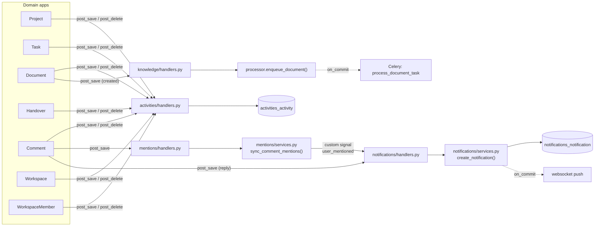

# 05 — Backend Architecture

[← Back to index](README.md)

---

## 1. What runs first

`python manage.py runserver` uses **daphne's** ASGI runserver, because `daphne`
is listed first in `INSTALLED_APPS` and deliberately precedes
`django.contrib.staticfiles` (`config/settings/base.py:42-44`). That is what makes
WebSockets work in development with no extra process.

Boot order:

```
manage.py
  └─ DJANGO_SETTINGS_MODULE (default: config.settings.development)
       └─ config/settings/base.py
            ├─ environ.Env.read_env(backend/.env)
            ├─ DATABASES = {"default": env.db("DATABASE_URL")}
            └─ INSTALLED_APPS
  └─ app registry populated
       └─ each AppConfig.ready()
            ├─ activities.handlers      (signal wiring)
            ├─ mentions.handlers
            ├─ notifications.handlers
            └─ knowledge.handlers
  └─ config/asgi.py
       ├─ get_asgi_application()  ← must run before importing anything model-touching
       └─ ProtocolTypeRouter{http, websocket}
```

The ordering comment in `asgi.py:19-21` matters: `get_asgi_application()` must be
called before importing `apps.common.channels_auth` or
`apps.notifications.routing`, because those touch models and the app registry has
to be populated first. That is also why `channels_auth._user_from_token` imports
SimpleJWT lazily inside the function (`channels_auth.py:25-28`).

---

## 2. Settings layering

```
base.py  ── everything, defaults read from the environment
   ├── development.py   DEBUG on, console email, eager Celery,
   │                    in-memory channels, locmem cache, browsable API
   ├── production.py    DEBUG off, JSON only, SSL redirect, HSTS,
   │                    secure cookies, SECURE_PROXY_SSL_HEADER
   └── test.py          no external services, throttling OFF, MD5 hasher
```

The development module encodes an explicit design goal, stated in its own
comment (`development.py:26-29`): *"Nexora runs locally with nothing but
Postgres."* Redis, Celery and SMTP each fall back to an in-process equivalent and
each is switched on by simply setting one environment variable.

`test.py` has a subtlety worth remembering. Clearing `DEFAULT_THROTTLE_CLASSES`
is not enough, because the auth views name their throttles explicitly via
`throttle_classes`, which overrides the default. Setting each **rate to `None`**
is what actually disables a scope (`test.py:46-61`).

---

## 3. The DRF configuration that shapes every endpoint

`config/settings/base.py:184-218`

| Setting | Value | Effect on every endpoint |
|---|---|---|
| `DEFAULT_AUTHENTICATION_CLASSES` | `JWTAuthentication` only | No session auth on the API. A browser cookie will not authenticate you. |
| `DEFAULT_PERMISSION_CLASSES` | `IsAuthenticated` | **Everything is private by default**; public endpoints must opt out with `AllowAny` |
| `DEFAULT_FILTER_BACKENDS` | DjangoFilterBackend, SearchFilter, OrderingFilter | Every list view supports `?search=`, `?ordering=`, plus its FilterSet fields |
| `DEFAULT_PAGINATION_CLASS` | `PageNumberPagination`, `PAGE_SIZE = 20` | Every list returns `{count, next, previous, results}` |
| `DEFAULT_SCHEMA_CLASS` | drf-spectacular `AutoSchema` | `/api/docs/` stays in sync automatically |
| `DEFAULT_THROTTLE_CLASSES` | `AnonRateThrottle`, `UserRateThrottle` | 60/min anonymous, 1000/hour authenticated |

Only three views opt out of `IsAuthenticated`: `RegisterView`, `LoginView`,
`PasswordResetRequestView`/`PasswordResetConfirmView` (`AllowAny`), and
`HealthCheckView` which additionally sets `authentication_classes = []`.

---

## 4. The four abstract models

`backend/apps/common/models.py`

```python
class TimeStampedModel(models.Model):      # created_at, updated_at
class UUIDModel(models.Model):             # id = UUIDField(primary_key=True)
class BaseModel(UUIDModel, TimeStampedModel)
class AuditModel(BaseModel):               # + created_by, updated_by (related_name="+")
class WorkspaceScopedModel(AuditModel):    # + workspace FK, related_name="%(class)ss"
```

Design decisions embedded here:

- **UUID primary keys**, so ids are safe to expose in URLs and APIs — no
  enumerable sequential integers (comment at line 27).
- **`related_name="+"`** on `created_by`/`updated_by` disables the reverse
  accessor, so a dozen models can share those FKs to `User` without name clashes
  (comment at lines 45-47).
- **`related_name="%(class)ss"`** on `workspace` auto-generates
  `workspace.projects`, `workspace.tasks`, `workspace.documents` (lines 72-74).
- Default `ordering = ("-created_at",)` everywhere, which also keeps pagination
  deterministic.

Which models inherit which:

| Base | Models |
|---|---|
| `WorkspaceScopedModel` | `Project`, `Task`, `Document`, `Handover`, `AIConversation`, `PromptTemplate` |
| `BaseModel` (+ own `workspace` FK) | `Comment`, `Mention`, `Activity`, `Notification`, `Invitation`, `DocumentChunk`, `EmbeddingJob`, `SearchHistory` |
| `BaseModel` (no workspace) | `Workspace`, `WorkspaceMember`, `AIMessage` |
| `BaseModel` + `OneToOne` | `AISettings` |
| `AbstractUser` (Django) | `User` |

The middle row is worth noticing: those models declare `workspace` themselves
instead of inheriting `WorkspaceScopedModel`, because they do not want the
`created_by`/`updated_by` audit columns.

---

## 5. `WorkspaceScopedViewSet` — the tenancy engine

`backend/apps/common/viewsets.py` — 48 lines that carry the whole multi-tenant
guarantee.

```python
class WorkspaceScopedViewSet(ModelViewSet):
    permission_classes = [IsAuthenticated, IsWorkspaceMember]

    def get_queryset(self):
        if getattr(self, "swagger_fake_view", False):
            return self.queryset.model.objects.none()
        return self.queryset.filter(workspace__members__user=self.request.user).distinct()

    def _require_membership(self, workspace):
        if workspace is None:
            raise ValidationError({"workspace": "This field is required."})
        if not workspace.members.filter(user=self.request.user).exists():
            raise PermissionDenied("You are not a member of this workspace.")

    def perform_create(self, serializer):
        self._require_membership(serializer.validated_data.get("workspace"))
        serializer.save(created_by=self.request.user, updated_by=self.request.user)

    def perform_update(self, serializer):
        serializer.save(updated_by=self.request.user)
```

Four guarantees, for free, in every subclass:

1. **Reads cannot cross tenants.** The `workspace__members__user` join means a
   non-member's `GET /tasks/<uuid>/` returns **404**, not 403 — the row was never
   in the queryset. That is better than 403: it does not confirm the id exists.
2. **`.distinct()`** is required because the join can duplicate rows.
3. **Writes are membership-checked** before anything is saved.
4. **Audit stamping** happens automatically.

`swagger_fake_view` is checked because there is no authenticated user during
OpenAPI schema generation — without it, `manage.py spectacular` would crash.

Subclasses then declare about ten lines each:

```python
class TaskViewSet(WorkspaceScopedViewSet):
    queryset = Task.objects.select_related("workspace","project","assignee",
                                           "reporter","created_by","updated_by")
    serializer_class = TaskSerializer
    filterset_class  = TaskFilter
    search_fields    = ("title", "description")
    ordering_fields  = ("created_at","updated_at","due_date","priority","status","title")
```
`backend/apps/tasks/views.py:10-25`

The `select_related` list is deliberate: `TaskSerializer` nests four user objects
plus the project, so without it a 20-row page would fire ~100 extra queries.

---

## 6. Permission classes

`backend/apps/common/permissions.py`

```python
def _resolve_workspace(obj):
    from apps.workspaces.models import Workspace   # local import: avoids a cycle
    return obj if isinstance(obj, Workspace) else getattr(obj, "workspace", None)

def _membership(user, workspace):
    if workspace is None or not user or not user.is_authenticated:
        return None
    return workspace.members.filter(user=user).first()
```

| Class | Allows | Used by |
|---|---|---|
| `IsWorkspaceMember` | any member | `WorkspaceScopedViewSet` (all scoped resources), `WorkspaceViewSet.retrieve`/`members` |
| `IsWorkspaceAdmin` | owner, admin | available; not currently referenced by a view — see note below |
| `IsWorkspaceManager` | owner, admin, manager (`REVIEWER_ROLES`) | available; handovers implement the same check inline |
| `IsWorkspaceOwner` | owner only | `WorkspaceViewSet.destroy` |
| `IsWorkspaceAdminOrReadOnly` | members read, owner/admin write | `WorkspaceViewSet.update`/`partial_update` |

> **Observation, not a bug:** `IsWorkspaceAdmin` and `IsWorkspaceManager` are
> defined and exported but no view currently lists them in `permission_classes`.
> The equivalent logic is written inline instead — `_reviewer_membership()` in
> `handovers/views.py:40-45`, `_is_admin()` in `invitations/views.py:66-71`, and
> `resolve_workspace(..., require_admin=True)` in `ai/permissions.py`. Behaviour
> is correct; the duplication is listed in
> [25-known-limitations.md](25-known-limitations.md).

**Important structural point:** every one of these implements only
`has_object_permission`. DRF calls that for *detail* routes
(`get_object()`), never for list or create. List safety therefore comes entirely
from `get_queryset()`, and create safety from `perform_create`'s explicit
membership check.

---

## 7. Serializer patterns

### a. Nested read, id write

```python
assignee    = UserSerializer(read_only=True)
assignee_id = serializers.UUIDField(write_only=True, required=False, allow_null=True)
```
`apps/tasks/serializers.py:11,18-20`

The client sends a UUID; the response carries the full user object so the UI can
render an avatar without another request.

### b. Derived tenant field

```python
workspace = serializers.PrimaryKeyRelatedField(read_only=True)
...
def validate(self, attrs):
    project = attrs.get("project") or getattr(self.instance, "project", None)
    attrs["workspace"] = project.workspace     # derived, never client-supplied
```
`apps/tasks/serializers.py:10, 70-76` — and the same shape in
`apps/handovers/serializers.py:85-86` (derived from the task).

This closes a real hole: a client cannot create a task pointing at project A
while claiming workspace B.

### c. Membership validation on relations

```python
def _resolve_member(self, workspace, user_id, field):
    member = workspace.members.filter(user_id=user_id).select_related("user").first()
    if member is None:
        raise serializers.ValidationError({field: "User is not a member of this workspace."})
    return member.user
```
`apps/tasks/serializers.py:59-68`

You cannot assign a task to somebody outside the workspace, even with a valid
user UUID.

### d. Representation rewriting

```python
def to_representation(self, instance):
    data = super().to_representation(instance)
    if instance.is_deleted:
        data["content"] = "[deleted]"
    return data
```
`apps/comments/serializers.py:63-67`

Soft-deleted comments keep their row (so reply threads stay intact) but never
leak their old content.

---

## 8. Signals — the decoupling mechanism

Registered in `AppConfig.ready()`; four handler modules.



### `activities/handlers.py`

A factory function registers three receivers per model:

```python
def _register_audited(model, entity, label):
    def on_save(sender, instance, created, **kwargs): log_activity(...)
    def on_delete(sender, instance, **kwargs):        log_activity(...)
    post_save.connect(on_save, sender=model, weak=False, dispatch_uid=f"activity_save_{entity}")
    post_delete.connect(on_delete, sender=model, weak=False, dispatch_uid=f"activity_delete_{entity}")

_register_audited(Project,  "project",  lambda i: {"name": i.name, "archived": i.archived})
_register_audited(Task,     "task",     lambda i: {"title": i.title, "status": i.status})
_register_audited(Document, "document", lambda i: {"title": i.title})
_register_audited(Handover, "handover", lambda i: {"task": i.task.title, "status": i.status})
```
`apps/activities/handlers.py:29-56`

`weak=False` is required: the handler closures are not referenced anywhere else
and would otherwise be garbage-collected. `dispatch_uid` prevents double
registration if the module is imported twice.

**Adding audit logging to a new model is one line.** That is the payoff.

### The cascade-delete guard

Deleting a workspace cascades into every child, and each cascade fires
`post_delete`, which would try to append activity rows referencing a workspace
that is about to disappear — a foreign-key violation at commit that would take
the whole delete down. `apps/activities/services.py:8-25` solves it with a
module-level set:

```python
_workspaces_being_deleted: set[str] = set()

def log_activity(*, actor, workspace, action, target=None, metadata=None):
    workspace_pk = getattr(workspace, "pk", workspace)
    if workspace_pk is not None and str(workspace_pk) in _workspaces_being_deleted:
        return None
    ...
```

This is a real, non-obvious bug fix and excellent interview material. Its
weakness — process-local mutable state — is noted in
[25-known-limitations.md](25-known-limitations.md).

---

## 9. Background jobs

| Task | Module | Retries | Notes |
|---|---|---|---|
| `send_email_task` | `apps/common/tasks.py` | 3, `default_retry_delay=30`, `retry_backoff=True` | Calls `send_templated_email(fail_silently=False)` so Celery sees the failure |
| `process_document_task` | `apps/knowledge/tasks.py` | 2, delay 60s | `process_document` already records failures on the job row, so the retry only covers "couldn't get far enough to do that" |

Celery tuning in `base.py:262-280`:

- `CELERY_WORKER_PREFETCH_MULTIPLIER = 1` and `--concurrency=2` in compose,
  because each worker process holds its own copy of a ~90 MB transformer model.
- `CELERY_TASK_ACKS_LATE = True` — a task is acknowledged after completion, so a
  crashed worker's job is redelivered.
- Soft/hard time limits of 600 s / 660 s.
- `CELERY_TASK_ALWAYS_EAGER` defaults to **True** in development, **False** in
  base/production.

---

## 10. Realtime internals

| File | Role |
|---|---|
| `config/asgi.py` | Protocol split + `OriginValidator` + `JWTAuthMiddleware` |
| `apps/common/channels_auth.py` | Reads `?token=` from the query string, validates it with SimpleJWT, sets `scope["user"]` |
| `apps/notifications/routing.py` | One route: `ws/notifications/` |
| `apps/notifications/consumers.py` | `NotificationConsumer` + the `push_to_user()` helper |

Group naming strips hyphens because Channels group names only allow
alphanumerics, hyphens, underscores and periods — and a UUID with hyphens is
still valid, but the code normalises anyway:
`f"notifications.{str(user_id).replace('-','')}"` (`consumers.py:26-29`).

`push_to_user()` swallows every exception (`consumers.py:74-80`). The reasoning
is in the docstring: realtime delivery is a convenience on top of REST, and a
channel layer that is down must never break the database write that triggered it.

The token travels in the URL because the browser WebSocket API cannot set an
`Authorization` header. `channels_auth.py:5-11` documents the mitigations: wss in
production, and a 15-minute token lifetime.

---

## 11. The AI layer's structure

```
ai/views.py  ─ ChatView, SearchView, SummarizeView, GenerateTasksView, AISettingsView
     │           + AIConversationViewSet, SearchHistoryViewSet, PromptTemplateViewSet
     ├─► ai/permissions.py  resolve_workspace(user, id, require_admin=False)
     ├─► ai/services/rag.py ── answer_question()
     │        ├─► knowledge/services/search.py  semantic_search()   ← retrieval
     │        ├─► ai/services/prompts.py        build_chat_messages()
     │        │        └─► ai/services/security.py  sanitize_input / wrap_untrusted
     │        └─► ai/providers/factory.py  get_llm_provider(workspace)
     │                 └─► GeminiProvider | OpenAIProvider | OllamaProvider
     ├─► ai/services/summarizer.py
     └─► ai/services/action_items.py
```

Why the action endpoints are `APIView` and not viewsets: the workspace arrives
in the **request body**, not the URL, so DRF object permissions cannot apply.
`resolve_workspace()` is the isolation gate, called before any retrieval happens
— the file's own comment calls it exactly that (`ai/views.py:7-8`).

---

## 12. What a request touches, in order

```
uvicorn/daphne
  → ProtocolTypeRouter (http)
    → SecurityMiddleware
    → CorsMiddleware            ← must be high, before CommonMiddleware
    → SessionMiddleware
    → CommonMiddleware
    → CsrfViewMiddleware        ← inert for JWT API calls (no session cookie)
    → AuthenticationMiddleware
    → MessageMiddleware
    → XFrameOptionsMiddleware
  → config/urls.py → apps/<x>/urls.py → Router → ViewSet
    → JWTAuthentication.authenticate()      (sets request.user)
    → throttle check
    → permission_classes has_permission
    → get_queryset() / get_object() → has_object_permission
    → serializer validate → save
    → post_save signals fire
    → Response → JSONRenderer
```

---

**Next:** [06 — Routing](06-routing.md)
