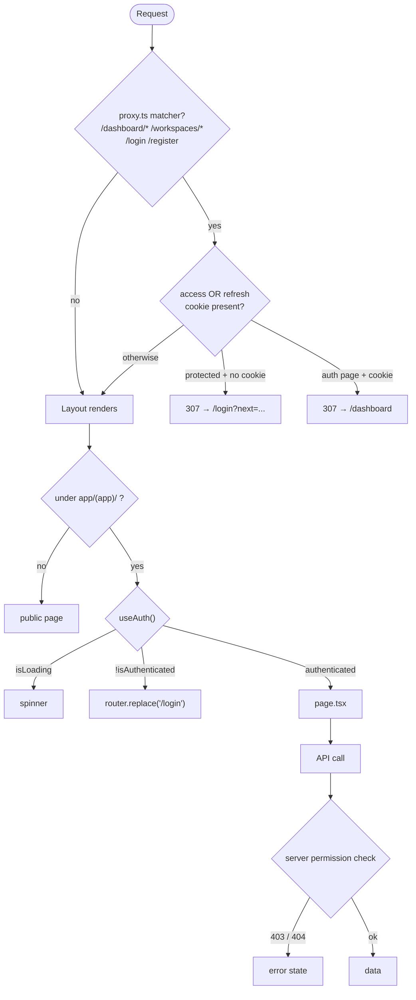

# 06 — Routing

[← Back to index](README.md)

---

## 1. How Next.js decides which page to render

There is no route table. Next.js App Router maps the filesystem:

| Filesystem | URL |
|---|---|
| `app/page.tsx` | `/` |
| `app/(auth)/login/page.tsx` | `/login` — parentheses are stripped |
| `app/(app)/tasks/page.tsx` | `/tasks` |
| `app/(app)/tasks/[id]/page.tsx` | `/tasks/<uuid>` |
| `app/(app)/tasks/[id]/edit/page.tsx` | `/tasks/<uuid>/edit` |
| `app/not-found.tsx` | any unmatched URL |

`(auth)` and `(app)` are **route groups**. They exist only so the two halves of
the app can have different `layout.tsx` files. Nothing in the URL reflects them.

Dynamic segments are read with `useParams()`:

```ts
const { id } = useParams<{ id: string }>();
```
`frontend/src/app/(app)/handovers/[id]/page.tsx:63`

The client-side route constants live in `ROUTES`
(`frontend/src/lib/constants.ts:95-134`). Nothing hard-codes a path string.

---

## 2. Route protection — three independent layers



| Layer | File | Checks | Strength |
|---|---|---|---|
| 1 — edge | `src/proxy.ts` | cookie **presence** only | Weak by design. Cannot be trusted; a forged cookie value passes it. |
| 2 — layout | `app/(app)/layout.tsx` | `useAuth().isAuthenticated`, which came from a real `/auth/me/` response | Real, but client-side — it protects the UI, not the data |
| 3 — server | DRF permissions + `get_queryset()` | JWT signature + workspace membership + role | **The only security boundary** |

**Coverage gap worth knowing.** The `proxy.ts` matcher is:

```ts
matcher: ["/dashboard/:path*", "/workspaces/:path*", "/login", "/register"]
```

So `/tasks`, `/projects`, `/handovers`, `/documents`, `/ai/*`, `/activity`,
`/search`, `/settings`, `/notifications` and `/invitations` are **not** matched.
Visiting them logged-out means the page mounts, `AppLayout` shows a spinner, and
only then redirects — a visible flash instead of a clean edge redirect. No data
leaks (there is no token, so every API call 401s), but the UX is inconsistent.
Logged in as an issue in [25-known-limitations.md](25-known-limitations.md).

---

## 3. Public routes

| URL | File | Renders | API calls |
|---|---|---|---|
| `/` | `app/page.tsx` | `SiteHeader`, hero, `HomeCta`, 3 feature `Card`s, footer | none |
| `/login` | `app/(auth)/login/page.tsx` | `Card` → `<Suspense>` → `LoginForm` | `POST /auth/login/` |
| `/register` | `app/(auth)/register/page.tsx` | `RegisterForm` | `POST /auth/register/` |
| `/forgot-password` | `app/(auth)/forgot-password/page.tsx` | `ForgotPasswordForm` | `POST /auth/password-reset/` |
| `/reset-password` | `app/(auth)/reset-password/page.tsx` | `ResetPasswordForm` | `POST /auth/password-reset/confirm/` |

`LoginForm` is wrapped in `<Suspense fallback={null}>` because it calls
`useSearchParams()` (to read `?next=`), which Next.js requires to be inside a
Suspense boundary.

---

## 4. Protected routes — full map

Every row below is under `app/(app)/`, so all of them inherit the auth gate and
`WorkspaceProvider`.

### Overview

| URL | Page file | Key components | Hooks → endpoints |
|---|---|---|---|
| `/dashboard` | `dashboard/page.tsx` | `StatCard` ×10, 4 `Card` lists, `EmptyState` | `useDashboard` → `GET /dashboard/?workspace=` |
| `/analytics` | `analytics/page.tsx` | `components/charts/charts.tsx` (SVG) | `useAnalytics` → `GET /analytics/?workspace=` |
| `/activity` | `activity/page.tsx` | activity feed + filters + CSV button | `useActivities` → `GET /activities/`; `useWorkspaceMembers` → `GET /workspaces/{id}/members/`; CSV via `downloadFile` |
| `/search` | `search/page.tsx` | cross-entity results | `useProjects`, `useTasks`, `useDocuments`, `useHandovers` — four parallel list calls with `?search=` |
| `/settings` | `settings/page.tsx` | profile form, theme toggle | `useAuth`, `useTheme` (client-only; profile save uses `PATCH /auth/me/`) |
| `/notifications` | `notifications/page.tsx` | `NotificationList` | `useNotifications`, `useUnreadCount`, `useMarkAllNotificationsRead` |
| `/invitations` | `invitations/page.tsx` | invite cards with accept/reject | `useMyInvitations` → `GET /invitations/?mine=true`; `useAcceptInvitation`, `useRejectInvitation` |

### Workspaces

| URL | Page file | Hooks → endpoints |
|---|---|---|
| `/workspaces` | `workspaces/page.tsx` | `useWorkspaces` → `GET /workspaces/` |
| `/workspaces/new` | `workspaces/new/page.tsx` | `useCreateWorkspace` → `POST /workspaces/` |
| `/workspaces/[id]/settings` | `workspaces/[id]/settings/page.tsx` | `useWorkspace`, `useWorkspaceMembers`, `useUpdateWorkspace`, `useDeleteWorkspace`, `useAuth` |

### Projects

| URL | Page file | Hooks → endpoints |
|---|---|---|
| `/projects` | `projects/page.tsx` | `useProjects` → `GET /projects/?workspace=&status=&archived=` |
| `/projects/new` | `projects/new/page.tsx` | `useCreateProject` → `POST /projects/` |
| `/projects/[id]` | `projects/[id]/page.tsx` | `useProject`, `useTasks` (filtered by project), `useDocuments` |
| `/projects/[id]/edit` | `projects/[id]/edit/page.tsx` | `useProject`, `useUpdateProject` → `PATCH /projects/{id}/` |

### Tasks

| URL | Page file | Hooks → endpoints |
|---|---|---|
| `/tasks` | `tasks/page.tsx` | `useTasks`, `useProjects` (filter dropdown), `useWorkspaceMembers` (assignee dropdown) |
| `/tasks/new` | `tasks/new/page.tsx` | `useCreateTask`; reads `?project=` via `useSearchParams` |
| `/tasks/[id]` | `tasks/[id]/page.tsx` | `useTask`, `useUpdateTask`, plus `CommentSection` |
| `/tasks/[id]/edit` | `tasks/[id]/edit/page.tsx` | `useTask`, `useUpdateTask` |

### Handovers

| URL | Page file | Hooks → endpoints |
|---|---|---|
| `/handovers` | `handovers/page.tsx` | `useHandovers`, `useAuth` (to tell "mine" from others') |
| `/handovers/new` | `handovers/new/page.tsx` | `useCreateHandover`; reads `?task=` via `useSearchParams` |
| `/handovers/reviews` | `handovers/reviews/page.tsx` | `useHandovers({status:"pending"})` — reviewer queue |
| `/handovers/[id]` | `handovers/[id]/page.tsx` | `useHandover`, `useDeleteHandover`, `HandoverReviewCard`, `downloadFile` for the PDF |

`/handovers/reviews` is only linked from the sidebar when
`REVIEWER_ROLES.includes(activeWorkspace.role)` (`app-sidebar.tsx:71-74`). Typing
the URL directly still renders the page — the server rejects the review action,
so this is cosmetic gating only.

### Documents

| URL | Page file | Hooks → endpoints |
|---|---|---|
| `/documents` | `documents/page.tsx` | `useDocuments`, `useProjects` |
| `/documents/new` | `documents/new/page.tsx` | `useUploadDocument` → `POST /documents/` multipart |
| `/documents/[id]` | `documents/[id]/page.tsx` | `useDocument`, `useReindexDocument` → `POST /documents/{id}/reindex/` |

### AI

| URL | Page file | Hooks → endpoints |
|---|---|---|
| `/ai` | `ai/page.tsx` | `useConversations`, `useDocuments`, `useSearchHistory` — an overview hub |
| `/ai/chat` | `ai/chat/page.tsx` | `ChatWindow` (new thread) → `POST /ai/chat/` |
| `/ai/chat/[id]` | `ai/chat/[id]/page.tsx` | `ChatWindow` for an existing conversation |
| `/ai/conversations` | `ai/conversations/page.tsx` | `useConversations`, `useDeleteConversation` |
| `/ai/search` | `ai/search/page.tsx` | `useSemanticSearch` → `POST /ai/search/`; `useSearchHistory` |
| `/ai/templates` | `ai/templates/page.tsx` | `usePromptTemplates` + create/update/delete |
| `/ai/settings` | `ai/settings/page.tsx` | `useAISettings`, `useUpdateAISettings` → `GET`/`PATCH /ai/settings/` |

Both chat pages delegate to `components/ai/chat-window.tsx`; the page files
themselves only read `useWorkspaceContext()` and pass ids down.

---

## 5. Redirect behaviour

| Situation | What happens | Where |
|---|---|---|
| Logged out visits `/dashboard` | `307 → /login?next=/dashboard` | `proxy.ts:34-39` |
| Logged in visits `/login` | `307 → /dashboard` | `proxy.ts:41-45` |
| Logged in visits `/reset-password` | **allowed through** — deliberate | `proxy.ts:18-22` |
| Session dies mid-use | `AppLayout` effect → `router.replace("/login")` | `(app)/layout.tsx:41-45` |
| Login succeeds | `router.replace(searchParams.get("next") \|\| ROUTES.dashboard)` | `login-form.tsx:39` |
| Logout | `router.replace(ROUTES.login)` after clearing cache | `auth-provider.tsx:77` |
| Create succeeds | `router.replace(ROUTES.<entity>(newId))` | e.g. `documents/new/page.tsx:40` |
| Delete succeeds | `router.replace(ROUTES.<list>)` | e.g. `handovers/[id]/page.tsx:90` |
| Unknown URL | `app/not-found.tsx` | Next.js |

`router.replace` rather than `push` is used consistently, so the back button
never returns to a page that no longer makes sense.

---

## 6. Backend URL routing

`backend/config/urls.py` builds one versioned prefix:

```python
api_v1_patterns = [
    path("",              include("apps.core.urls")),         # health, dashboard, analytics
    path("auth/",         include("apps.accounts.urls")),
    path("workspaces/",   include("apps.workspaces.urls")),
    path("projects/",     include("apps.projects.urls")),
    path("tasks/",        include("apps.tasks.urls")),
    path("handovers/",    include("apps.handovers.urls")),
    path("documents/",    include("apps.documents.urls")),
    path("comments/",     include("apps.comments.urls")),
    path("mentions/",     include("apps.mentions.urls")),
    path("notifications/",include("apps.notifications.urls")),
    path("activities/",   include("apps.activities.urls")),
    path("invitations/",  include("apps.invitations.urls")),
    path("ai/",           include("apps.ai.urls")),
]

urlpatterns = [
    path("admin/", admin.site.urls),
    path("api/v1/", include((api_v1_patterns, "v1"), namespace="v1")),
    path("api/schema/", SpectacularAPIView.as_view(), name="schema"),
    path("api/docs/",   SpectacularSwaggerView.as_view(url_name="schema")),
    path("api/redoc/",  SpectacularRedocView.as_view(url_name="schema")),
]
if settings.DEBUG:
    urlpatterns += static(settings.MEDIA_URL, document_root=settings.MEDIA_ROOT)
```

Two things to note:

1. The namespace `v1` means a `v2` can be mounted side by side later without
   touching any app.
2. `/media/` is served by Django **only when `DEBUG`**. In production a real
   object store or web server must serve it — and nothing in this repository
   currently does. See
   [22-production-deployment.md](22-production-deployment.md).

Ten of the thirteen apps just register a `DefaultRouter` at `""`, which produces
the standard `/`, `/{id}/` pair plus any `@action` routes.

### WebSocket route

```python
websocket_urlpatterns = [path("ws/notifications/", NotificationConsumer.as_asgi())]
```
`backend/apps/notifications/routing.py:7-9`

Mounted at the **root**, not under `/api/v1/`. That is why
`frontend/src/lib/realtime.ts` replaces the pathname rather than appending to it:

```ts
const api = new URL(env.NEXT_PUBLIC_API_URL);      // http://host:8000/api/v1
api.protocol = api.protocol === "https:" ? "wss:" : "ws:";
api.pathname = "/ws/notifications/";               // replaced, not appended
api.search   = `?token=${encodeURIComponent(token)}`;
```

---

## 7. Route → API cross-reference

Which frontend routes touch which backend endpoints, at a glance:

| Backend endpoint | Consumed by |
|---|---|
| `GET /dashboard/` | `/dashboard` |
| `GET /analytics/` | `/analytics` |
| `GET /activities/`, `/activities/export/` | `/activity` |
| `/workspaces/*` | `/workspaces`, `/workspaces/new`, `/workspaces/[id]/settings`, and `WorkspaceProvider` on **every** authenticated page |
| `/projects/*` | `/projects*`, `/tasks` (filter), `/documents` (filter), `/search` |
| `/tasks/*` | `/tasks*`, `/projects/[id]`, `/search`, `/handovers/new` |
| `/handovers/*` | `/handovers*`, `/dashboard`, `/search` |
| `/documents/*` | `/documents*`, `/projects/[id]`, `/ai`, `/search` |
| `/comments/*` | task/project/document detail pages via `CommentSection` |
| `/notifications/*` | `NotificationBell` (all pages) + `/notifications` |
| `/invitations/*` | `/invitations`, `/workspaces/[id]/settings` |
| `/ai/*` | `/ai/*` pages |
| `/auth/*` | `(auth)` pages, `AuthProvider`, `lib/api/client.ts` refresh |
| `WS /ws/notifications/` | `use-notification-socket`, mounted via `NotificationBell` |

---

**Next:** [07 — API Architecture](07-api-architecture.md)
