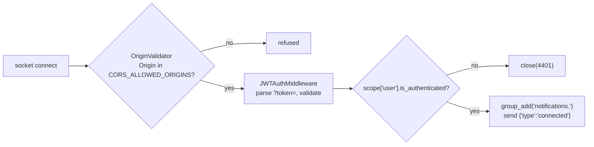

# 08 — Authentication & Authorization

[← Back to index](README.md)

The two are separate systems in this codebase:

- **Authentication** = "who are you?" → JWT, `apps/accounts/`
- **Authorization** = "what may you do here?" → workspace role, `apps/common/permissions.py`

You can be perfectly authenticated and still get a 403 or 404, because
authorization is evaluated *per workspace*.

---

## 1. The user model

`backend/apps/accounts/models.py`

```python
class User(AbstractUser):
    username = None                                  # removed entirely
    id       = models.UUIDField(primary_key=True, default=uuid.uuid4, editable=False)
    email    = models.EmailField("email address", unique=True)
    name     = models.CharField("full name", max_length=150, blank=True)
    avatar   = models.URLField(blank=True, default="")
    created_at / updated_at
    USERNAME_FIELD  = "email"
    REQUIRED_FIELDS = []
    objects = UserManager()
    class Meta: db_table = "accounts_user"
```

- Email is the login identifier. There is no username field at all.
- `avatar` is a **URL**, not an upload. The model comment says "file uploads
  arrive in a later phase" (line 53) — user avatar upload is **not implemented**.
- `UserManager._create_user` calls `self.normalize_email(email)` and
  `user.set_password(password)` — so hashing always happens, even for superusers.
- `db_table` is set explicitly, which is why the table is `accounts_user` rather
  than the Django default `accounts_user` derived from the app label. (Same
  result here, but pinned so a future app rename cannot move the table.)

**Password hashing:** Django's default `PBKDF2PasswordHasher` — there is no
custom `PASSWORD_HASHERS` in `base.py` or `production.py`. `test.py` overrides it
to MD5 purely for suite speed (`test.py:69`), which is safe because it only
applies to the test database.

**Password strength:** the four standard validators are enabled
(`base.py:156-161`): user-attribute similarity, minimum length, common-password
list, numeric-only. They run because `RegisterSerializer.password` and
`PasswordResetConfirmSerializer.password` both declare
`validators=[validate_password]`.

---

## 2. JWT configuration

`config/settings/base.py:296-311`

| Setting | Value | Meaning |
|---|---|---|
| `ACCESS_TOKEN_LIFETIME` | 15 minutes (`JWT_ACCESS_TOKEN_LIFETIME_MINUTES`) | A stolen access token expires quickly |
| `REFRESH_TOKEN_LIFETIME` | 7 days (`JWT_REFRESH_TOKEN_LIFETIME_DAYS`) | How long a session survives without re-login |
| `ROTATE_REFRESH_TOKENS` | `True` | Every refresh issues a **new** refresh token |
| `BLACKLIST_AFTER_ROTATION` | `True` | The old refresh token is immediately unusable |
| `UPDATE_LAST_LOGIN` | `True` | Writes `last_login` on each token issue |
| `AUTH_HEADER_TYPES` | `("Bearer",)` | Header format |
| `SIGNING_KEY` | `JWT_SIGNING_KEY` or `SECRET_KEY` | See note below |

Note on the signing key (comment at lines 307-310): SimpleJWT calls this
`SIGNING_KEY` and **rejects the literal string `"SECRET_KEY"`**, which would take
the app down at import time. The code falls back to `SECRET_KEY` when
`JWT_SIGNING_KEY` is unset *or blank*:

```python
"SIGNING_KEY": env("JWT_SIGNING_KEY", default="") or SECRET_KEY,
```

Rotation + blacklist together give a meaningful security property: a refresh
token can be used exactly once. If an attacker steals one and uses it, the real
user's next refresh fails and the session dies — a detectable event. (Nothing in
this codebase alerts on that; see [18-security.md](18-security.md).)

---

## 3. Login, start to finish

```mermaid
sequenceDiagram
    autonumber
    actor U as User
    participant F as LoginForm
    participant P as AuthProvider
    participant A as authApi
    participant C as apiClient
    participant V as LoginView
    participant S as EmailTokenObtainPairSerializer
    participant DB as PostgreSQL
    participant T as tokenStorage

    U->>F: email + password, submit
    F->>F: zodResolver(loginSchema) validates locally
    F->>P: login(values)
    P->>A: authApi.login(data)
    A->>C: apiClient.post("/auth/login/", data, {skipAuth:true})
    C->>V: POST /api/v1/auth/login/
    V->>V: LoginRateThrottle (10/min per IP)
    V->>S: validate(attrs)
    S->>DB: SELECT * FROM accounts_user WHERE email = ...
    DB-->>S: row (or none)
    S->>S: check_password(raw, hash)
    alt invalid
        S-->>C: 401 {"detail": "No active account found..."}
        C-->>F: throw ApiError
        F->>F: applyFieldErrors + toast.error
    else valid
        S->>S: build access + refresh, UPDATE_LAST_LOGIN
        S->>S: data["user"] = UserSerializer(self.user).data
        S-->>C: 200 {access, refresh, user}
        C-->>P: LoginResponse
        P->>T: tokenStorage.set(access, refresh)
        T->>T: document.cookie = nexora.accessToken=...; nexora.refreshToken=...
        P->>P: setUser(res.user)
        F->>F: toast.success + router.replace(next ?? "/dashboard")
    end
```

### Files in order

| Step | File | Function |
|---|---|---|
| 1 | `frontend/src/components/auth/login-form.tsx` | `onSubmit` (line 35) |
| 2 | `frontend/src/lib/validations/auth.ts` | `loginSchema` (line 4) |
| 3 | `frontend/src/providers/auth-provider.tsx` | `login` (line 58) |
| 4 | `frontend/src/lib/api/auth.ts` | `authApi.login` (line 19) |
| 5 | `frontend/src/lib/api/client.ts` | `request` (line 74) |
| 6 | `backend/apps/accounts/urls.py` | `path("login/", LoginView...)` |
| 7 | `backend/apps/accounts/views.py` | `LoginView` (line 58) |
| 8 | `backend/apps/accounts/serializers.py` | `EmailTokenObtainPairSerializer` (line 81) |
| 9 | `frontend/src/lib/auth/token-storage.ts` | `tokenStorage.set` (line 37) |

### Why `EmailTokenObtainPairSerializer` exists

```python
class EmailTokenObtainPairSerializer(TokenObtainPairSerializer):
    def validate(self, attrs):
        data = super().validate(attrs)
        data["user"] = UserSerializer(self.user).data
        return data
```
`backend/apps/accounts/serializers.py:81-91`

Five lines that save a network round trip: the login response already contains
the user object, so `AuthProvider.login()` never has to call `/auth/me/`. The
docstring notes that `USERNAME_FIELD` is already `email`, so the parent class
handles credential validation unchanged — this subclass **only enriches the
response**.

---

## 4. Token storage — the key trade-off

`frontend/src/lib/auth/token-storage.ts`

```ts
const COOKIE_OPTS = "path=/; SameSite=Lax";
const MAX_AGE = 60 * 60 * 24 * 7;          // mirrors the backend's 7-day refresh

function setCookie(name, value) {
  document.cookie = `${name}=${encodeURIComponent(value)}; Max-Age=${MAX_AGE}; ${COOKIE_OPTS}`;
}
```

| Property | Value | Consequence |
|---|---|---|
| Storage | Cookies, **not** localStorage | `proxy.ts` can read them server-side at the edge |
| `httpOnly` | **No** — set by JavaScript | Any XSS on the page can read both tokens |
| `Secure` | **Not set** | Cookies would be sent over plain HTTP |
| `SameSite` | `Lax` | Blocks the cookie on cross-site POST; some CSRF protection |
| `path` | `/` | Sent to every route on the frontend origin |
| Max-Age | 7 days for **both** tokens | The access cookie outlives the 15-minute token; the client just refreshes |

The file documents this trade-off itself (lines 3-10): *"They are NOT httpOnly —
the backend returns tokens in the JSON body, so the client owns them. Good enough
for this foundation; a later phase can move refresh tokens to an httpOnly
cookie."*

Note the cookies are set on the **frontend origin** (`localhost:3000`) and are
never sent to the API automatically — the API is a different origin and reads the
`Authorization` header instead. So `SameSite`/`Secure` here protect the cookie
from other sites, not the API call.

Full risk analysis in [18-security.md](18-security.md).

---

## 5. Authenticated requests and silent refresh

```mermaid
sequenceDiagram
    participant H as Hook
    participant C as client.ts request()
    participant API as Django
    participant R as refreshAccessToken()

    H->>C: apiClient.get("/tasks/")
    C->>C: access = tokenStorage.getAccess()
    C->>API: GET /tasks/  Authorization: Bearer <access>
    alt 200
        API-->>C: JSON
        C-->>H: data
    else 401 and not skipAuth and not _isRetry
        API-->>C: 401
        C->>R: getRefreshedToken()   (single-flight)
        R->>API: POST /auth/refresh/ {refresh}
        alt refresh valid
            API-->>R: {access, refresh}   (rotated; old one blacklisted)
            R->>R: tokenStorage.set(new pair)
            R-->>C: newAccess
            C->>API: retry once with _isRetry:true
            API-->>C: 200
            C-->>H: data
        else refresh invalid / expired / blacklisted
            API-->>R: 401
            R->>R: tokenStorage.clear()
            R-->>C: null
            C-->>H: throw ApiError 401
        end
    end
```

Three properties worth being able to state:

1. **Exactly one refresh** for N concurrent 401s — `refreshPromise` is module
   scope (`client.ts:39`).
2. **Exactly one retry** — `_isRetry: true` on the recursive call
   (`client.ts:109`).
3. **`skipAuth` endpoints never refresh** — login, register and the refresh call
   itself are excluded, so a failed login cannot trigger a refresh loop
   (`lib/api/auth.ts:17,21`).

When the refresh finally fails, cookies are cleared. The next render of
`app/(app)/layout.tsx` sees `isAuthenticated === false` and redirects to
`/login`.

---

## 6. `GET /auth/me/`

```python
class MeView(generics.RetrieveUpdateAPIView):
    permission_classes = [IsAuthenticated]
    def get_object(self):            return self.request.user
    def get_serializer_class(self):  return ProfileUpdateSerializer if PUT/PATCH else UserSerializer
    def update(self, request, *a, **kw):
        super().update(request, *a, **kw)
        return Response(UserSerializer(self.get_object()).data)   # always the full user
```
`backend/apps/accounts/views.py:86-103`

Two calls in one view. `ProfileUpdateSerializer` exposes only `name` and
`avatar` (`serializers.py:67-72`), so a user cannot PATCH their own `email`,
`is_active` or `is_staff` — the allow-list *is* the protection.

`/auth/me/` is called in exactly one place: `AuthProvider`'s mount effect. It is
what turns "I have a cookie" into "I am user X".

---

## 7. Logout

```python
class LogoutView(APIView):
    permission_classes = [IsAuthenticated]
    def post(self, request):
        serializer = LogoutSerializer(data=request.data); serializer.is_valid(raise_exception=True)
        try:    RefreshToken(serializer.validated_data["refresh"]).blacklist()
        except TokenError: return Response({"detail": "Invalid or expired token."}, status=400)
        return Response(status=205)
```
`backend/apps/accounts/views.py:66-83`

Client side (`auth-provider.tsx:67-79`) does four things in `finally`, so they
happen even if the request fails:

```ts
tokenStorage.clear();
setUser(null);
queryClient.clear();          // ← critical: no stale data for the next user
router.replace(ROUTES.login);
```

**What logout does not do:** it blacklists only the refresh token that was sent.
The current *access* token stays valid until it expires (up to 15 minutes) —
that is inherent to stateless JWT, not a bug. Sessions on other devices are
untouched.

---

## 8. Password reset

```mermaid
sequenceDiagram
    actor U as User
    participant FE as forgot-password page
    participant V1 as PasswordResetRequestView
    participant DB as PostgreSQL
    participant Q as Celery (send_email_task)
    participant M as SMTP
    participant V2 as PasswordResetConfirmView

    U->>FE: enter email
    FE->>V1: POST /auth/password-reset/ {email}
    V1->>V1: PasswordResetRateThrottle 5/hour per IP
    V1->>DB: User.objects.filter(email__iexact=..., is_active=True).first()
    alt user exists
        V1->>V1: build_reset_credentials(user) → (uid, token)
        V1->>Q: queue_templated_email("password_reset", ...) on_commit
        Q->>M: send
    else no user
        Note over V1: do nothing at all
    end
    V1-->>FE: 202 "If an account exists for that address, a reset link is on its way."

    U->>U: open link /reset-password?uid=..&token=..
    U->>V2: POST /auth/password-reset/confirm/ {uid, token, password, password_confirm}
    V2->>V2: serializer decodes uid, checks token, checks match
    V2->>DB: user.set_password(); save(update_fields=["password"])
    V2->>DB: blacklist EVERY OutstandingToken for this user
    V2->>Q: queue "password_changed" email
    V2-->>U: 200 "Password updated."
```

### The three security decisions in this flow

**a. No user enumeration.** The endpoint returns `202` with the same body whether
or not the address exists. The docstring states the reason plainly: *"Saying 'no
such user' here would turn this endpoint into a way to test which email addresses
are registered"* (`views.py:110-113`).

**b. The token self-invalidates.** `build_reset_credentials` uses Django's
`default_token_generator`, whose hash is derived from the user's password hash
and `last_login`. So the link stops working the moment the password changes or
the user logs in (`serializers.py:156-162`).

**c. Every session is revoked on reset.** This is the subtle one:

```python
def _blacklist_all_refresh_tokens(user) -> None:
    for outstanding in OutstandingToken.objects.filter(user=user):
        BlacklistedToken.objects.get_or_create(token=outstanding)
```
`backend/apps/accounts/views.py:188-191`

The comment explains why (lines 166-168): refresh tokens outlive a reset by days,
so whoever caused the reset would keep access unless they are revoked. Resetting
your password because you think you were compromised now actually kicks the
attacker out.

### Validation placement

Token validation lives in `PasswordResetConfirmSerializer.validate()`, not the
view. The docstring gives the reason: an invalid link and a mismatched password
are then reported the same way, as field errors (`serializers.py:104-108`). It
also catches Django's `ValidationError` explicitly, because the primary key is a
UUID — a malformed `uid` fails inside the query rather than simply matching
nothing (comment at lines 137-139).

---

## 9. Registration

```
POST /auth/register/  {name, email, password, password_confirm}
   → RegisterRateThrottle (5/hour per IP)
   → RegisterSerializer
        validate_email:  lowercase + strip, reject if User.objects.filter(email__iexact=...).exists()
        validate:        password == password_confirm
        password field:  validators=[validate_password]  (Django's 4 validators)
        create:          User.objects.create_user(password=password, **rest)
   → 201 with UserSerializer(user)  ← NO tokens
```

Registration does **not** log you in. The response carries no tokens, so the
frontend must send the user to `/login`. (Confirmed by
`authApi.register` returning `AuthUser`, not `LoginResponse` —
`lib/api/auth.ts:16-17`.)

There is **no email verification step**. An account is usable immediately.

---

## 10. WebSocket authentication

The browser `WebSocket` API cannot set headers, so the token goes in the query
string:

```
ws://localhost:8000/ws/notifications/?token=<access token>
```



Design notes taken from the code:

- `OriginValidator` is checked against `CORS_ALLOWED_ORIGINS`, **not**
  `ALLOWED_HOSTS`. The comment in `asgi.py:37-41` explains: the Origin here is the
  *frontend's*, while `ALLOWED_HOSTS` lists the API's own hostnames. They coincide
  only while both run on localhost — split them across `api.example.com` and
  `app.example.com` and every socket would be denied.
- A missing `Origin` header is refused too; browsers always send one.
- Anonymous connections are **not** rejected in the middleware — the consumer
  decides, so it can close with the meaningful code 4401
  (`channels_auth.py:10-11`, `consumers.py:35-40`).
- Accept-then-close is deliberately avoided because it would look like success to
  the client (`consumers.py:38`).
- The token-in-URL risk is documented and mitigated: wss in production, plus the
  15-minute token lifetime (`channels_auth.py:4-8`).

---

## 11. Authorization — the role model

`backend/apps/workspaces/models.py:17-25`

```python
class WorkspaceRole(models.TextChoices):
    OWNER = "owner"; ADMIN = "admin"; MANAGER = "manager"; MEMBER = "member"

REVIEWER_ROLES = (WorkspaceRole.OWNER, WorkspaceRole.ADMIN, WorkspaceRole.MANAGER)
```

Roles are stored on `workspaces_workspacemember.role`, **per workspace**. The
same person can be an owner in one workspace and a member in another.

### Where each role is actually enforced

| Action | Required role | Enforced in |
|---|---|---|
| Read anything in a workspace | member | `WorkspaceScopedViewSet.get_queryset()` |
| Create/update content | member | `WorkspaceScopedViewSet._require_membership()` |
| Update a workspace | owner / admin | `IsWorkspaceAdminOrReadOnly` via `WorkspaceViewSet.get_permissions()` |
| Delete a workspace | owner | `IsWorkspaceOwner` |
| Add / remove / re-role a member | owner / admin | `WorkspaceViewSet.manage_member` inline check (line 100) |
| Transfer ownership | owner | `WorkspaceViewSet.transfer_ownership` inline check (line 132) |
| Create / cancel / resend an invitation | owner / admin | `InvitationViewSet._is_admin()` (line 66) |
| Accept / reject an invitation | the invited email | `_require_recipient()` (line 73) |
| **Review a handover** | owner / admin / manager | `HandoverViewSet._reviewer_membership()` (line 40) |
| Edit a handover | the submitter only | `perform_update` (line 62) |
| Delete a pending handover | submitter or reviewer role | `perform_destroy` (line 66) |
| Edit a comment | the author only | `IsAuthorOrWorkspaceAdmin` |
| Delete a comment | author, or owner / admin | `IsAuthorOrWorkspaceAdmin` |
| Change AI settings | owner / admin | `resolve_workspace(require_admin=True)` |
| Use AI endpoints | member | `resolve_workspace()` |

### The permission classes

All five in `apps/common/permissions.py` share two helpers:

```python
def _resolve_workspace(obj):
    from apps.workspaces.models import Workspace          # local import breaks a cycle
    return obj if isinstance(obj, Workspace) else getattr(obj, "workspace", None)

def _membership(user, workspace):
    if workspace is None or not user or not user.is_authenticated: return None
    return workspace.members.filter(user=user).first()
```

That `_resolve_workspace` is why **one** permission class protects both a
workspace and everything nested inside it.

### Structural limitation

Every class implements only `has_object_permission`. DRF calls that from
`get_object()`, i.e. for detail routes only. It is **never** called for `list` or
`create`. So:

- List safety = `get_queryset()` filtering.
- Create safety = `perform_create`'s explicit membership check.
- Detail safety = the permission class.

All three exist, so the system is correct — but if someone adds a new viewset and
relies on `permission_classes` alone for a list endpoint, it will not protect
anything. Worth knowing before an interviewer asks.

---

## 12. Failure matrix

| Scenario | Status | What the user sees |
|---|---|---|
| Wrong password | 401 | Toast: "No active account found with the given credentials" |
| More than 10 login attempts/min from one IP | 429 | Toast: "Request was throttled. Expected available in N seconds." |
| Access token expired | transparent | Nothing — silent refresh, request retried |
| Refresh token expired / blacklisted | 401 → cookies cleared | Redirected to `/login` |
| No token at all on a protected page | edge redirect (matched routes) or spinner→redirect | `/login?next=...` |
| Authenticated, not a workspace member, requests a task by id | **404** | "Not found" — the id is not confirmed to exist |
| Member tries to review a handover | 403 | Toast: "Only workspace owners, admins, and managers can review handovers." |
| Admin tries to delete a workspace | 403 | Toast: "Only the workspace owner can perform this action." |
| Non-recipient tries to accept an invitation | 403 | "This invitation was sent to a different email." |
| Reset link reused after the password changed | 400 | "This password reset link is invalid or has expired." |
| Socket with a bad token | close 4401 | Silently falls back to 30-second polling |

---

**Next:** [09 — Database Architecture](09-database-architecture.md)
