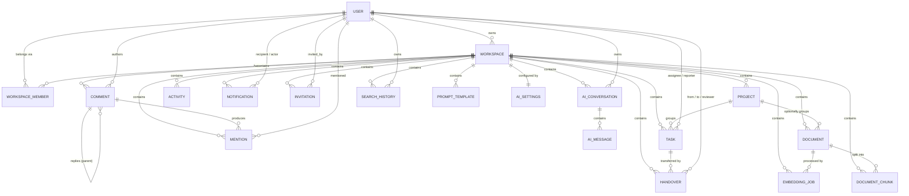

# 09 — Database Architecture

[← Back to index](README.md)

Column-by-column reference: [10-database-tables.md](10-database-tables.md).
Relationship deep-dive: [database/relationships.md](database/relationships.md).

---

## 1. Engine and connection

**PostgreSQL 16 with the `vector` (pgvector) extension.** Nothing else — no
SQLite fallback in the checked-in settings, no read replica, no second database.

```python
DATABASES = {"default": env.db("DATABASE_URL")}
```
`backend/config/settings/base.py:145-147`

`env.db()` is django-environ's parser: it turns a single connection string into
Django's `{ENGINE, NAME, USER, PASSWORD, HOST, PORT}` dict.

```
DATABASE_URL=postgres://<user>:<hidden>@<host>:5432/<dbname>
```

Under Docker the compose file builds it from parts
(`docker-compose.yml:68`), pointing at the internal service name `db`.

### Connection pooling — the honest answer

**There is no application-level connection pool.** `CONN_MAX_AGE` is not set
anywhere in `backend/config/settings/`, so it uses Django's default of `0`:
**a new PostgreSQL connection is opened and closed for every request.**

No PgBouncer, no `django-db-connection-pool`, no `psycopg_pool` usage appears in
the codebase. This is workable at low traffic and is a real scaling item — see
[19-performance-scalability.md](19-performance-scalability.md).

### The pgvector extension

Created by a migration operation rather than by hand:

```python
from pgvector.django import VectorExtension
...
operations = [
    VectorExtension(),      # CREATE EXTENSION IF NOT EXISTS vector
    ...
]
```
`backend/apps/knowledge/migrations/0001_initial.py:8,24`

That is why the Docker image is `pgvector/pgvector:pg16` and why CI uses the same
image — plain `postgres:16` would fail this migration.

`backend/requirements.txt` notes this explicitly: `pgvector==0.3.6` is *the Python
client only*; the server extension must exist in PostgreSQL.

---

## 2. Entity-relationship diagram



`COMMENT` and `ACTIVITY` additionally point at *any* object through a generic
foreign key (`content_type_id` + `object_id`), which the diagram cannot express.

---

## 3. Table inventory

### Application tables (17)

| # | Table | Django model | Base | Has `workspace_id` |
|---|---|---|---|---|
| 1 | `accounts_user` | `User` | `AbstractUser` | — |
| 2 | `workspaces_workspace` | `Workspace` | `BaseModel` | is the workspace |
| 3 | `workspaces_workspacemember` | `WorkspaceMember` | `BaseModel` | ✅ |
| 4 | `projects_project` | `Project` | `WorkspaceScopedModel` | ✅ |
| 5 | `tasks_task` | `Task` | `WorkspaceScopedModel` | ✅ |
| 6 | `documents_document` | `Document` | `WorkspaceScopedModel` | ✅ |
| 7 | `handovers_handover` | `Handover` | `WorkspaceScopedModel` | ✅ |
| 8 | `comments_comment` | `Comment` | `BaseModel` + own FK | ✅ |
| 9 | `mentions_mention` | `Mention` | `BaseModel` + own FK | ✅ |
| 10 | `notifications_notification` | `Notification` | `BaseModel` + own FK | ✅ (nullable) |
| 11 | `activities_activity` | `Activity` | `BaseModel` + own FK | ✅ |
| 12 | `invitations_invitation` | `Invitation` | `BaseModel` + own FK | ✅ |
| 13 | `knowledge_documentchunk` | `DocumentChunk` | `BaseModel` + own FK | ✅ |
| 14 | `knowledge_embeddingjob` | `EmbeddingJob` | `BaseModel` + own FK | ✅ |
| 15 | `ai_aiconversation` | `AIConversation` | `WorkspaceScopedModel` | ✅ |
| 16 | `ai_aimessage` | `AIMessage` | `BaseModel` | — (via conversation) |
| 17 | `ai_aisettings` | `AISettings` | `BaseModel` | ✅ (OneToOne) |
| 18 | `ai_searchhistory` | `SearchHistory` | `BaseModel` + own FK | ✅ |
| 19 | `ai_prompttemplate` | `PromptTemplate` | `WorkspaceScopedModel` | ✅ |

(19 rows; the "17 tables" figure quoted elsewhere counts the core domain and
excludes the three smaller AI side tables — either way, this list is complete.)

### Framework tables also present

| Table(s) | From |
|---|---|
| `token_blacklist_outstandingtoken`, `token_blacklist_blacklistedtoken` | `rest_framework_simplejwt.token_blacklist` |
| `django_content_type` | `django.contrib.contenttypes` — required by the generic FKs |
| `auth_permission`, `auth_group`, `auth_group_permissions`, `accounts_user_groups`, `accounts_user_user_permissions` | `django.contrib.auth` |
| `django_session` | `django.contrib.sessions` (used by the admin, not the API) |
| `django_admin_log` | `django.contrib.admin` |
| `django_migrations` | Django |

The `token_blacklist` tables are **not decorative** — they are what makes logout
and password-reset revocation work.

---

## 4. Primary keys

Every application table uses a **UUID v4 primary key**, generated in Python:

```python
id = models.UUIDField(primary_key=True, default=uuid.uuid4, editable=False)
```
`backend/apps/common/models.py:29` (and `accounts/models.py:50`)

Trade-offs, worth being able to argue both sides:

| Benefit | Cost |
|---|---|
| Safe to expose in URLs — no enumeration | 16 bytes vs 4/8 for an integer |
| Generated client-side before insert, so no round trip needed | Random ordering hurts B-tree index locality on inserts |
| No collision when merging data between environments | Harder to eyeball in logs |

Because ids are random, the codebase orders by `-created_at` rather than by id.

---

## 5. Foreign keys and delete behaviour

The `on_delete` choices encode real business decisions:

| Relationship | `on_delete` | Why |
|---|---|---|
| `WorkspaceScopedModel.workspace → Workspace` | `CASCADE` | Deleting a workspace removes all of its content |
| `Task.project → Project` | `CASCADE` | A task cannot exist without its project |
| `Document.project → Project` | `SET_NULL` | A document survives its project — it may be workspace-level |
| `Task.assignee / reporter → User` | `SET_NULL` | Deleting a person must not delete the work |
| `Handover.from_user / to_user / reviewer → User` | `SET_NULL` | The historical record survives |
| `AuditModel.created_by / updated_by → User` | `SET_NULL` | Same |
| `Activity.actor → User` | `SET_NULL` | The audit entry survives; the actor becomes null |
| `Comment.author → User` | **`CASCADE`** | Deleting a user deletes their comments — inconsistent with the rest |
| `Comment.parent → Comment` | `CASCADE` | Deleting a comment removes its replies (but deletion is soft in the API) |
| `Comment.content_type → ContentType` | `CASCADE` | Django default |
| `Activity.content_type → ContentType` | `SET_NULL` | Keeps the audit row when a content type disappears |
| `Mention.comment / mentioned_user` | `CASCADE` | A mention has no meaning without either |
| `Notification.recipient → User` | `CASCADE` | Notifications die with the recipient |
| `Notification.actor → User` | `SET_NULL` | The notification survives the actor |
| `Notification.workspace` | `CASCADE`, nullable | System notifications have no workspace |
| `DocumentChunk.document / workspace` | `CASCADE` | Vectors die with the document |
| `AIMessage.conversation` | `CASCADE` | Messages die with the thread |
| `AISettings.workspace` | `CASCADE` (OneToOne) | One config per workspace |
| `Workspace.owner → User` | `CASCADE` | **Deleting a user deletes every workspace they own** |

Two of these deserve a flag, and both are recorded in
[25-known-limitations.md](25-known-limitations.md):

- `Comment.author` is `CASCADE` while every other user reference is `SET_NULL`.
  Deleting a user silently erases their comment history — and, via
  `Comment.parent` cascade, other people's replies underneath.
- `Workspace.owner` is `CASCADE`, so deleting one user can destroy a whole
  workspace and everything in it. There is no "orphaned workspace" path.

---

## 6. Unique constraints

| Constraint | Table | Purpose |
|---|---|---|
| `email` unique | `accounts_user` | Login identifier |
| `slug` unique | `workspaces_workspace` | Global slug namespace |
| `unique_workspace_member` on `(workspace, user)` | `workspaces_workspacemember` | A person joins a workspace once |
| `unique_project_slug_per_workspace` on `(workspace, slug)` | `projects_project` | Slugs are unique *per tenant*, not globally |
| `unique_comment_mention` on `(comment, mentioned_user)` | `mentions_mention` | Mentioning someone twice in one comment yields one row |
| `unique_document_chunk_index` on `(document, chunk_index)` | `knowledge_documentchunk` | Chunk ordering is unambiguous |
| `token` unique | `invitations_invitation` | The token is the credential |
| `workspace` unique (OneToOne) | `ai_aisettings` | One settings row per workspace |

Note the contrast between workspace slugs (global) and project slugs
(per workspace). The project version is the correct multi-tenant choice; the
workspace one has to be global because it is the top-level namespace.

---

## 7. Indexes

Beyond the automatic index on every FK and PK:

| Table | Index | Supports |
|---|---|---|
| `tasks_task` | `(workspace, status)` | The dashboard's pending/completed/overdue counts, and status filters |
| `tasks_task` | `(project, status)` | Project detail page task lists |
| `handovers_handover` | `(workspace, status)` | The reviewer queue (`?status=pending`) |
| `handovers_handover` | `(task, status)` | "Does this task already have a pending handover?" |
| `comments_comment` | `(content_type, object_id)` | Loading a thread for one task/project/document |
| `comments_comment` | `(workspace, created_at)` | Workspace-wide comment ordering |
| `activities_activity` | `(workspace, created_at)` | The audit log's default view |
| `activities_activity` | `(content_type, object_id)` | Per-object timelines |
| `notifications_notification` | `(recipient, is_read)` | The unread-count badge |
| `invitations_invitation` | `(workspace, status)` | Pending-invite lists |
| `knowledge_documentchunk` | `(workspace)` | Tenant filter before the vector scan |
| `knowledge_documentchunk` | **HNSW** on `embedding`, `vector_cosine_ops`, `m=16`, `ef_construction=64` | Approximate nearest-neighbour search |
| `knowledge_embeddingjob` | `(document, -created_at)` | "Latest job for this document" |
| `ai_aiconversation` | `(workspace, user, -updated_at)` | Conversation list |
| `ai_aimessage` | `(conversation, created_at)` | Thread rendering |
| `ai_searchhistory` | `(workspace, user, -created_at)` | Recent queries |
| `ai_prompttemplate` | `(workspace, category)` | Template library filter |

Every one of these matches a query that actually exists in the codebase — this is
not speculative indexing.

**The gap:** no index on `projects_project(workspace, status)` or
`documents_document(workspace)` even though both are filtered that way. Low
impact at current data sizes; noted in
[19-performance-scalability.md](19-performance-scalability.md).

---

## 8. The vector column

```python
EMBEDDING_DIM = settings.AI["EMBEDDING_DIM"]        # 384

embedding = VectorField(dimensions=EMBEDDING_DIM, null=True, blank=True)

indexes = [
    models.Index(fields=["workspace"]),
    HnswIndex(name="documentchunk_embedding_hnsw", fields=["embedding"],
              m=16, ef_construction=64, opclasses=["vector_cosine_ops"]),
]
```
`backend/apps/knowledge/models.py:19,39,50-60`

Four points:

- **384 dimensions** because the default embedder is `all-MiniLM-L6-v2`.
- **Nullable**, so a chunk row can exist before its embedding is computed
  (comment at line 38).
- **HNSW**, not IVFFlat — HNSW needs no training pass and handles incremental
  inserts, which suits a system where documents arrive one at a time.
- `vector_cosine_ops` matches the query, which uses `CosineDistance`. Using a
  different operator class would make the index unusable.

**The dimension is baked into the column at migration time.** `base.py:336-338`
warns about this in capitals: switching to a 768- or 1536-dimension provider
requires a new migration altering the column. `embeddings/factory.py:24-29` even
records the required dimension per unimplemented provider so the mistake is
obvious.

---

## 9. Generic foreign keys

Two tables point at *any* model:

```python
content_type = models.ForeignKey(ContentType, on_delete=...)
object_id    = models.UUIDField()
target       = GenericForeignKey("content_type", "object_id")
```

| Table | Points at | Constrained by |
|---|---|---|
| `comments_comment` | project, task, document | `ALLOWED_TARGETS` whitelist in `apps/comments/serializers.py:10-14` |
| `activities_activity` | project, task, document, handover, comment, workspace | whatever the signal handlers register |

`object_id` is a `UUIDField` rather than the usual `PositiveIntegerField`,
because every domain model uses UUID primary keys (comment at
`comments/models.py:38-39`).

**Trade-off:** flexibility, at the cost of no database-level referential
integrity — PostgreSQL cannot enforce that `object_id` points at a live row. The
whitelist limits the blast radius on the comments side.

---

## 10. JSON columns

| Table | Column | Contents |
|---|---|---|
| `tasks_task` | `labels` | `["bug", "frontend"]` — a plain string list |
| `activities_activity` | `metadata` | Small snapshot, e.g. `{"title": "...", "status": "todo"}` |
| `knowledge_documentchunk` | `metadata` | `{"title": "<document title>"}` |
| `ai_aimessage` | `sources` | The retrieved chunks cited by an assistant reply |
| `ai_aimessage` | `metadata` | `{"confidence": "...", "top_score": 0.72, "model": "..."}` |

All are `models.JSONField`, which maps to **`jsonb`** on PostgreSQL. None of them
are queried with JSON operators anywhere in the codebase — they are stored and
read whole. That means no GIN indexes are needed, and also that filtering by
label (`?labels=bug`) is **not supported** today.

The audit `metadata` design is deliberate: it stores a *human-readable snapshot*
taken at the time of the event, so the log still reads correctly after the
underlying row is renamed or deleted.

---

## 11. Transactions

Explicit transaction use is sparse and targeted. Everywhere else, DRF's default
per-request autocommit applies (`ATOMIC_REQUESTS` is **not** enabled).

| Location | Wrapped in | Why |
|---|---|---|
| `WorkspaceViewSet.perform_create` | `@transaction.atomic` | Workspace + owner `WorkspaceMember` must be created together, or not at all |
| `WorkspaceViewSet.transfer_ownership` | `with transaction.atomic()` | Three writes — promote target, demote actor, update `workspace.owner` — must not half-apply |
| `processor._store_chunks` | `@transaction.atomic` | Delete-then-bulk-insert must be atomic so a re-index never leaves a document with zero chunks |
| `notifications.services._push` | `transaction.on_commit` | Do not push a websocket message for a row that has not committed |
| `processor.enqueue_document` | `transaction.on_commit` | Do not queue a Celery job for a document the worker cannot read yet |
| `common.email.queue_templated_email` | `transaction.on_commit` | Do not email a link to a row that may roll back |

The three `on_commit` uses are the interesting ones — they are not about
atomicity but about **ordering between the database and an external system**.

---

## 12. Things the database does NOT have

Verified absent:

- **No SQL views.**
- **No stored procedures or functions** (other than what pgvector installs).
- **No database triggers.** All "trigger-like" behaviour is Django signals, which
  run in Python, in the web process — so a write made outside Django (psql, a
  data migration using `bulk_create`, `queryset.update()`) produces **no**
  activity row and **no** notification. `queryset.update()` bypassing `post_save`
  is a real, standard Django gotcha and it applies here: see
  `NotificationViewSet.read_all` (`apps/notifications/views.py:65-67`), which
  uses `.update()` deliberately.
- **No materialised views** for analytics — `AnalyticsView` computes everything
  live on each request.
- **No partitioning, sharding or read replicas.**
- **No soft-delete framework.** Only `Comment` has an `is_deleted` flag; every
  other delete is a real `DELETE`.
- **No raw SQL** anywhere. Confirmed: no `.raw(`, no `cursor.execute` outside
  `connection.ensure_connection()` in the health check.

---

**Next:** [10 — Database Tables](10-database-tables.md)
