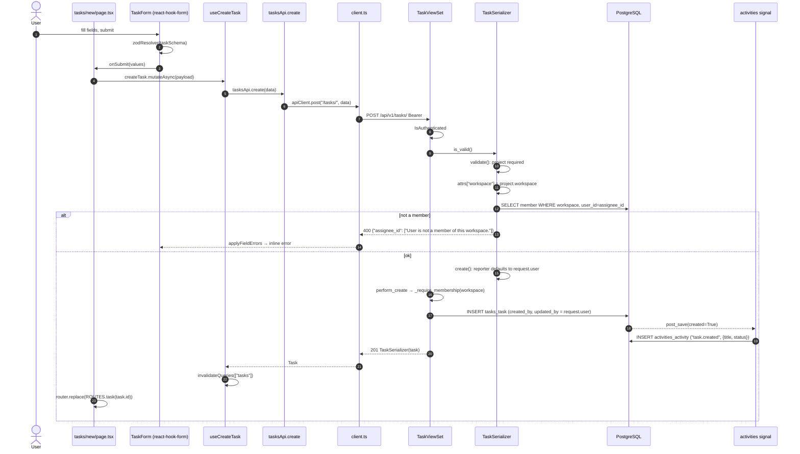
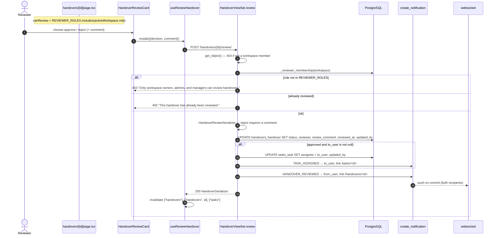
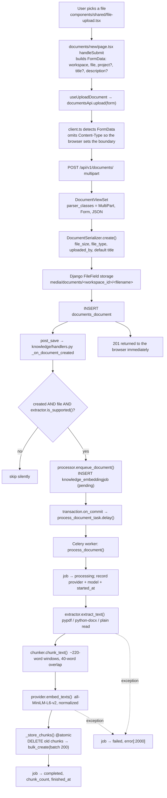
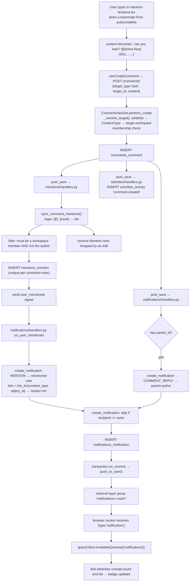

# 11 — Data Flow

[← Back to index](README.md)

Seven complete traces through the real code. Every filename and function name
below exists.

---

## Flow 1 — Login

Already diagrammed in
[08-authentication-authorization.md](08-authentication-authorization.md#3-login-start-to-finish).
Summary chain:

```
login-form.tsx onSubmit
  → auth-provider.tsx login()
    → lib/api/auth.ts authApi.login()
      → lib/api/client.ts apiClient.post("/auth/login/", data, {skipAuth:true})
        → POST /api/v1/auth/login/
          → accounts/urls.py → LoginView (TokenObtainPairView)
            → LoginRateThrottle
            → EmailTokenObtainPairSerializer.validate()
              → SELECT accounts_user WHERE email=...
              → check_password()
              → issue access + refresh, UPDATE last_login
              → data["user"] = UserSerializer(self.user).data
            → LoginView.post pops "refresh" into an httpOnly cookie
          ← 200 {access, user} + Set-Cookie: nexora_refresh
      ← LoginResponse
    → tokenStorage.setAccess(access)      [memory only]
       (refresh token arrives as an httpOnly cookie set by the server)
    → setUser(res.user)
  → toast.success + router.replace(next ?? "/dashboard")
```

---

## Flow 2 — Creating a task (the canonical write)

**User action:** fills the form at `/tasks/new` and clicks Create.



### Files, in order

| Step | File | Symbol |
|---|---|---|
| 1 | `frontend/src/app/(app)/tasks/new/page.tsx` | page component |
| 2 | `frontend/src/lib/validations/task.ts` | `taskSchema` |
| 3 | `frontend/src/hooks/use-tasks.ts:33` | `useCreateTask` |
| 4 | `frontend/src/lib/api/tasks.ts` | `tasksApi.create` |
| 5 | `frontend/src/lib/api/client.ts:134` | `apiClient.post` |
| 6 | `backend/apps/tasks/urls.py` | router |
| 7 | `backend/apps/tasks/views.py:10` | `TaskViewSet` |
| 8 | `backend/apps/common/viewsets.py:41` | `perform_create` |
| 9 | `backend/apps/tasks/serializers.py:70` | `validate` |
| 10 | `backend/apps/tasks/models.py:24` | `Task` |
| 11 | `backend/apps/activities/handlers.py:32` | `on_save` |

### Three things that happen without the view knowing

1. `workspace` is derived from `project`, in the serializer.
2. `created_by` / `updated_by` are stamped by the base viewset.
3. An audit row is written by a signal.

`apps/tasks/views.py` is **25 lines** and contains none of that logic.

---

## Flow 3 — Submitting and approving a handover ⭐

The flagship flow. It is the only place in the codebase where one module writes
to another module's table.

### Part A — Submit

```
handovers/new/page.tsx  (task id may arrive as ?task=<uuid>)
  → useCreateHandover → handoversApi.create(toHandoverPayload(values))
    → POST /api/v1/handovers/  {task, to_user_id, summary, pending_items, resources}
      → HandoverViewSet (WorkspaceScopedViewSet)
        → HandoverSerializer.validate()
             task required
             workspace = task.workspace              ← derived
             to_user must be a workspace member
             to_user != request.user                 ← "can't hand over to yourself"
        → HandoverSerializer.create(): from_user = request.user
        → perform_create():
             super() → _require_membership + created_by/updated_by + INSERT
             create_notification(
                 recipient = handover.to_user,
                 actor     = handover.from_user,
                 type      = HANDOVER_SUBMITTED,
                 title     = '<from> handed over "<task title>"',
                 message   = summary[:140],
                 link      = f"/handovers/{pk}")
      ← 201
```

`backend/apps/handovers/views.py:47-58`.

Meanwhile two signals fire on the INSERT: `activities` writes
`handover.created`, and `create_notification` schedules a websocket push on
commit.

### Part B — Review



`backend/apps/handovers/views.py:76-144`.

### Why this flow matters

- **Cross-module write.** `HandoverViewSet.review` updates `tasks_task`. That is
  the single business action that changes another module's data.
- **`update_fields` is used on both saves**, so only the changed columns are
  written — and, importantly, `post_save` still fires, so both the handover
  update *and* the task update land in the audit log.
- **Two notifications** are created on approval, one on rejection.
- **The frontend must invalidate three caches** because the write touched two
  resources — this is the clearest example of why invalidation lives in the hooks
  layer.

---

## Flow 4 — Uploading a document, through to a searchable vector

The longest path in the system: one user action, four processes.



### Key properties

| Property | Where | Why |
|---|---|---|
| Upload returns before embedding | `enqueue_document` returns the pending job immediately | The transformer model alone is ~90 MB; holding the request open would time out |
| Only on **create** | `if not created or not instance.file: return` (`handlers.py:26`) | Metadata-only edits never trigger expensive re-embedding |
| Unsupported files are skipped **silently** | `handlers.py:28-30` | Images and archives are legitimate uploads with no text |
| Ingestion never breaks the upload | broad `except` in `handlers.py:33-34` and in `process_document` | A failed embedding must not fail a successful file upload |
| Re-index is atomic | `_store_chunks` is `@transaction.atomic` | A document is never left with zero chunks mid-reindex |
| Failure is recorded, not raised | `process_document` writes `status=failed, error=...` | The UI can show it via `embedding_status` |
| Broker down → inline | `except` around `.delay()` (`processor.py:47-52`) | "better slow than lost" |

The document's `embedding_status` field in the API is computed from the **latest**
`EmbeddingJob` (`DocumentSerializer.get_embedding_status`), which is what the
`components/ai/embedding-status-badge.tsx` renders.

---

## Flow 5 — Asking the AI a question (RAG)

```mermaid
sequenceDiagram
    autonumber
    actor U as User
    participant CW as chat-window.tsx
    participant V as ChatView
    participant RW as resolve_workspace()
    participant DB as PostgreSQL
    participant RAG as rag.answer_question()
    participant SS as semantic_search()
    participant EMB as embedding provider
    participant PR as prompts.build_chat_messages()
    participant LLM as provider.generate()

    U->>CW: type a question
    CW->>V: POST /ai/chat/ {workspace, message, conversation?}
    V->>V: AIRateThrottle (30/hour per user)
    V->>RW: resolve_workspace(user, workspace)
    RW->>DB: workspace exists? member?
    RW-->>V: Workspace  (or 404 / 403)
    V->>DB: get or create AIConversation (title = message[:80])
    V->>DB: INSERT AIMessage(role=user)   ← persisted BEFORE the LLM call
    V->>DB: last 10 messages as history
    V->>RAG: answer_question(workspace, query, history)
    RAG->>RAG: security.sanitize_input()  strip control chars, cap 4000 chars
    RAG->>SS: semantic_search(workspace, query)
    SS->>EMB: embed_query(query) → 384-dim vector
    SS->>DB: SELECT ... WHERE workspace_id = ? AND embedding IS NOT NULL<br/>ORDER BY embedding <=> ? LIMIT 6
    DB-->>SS: chunks + cosine distance
    SS-->>RAG: SearchResult[] with score = 1 - distance
    RAG->>DB: build_structured_context(): 8 projects, task counts, 10 keyword-matched tasks
    RAG->>PR: build_chat_messages(question, sources, history, structured)
    PR->>PR: fence every source in wrap_untrusted(); prepend SYSTEM_GUARDRAILS
    RAG->>LLM: generate(messages, temperature, max_tokens)
    alt ProviderError
        V-->>CW: 502 {"detail": "..."}
    else DatabaseError (pgvector missing)
        V-->>CW: 503 "Semantic search isn't available yet..."
    else ok
        LLM-->>RAG: text
        RAG-->>V: {answer, sources, confidence, top_score, model}
        V->>DB: INSERT AIMessage(role=assistant, sources, metadata)
        V->>DB: touch conversation.updated_at
        V-->>CW: 200 {conversation, message, confidence}
        CW->>CW: render bubble + sources-panel + confidence-badge
    end
```

### The pieces

| Concern | File | Detail |
|---|---|---|
| Tenant isolation | `apps/ai/permissions.py:15` | Called before any retrieval |
| Retrieval | `apps/knowledge/services/search.py:31` | `CosineDistance`, `distance <= 0.75`, top 6 |
| Structured context | `apps/ai/services/rag.py:38` | Projects, open/overdue counts, keyword-matched tasks |
| Prompt-injection defence | `apps/ai/services/security.py` | `sanitize_input`, `wrap_untrusted`, `SYSTEM_GUARDRAILS` |
| Prompt assembly | `apps/ai/services/prompts.py:35` | Sources fenced as `<source id=1 title='...'>` |
| Provider choice | `apps/ai/providers/factory.py:65` | Per-workspace settings over env defaults |
| Confidence | `rag.py:89-94` | `>=0.6` high, `>=0.4` or structured present medium, else low |

The **order** in `build_chat_messages` matters: system prompt → context as a user
message explicitly labelled *"(untrusted data, for reference only)"* → history →
the real question last (`prompts.py:43-66`).

---

## Flow 6 — Comment with an @mention → live notification

One user action, four tables, and a websocket push.



### Details worth remembering

- The mention token format `@[Display Name](uuid)` is a **contract** between
  `components/comments/mention-textarea.tsx` and the regex in
  `backend/apps/mentions/services.py:23`. Nothing type-checks it.
- `sync_comment_mentions` is **idempotent**: it adds new mentions, removes ones
  deleted by an edit, and fires the signal only for genuinely new ones
  (`services.py:31-68`). Editing a comment does not re-notify.
- You cannot mention yourself into a notification — filtered twice, once in
  `sync_comment_mentions` (`.exclude(id=comment.author_id)`) and again in
  `create_notification`.
- You cannot mention a non-member: the query joins
  `workspace_memberships__workspace=comment.workspace`.
- The websocket carries **no data the UI trusts** — it only triggers a refetch.

---

## Flow 7 — Dashboard load

The simplest read path, and the one with the most queries.

```
/dashboard
  → useWorkspaceContext() supplies activeWorkspaceId
  → useDashboard(id) → GET /dashboard/?workspace=<id>
    → DashboardView.get()
        workspace = get_object_or_404(
            Workspace.objects.filter(members__user=request.user).distinct(), pk=id)
        ── 10 COUNT queries ────────────────────────────
        total_projects, active_projects, archived_projects,
        total_tasks, pending_tasks, completed_tasks, overdue_tasks,
        total_documents, my_tasks, pending_handovers
        ── 4 list queries, 5 rows each ─────────────────
        recent_projects  ProjectSerializer  (select_related owner, created_by)
        recent_tasks     TaskSerializer     (select_related project, assignee)
        recent_documents DocumentSerializer (select_related uploaded_by)
        pending_handovers HandoverSerializer(select_related task, from_user, to_user)
    ← 200 {stats, recent_projects, recent_tasks, recent_documents, pending_handovers}
  → dashboard/page.tsx renders 10 StatCards + 4 Cards
  → while loading: 10 <Skeleton className="h-24"/>
```

**Roughly 15+ queries per dashboard load**, plus the `DocumentSerializer`
`SerializerMethodField`s which add two more per document row. Measured cost is
discussed in [19-performance-scalability.md](19-performance-scalability.md).

The `overdue_tasks` definition is worth memorising:

```python
tasks.filter(due_date__lt=today, status__in=OPEN_TASK_STATUSES).count()
```
`backend/apps/core/views.py:120-122` — where
`OPEN_TASK_STATUSES = (TODO, IN_PROGRESS, REVIEW)`. A completed task with a past
due date is **not** overdue.

---

## Flow 8 — Exporting a handover as PDF

Different from every other flow because the response is not JSON.

```
handovers/[id]/page.tsx  "Export PDF" button
  → setExporting(true)
  → downloadFile(API_ROUTES.handovers.export(id), "handover.pdf")
      lib/api/download.ts — NOT apiClient (that parses JSON)
      fetch(url, {headers: {Authorization: Bearer <access>}})
      ← 200 application/pdf, Content-Disposition: attachment; filename="handover-<slug>.pdf"
      parse the filename out of the header
      response.blob() → URL.createObjectURL → hidden <a download> → click() → revokeObjectURL
  ← file lands in Downloads

Backend:
  GET /handovers/{id}/export/
    → HandoverViewSet.export
    → get_object()  (404 if not a workspace member — the queryset filter)
    → from apps.handovers.pdf import render_handover_pdf   ← local import
    → reportlab SimpleDocTemplate → A4, metadata table, sections
    → HttpResponse(pdf, content_type="application/pdf")
```

Two implementation notes:

- `render_handover_pdf` is imported **inside** the action, "so the app works even
  before reportlab is installed" (`views.py:153-154`).
- The filename is `slugify(task.title)` with the handover pk as a fallback
  (`views.py:158`).
- `downloadFile` does not retry on 401 — it has no refresh logic.

---

## Cross-flow summary

| Flow | Tables written | Side effects |
|---|---|---|
| Login | `accounts_user.last_login`, `token_blacklist_outstandingtoken` | — |
| Create task | `tasks_task`, `activities_activity` | — |
| Submit handover | `handovers_handover`, `activities_activity`, `notifications_notification` | websocket push |
| Review handover (approve) | `handovers_handover`, **`tasks_task`**, `activities_activity` ×2, `notifications_notification` ×2 | 2 websocket pushes |
| Upload document | `documents_document`, `knowledge_embeddingjob`, `activities_activity`, later `knowledge_documentchunk` | file written to storage, Celery job |
| AI chat | `ai_aiconversation`, `ai_aimessage` ×2 | outbound LLM call, costs money |
| Comment + mention | `comments_comment`, `mentions_mention`, `notifications_notification`, `activities_activity` | websocket push |
| Accept invitation | `invitations_invitation`, `workspaces_workspacemember`, `activities_activity` | — |

---

**Next:** [12 — Business Modules](12-business-modules.md)
