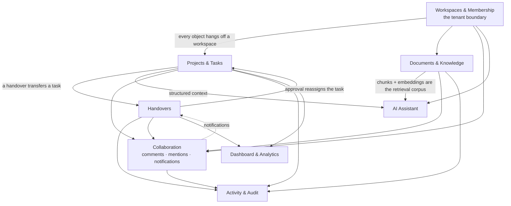

# 12 — Business Modules

[← Back to index](README.md)

Eight modules. Each has its own file in [`modules/`](modules/) with the full
treatment: purpose, users, frontend, backend, tables, APIs, business rules,
workflows, failure modes and interview questions.

---

## Module map

---

## Summary table

| Module | Solves | Backend apps | Tables | Frontend routes |
|---|---|---|---|---|
| **[Workspaces & membership](modules/workspaces.md)** | Multi-tenancy, roles, inviting people | `workspaces`, `invitations` | `workspaces_workspace`, `workspaces_workspacemember`, `invitations_invitation` | `/workspaces`, `/workspaces/new`, `/workspaces/[id]/settings`, `/invitations` |
| **[Projects & tasks](modules/projects-tasks.md)** | Organising work | `projects`, `tasks` | `projects_project`, `tasks_task` | `/projects*`, `/tasks*` |
| **[Handovers](modules/handovers.md)** | Losing context when work changes hands | `handovers` | `handovers_handover` (writes `tasks_task`) | `/handovers*` |
| **[Documents & knowledge](modules/documents-knowledge.md)** | Storing files and making them searchable by meaning | `documents`, `knowledge` | `documents_document`, `knowledge_documentchunk`, `knowledge_embeddingjob` | `/documents*` |
| **[AI assistant](modules/ai-assistant.md)** | Answering questions over your own workspace | `ai` | `ai_aiconversation`, `ai_aimessage`, `ai_aisettings`, `ai_searchhistory`, `ai_prompttemplate` | `/ai/*` |
| **[Collaboration](modules/collaboration.md)** | Discussion, attention, awareness | `comments`, `mentions`, `notifications` | `comments_comment`, `mentions_mention`, `notifications_notification` | inline + `/notifications` |
| **[Activity & audit](modules/activity-audit.md)** | Reconstructing who changed what | `activities` | `activities_activity` | `/activity` |
| **[Dashboard & analytics](modules/dashboard-analytics.md)** | Seeing the state of a workspace | `core` | reads only | `/dashboard`, `/analytics` |

---

## How the modules talk to each other

There are exactly **five** cross-module couplings in the backend. Knowing all
five is worth more than knowing any single module.

| # | From | To | Mechanism | File |
|---|---|---|---|---|
| 1 | Handovers | Tasks | **Direct write.** Approval sets `task.assignee` | `apps/handovers/views.py:116-120` |
| 2 | Handovers, Invitations, Notifications-handlers | Notifications | `create_notification()` service call | `apps/notifications/services.py:22` |
| 3 | Comments | Mentions | `post_save` signal → `sync_comment_mentions()` | `apps/mentions/handlers.py:10` |
| 4 | Mentions | Notifications | Custom `user_mentioned` signal | `apps/mentions/signals.py`, `notifications/handlers.py:21` |
| 5 | Documents | Knowledge | `post_save` signal → `enqueue_document()` | `apps/knowledge/handlers.py:37` |

Plus one read-only coupling: `apps/core/views.py` imports models and serializers
from six apps to build the dashboard and analytics payloads. And one layering
edge: `apps/ai` imports `apps.knowledge.services.search` — generation depends on
retrieval, never the reverse.

**Notice what is absent.** No domain app imports `activities`. Audit logging is
attached entirely from the outside, by signals registered in
`ActivitiesConfig.ready()`. That is the cleanest decoupling in the codebase and
the easiest one to point at in an interview.

---

## Which module to study first

If you have limited time, study them in this order:

1. **Workspaces** — nothing else makes sense until tenancy does.
2. **Handovers** — the richest business logic and the only cross-module write.
3. **Documents & knowledge** — the async pipeline.
4. **AI assistant** — builds directly on 3.
5. **Collaboration** — signals and realtime.
6. **Projects & tasks** — mostly CRUD; read it to see the base classes at work.
7. **Activity & audit** — small, elegant, and full of good interview material.
8. **Dashboard & analytics** — pure read aggregation.

---

**Next:** [13 — Business Logic](13-business-logic.md)
