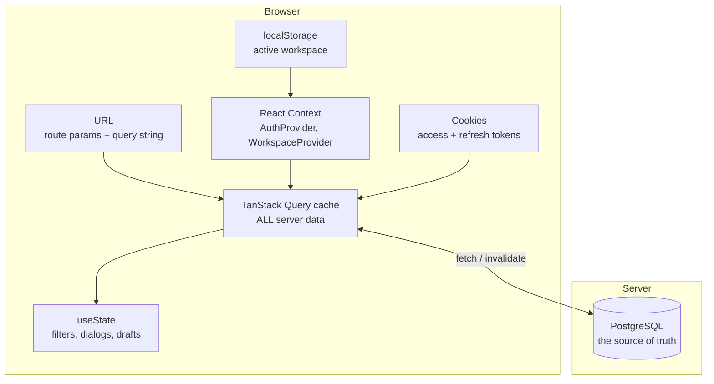

# 16 — State Management

[← Back to index](README.md)

The question to answer for every value: **where does it actually live, who owns
it, who can change it, and what makes the UI re-render?**

---

## 1. The seven places state lives



| # | Location | What lives there | Survives reload? | Shared across tabs? |
|---|---|---|---|---|
| 1 | PostgreSQL | Everything real | ✅ | ✅ |
| 2 | TanStack Query cache | A copy of server data | ❌ | ❌ |
| 3 | React Context | `user`, `activeWorkspace` | ❌ (rebuilt on mount) | ❌ |
| 4 | Cookies | `nexora.accessToken`, `nexora.refreshToken` | ✅ | ✅ |
| 5 | localStorage | `nexora.activeWorkspace` | ✅ | ✅ (via `storage` event) |
| 6 | URL | ids, `?next=`, `?task=`, `?project=`, `?token=`, `?uid=` | ✅ | shareable |
| 7 | `useState` | Filters, dialog open/closed, form drafts | ❌ | ❌ |

**The rule:** if it matters, it is in PostgreSQL. Everything above it is a cache,
a pointer, or a UI detail.

---

## 2. Server state — TanStack Query

This is the largest category by far. **No server data is stored in `useState`
anywhere in this codebase.**

### Ownership

```ts
const KEYS = {
  all:    ["tasks"] as const,
  list:   (params) => ["tasks", "list", params] as const,
  detail: (id)     => ["tasks", id] as const,
};
```

Each `hooks/use-*.ts` file owns its key namespace. Nothing outside that file
constructs a task key — except deliberately, where a mutation crosses modules
(`use-handovers.ts:73` invalidates `["tasks"]`).

### What causes a refetch

| Trigger | Mechanism |
|---|---|
| Key changes | Changing the workspace, a filter, or the page produces a new key → new fetch |
| `staleTime` expires | 60 seconds (`lib/query-client.ts:15`) |
| A mutation succeeds | `onSuccess: () => qc.invalidateQueries(...)` |
| WebSocket message | `invalidateQueries(["notifications"])` |
| Polling | Only `useUnreadCount`, only when the socket is **not** live |
| Window focus | **Disabled** — `refetchOnWindowFocus: false` |

### The "change the workspace and everything refetches" property

Every list hook takes `workspace` in its params, and params are part of the key.
So switching workspace changes ~12 query keys at once, and every visible list
refetches automatically. **No manual invalidation is involved.** This is the
single most elegant consequence of the key design.

It also means the previous workspace's data stays in the cache (keyed
separately), so switching back is instant.

### Cache lifetime and the logout hole that was closed

`queryClient.clear()` in `logout()` (`auth-provider.tsx:76`) is not optional.
Without it, signing out and signing in as someone else on the same browser would
briefly render the previous user's cached lists before the refetches land.

---

## 3. Auth state — `AuthProvider`

| Question | Answer |
|---|---|
| Where does it live? | `React.useState` inside `AuthProvider` |
| What is the source of truth? | The cookies (proof) + `GET /auth/me/` (identity) |
| Who can change it? | Only `login()`, `logout()`, `setUser()` |
| Who reads it? | `(app)/layout.tsx`, `nav-user`, `settings`, `handovers/[id]`, `handovers` list |
| What re-renders? | Every `useAuth()` consumer, because the context value changes |
| Survives reload? | The *user object* does not; the *cookies* do, so the bootstrap effect rebuilds it |

The context value is memoised on `[user, isLoading, login, logout]`
(`auth-provider.tsx:81-91`), so an unrelated re-render of the provider does not
cascade.

**The bootstrap is the important part:** a page reload leaves the cookies but
empties the JS heap, so `isLoading` starts `true`, `/auth/me/` runs, and
`(app)/layout.tsx` shows a spinner until it resolves. That is why there is a
brief spinner on every hard refresh of an authenticated page.

---

## 4. Workspace state — the three-source resolution

```ts
const preferredId = selectedId ?? storedId;
const activeWorkspace = workspaces.find(w => w.id === preferredId)
                     ?? workspaces[0] ?? null;
```
`providers/workspace-provider.tsx:74-76`

| Source | Type | Set by | Survives |
|---|---|---|---|
| `selectedId` | `useState` | `setActiveWorkspaceId()` — an explicit in-app choice | this tab, this session |
| `storedId` | `useSyncExternalStore` over `localStorage` | the same function, and other tabs | reload and tabs |
| `workspaces` | TanStack Query (`useWorkspaces`) | the server | cache lifetime |

**Why both `selectedId` and `storedId`?** Writing to `localStorage` in the same
tab does **not** fire a `storage` event — that event only fires in *other* tabs.
So the in-tab choice needs its own state, and it takes precedence
(comment at line 56-57).

**Why resolve during render?** Because deriving cannot race. The comment at lines
70-73 records the bug in the previous effect-based version: restoring the
persisted id and then immediately overwriting it with `workspaces[0]`, because
the validating effect still saw the pre-restore value.

**Both localStorage calls are wrapped in `try/catch`** for private-browsing modes
where storage throws.

### "If I change the workspace here, how does another page know?"

It does not need to be told. Context updates → every consumer re-renders → their
`useQuery` calls now pass a different `workspace` param → different key → fetch.
The propagation is automatic.

---

## 5. Token state — cookies

| Question | Answer |
|---|---|
| Where? | `document.cookie`, keys `nexora.accessToken` / `nexora.refreshToken` |
| Who writes? | `tokenStorage.set()` — called from `login()` and from `refreshAccessToken()` |
| Who clears? | `tokenStorage.clear()` — logout, failed refresh, failed bootstrap |
| Who reads? | `client.ts` (every request), `use-notification-socket.ts`, `download.ts`, and **`proxy.ts` server-side** |
| Max-Age | 7 days for both, mirroring the backend's refresh lifetime |

**Not React state.** `tokenStorage` is a plain module with no subscribers, so
writing a token does **not** re-render anything. That is intentional — the token
is plumbing, and the user-visible consequence is carried by `AuthProvider`
instead.

Cookies rather than `localStorage` for one specific reason: `proxy.ts` runs
server-side at the edge and can only read cookies. That single requirement
determines the whole storage choice — and its security cost. See
[18-security.md](18-security.md).

---

## 6. URL state

| Parameter | Route | Read by | Purpose |
|---|---|---|---|
| `[id]` | `/tasks/[id]`, `/projects/[id]`, `/handovers/[id]`, `/documents/[id]`, `/ai/chat/[id]`, `/workspaces/[id]/settings` | `useParams()` | Which record |
| `?next=` | `/login` | `useSearchParams()` in `login-form.tsx:39` | Where to go after signing in |
| `?task=` | `/handovers/new` | `useSearchParams()` | Pre-fill the task from a task page |
| `?project=` | `/tasks/new` | `useSearchParams()` | Pre-fill the project |
| `?uid=` `?token=` | `/reset-password` | form default values | Reset credentials from the email link |
| `?token=` | `/invitations` | invite page | Deep-link an invitation |

**What is deliberately *not* in the URL:** list filters. Status, priority,
assignee, search text and page number all live in `useState`, so a filtered list
view **cannot be shared or bookmarked**, and a browser refresh resets it. That is
a genuine UX gap — noted in [25-known-limitations.md](25-known-limitations.md).

---

## 7. Local component state

Everything here is UI-only:

| Kind | Example |
|---|---|
| Filter selections | `tasks/page.tsx`, `documents/page.tsx`, `activity/page.tsx` |
| Dialog / popover open | `confirmDelete` (`handovers/[id]/page.tsx:69`), `open` in `notification-bell.tsx:24` |
| Transient action flags | `exporting` (`handovers/[id]/page.tsx:70`) |
| Drag hover | `dragging` in `file-upload.tsx:21` |
| Form values | `react-hook-form` internal store, not `useState` |
| Socket status | `status` inside `use-notification-socket.ts:32` |

**Form state deserves its own note.** `react-hook-form` keeps values in a ref-based
store and only re-renders the fields that change — which is why forms in this app
do not re-render the whole page on every keystroke. Server-side validation errors
are pushed into that same store by `applyFieldErrors()`, so both validation
sources render through one mechanism.

---

## 8. Backend state

| Kind | Where | Note |
|---|---|---|
| Durable data | PostgreSQL | The only real source of truth |
| Session | **None for the API** | JWT is stateless; `django_session` exists only for the admin |
| Token revocation | `token_blacklist_*` tables | The one piece of *stateful* auth |
| Throttle counters | Django cache (Redis) | Ephemeral; resets if Redis is flushed |
| Channel groups | Redis channel layer | Ephemeral socket registry |
| Celery queue | Redis | Persisted with AOF in the compose config |
| **Process-local mutable state** | `_workspaces_being_deleted` (`activities/services.py:15`), `_MODELS` (`sentence_transformer.py:16`), `_INSTANCES` (`embeddings/factory.py:22`), `refreshPromise` (frontend) | See below |

The four module-level caches are worth understanding:

- `_MODELS` and `_INSTANCES` are **beneficial** — they keep an expensive model in
  memory per process.
- `_workspaces_being_deleted` is **correct but fragile**: it is per-process, so it
  only works because the delete and its cascade happen in the same request. It
  would not protect a delete split across processes.
- `refreshPromise` is per-tab, which is exactly right for its purpose.

---

## 9. Walkthroughs: "where does this value live?"

### "The task list I'm looking at"
PostgreSQL → fetched by `useTasks` → cached under
`["tasks","list",{workspace,status,page,...}]` → rendered. Not in `useState`
anywhere. Stale after 60s; refetched on any task mutation.

### "Which workspace am I in?"
`localStorage["nexora.activeWorkspace"]` (durable) + `selectedId` (this tab) →
resolved against the `useWorkspaces` list during render → exposed via context.

### "Am I logged in?"
Cookies (durable proof) → `GET /auth/me/` on mount → `user` state in
`AuthProvider` → `isAuthenticated` derived → read by `(app)/layout.tsx`.

### "Is this dialog open?"
`useState` in the page component. Nowhere else. Gone on navigation.

### "How many unread notifications?"
PostgreSQL `COUNT(*)` → `GET /notifications/unread-count/` → cached under
`["notifications","unread"]` → invalidated by the websocket, or polled every 30s
when the socket is down.

### "What did I type in the filter box?"
`useState` in the list page. **Not** in the URL, so a refresh loses it.

---

## 10. What is deliberately absent

- **No Redux, Zustand, Jotai, MobX or Recoil.** Two React Contexts plus TanStack
  Query cover everything.
- **No global client store at all.** There is no "app state" object.
- **No optimistic updates.** Every mutation waits for the server, then
  invalidates. Simpler, and always consistent — at the cost of a visible delay on
  slow connections.
- **No offline persistence.** No `persistQueryClient`, no service worker.
- **No SSR of authenticated data.** Every `(app)` page is `"use client"` and
  fetches after hydration, so the server never renders user data.

---

## 11. Why this architecture holds up

The reason two contexts are enough: **almost nothing in this app is genuinely
global client state.** It is nearly all server state, and server state belongs in
a cache with invalidation rules — not in a store you have to keep in sync by
hand.

The two things that *are* genuinely client-owned — "who am I" and "which
workspace am I looking at" — are exactly the two contexts that exist.

That is the answer to "why didn't you use Redux?": there is no shared mutable
client state to manage. Adding a store would mean duplicating the server's data
and then writing code to keep the duplicate correct.

---

**Next:** [17 — Error Handling](17-error-handling.md)
