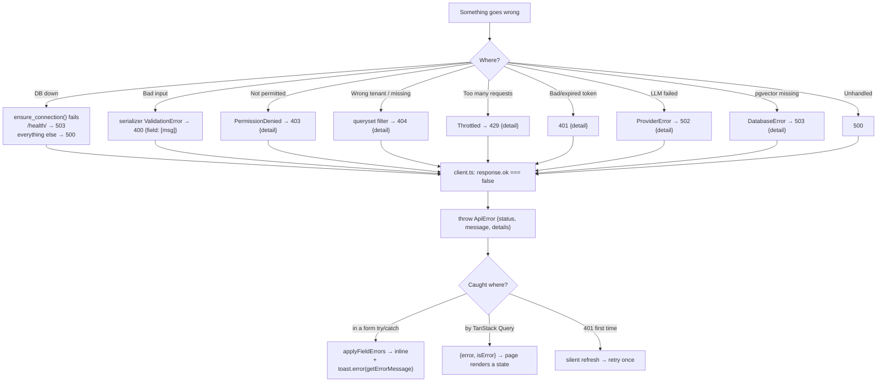

# 17 — Error Handling

[← Back to index](README.md)

---

## 1. The full error path



---

## 2. Backend

### Where errors are raised deliberately

| Exception | Status | Example |
|---|---|---|
| `serializers.ValidationError` | 400 | `"You can't hand a task over to yourself."` (`handovers/serializers.py:100`) |
| `rest_framework.exceptions.ValidationError` | 400 | `"Only pending handovers can be deleted."` (`handovers/views.py:68`) |
| `PermissionDenied` | 403 | `"Only the submitter can edit a handover."` (`handovers/views.py:63`) |
| `NotFound` | 404 | `"Workspace not found."` (`ai/permissions.py:21`) |
| `get_object_or_404` over a filtered queryset | 404 | Dashboard, analytics (`core/views.py:98-101`) |
| `TokenError` | 400 | `"Invalid or expired token."` on logout (`accounts/views.py:78-82`) |
| `ProviderError` | 502 | `"Gemini API key is not configured for this workspace."` |
| `SummaryError` / `ActionItemError` | 400 | `"Document not found in this workspace."` |
| `DatabaseError` | 503 | Retrieval unavailable (`ai/views.py:59-70`) |

Every `PermissionDenied` in this codebase carries a **specific, actionable
message** rather than a bare 403. That is a deliberate quality choice — the
message goes straight into a toast the user reads.

### Where errors are deliberately swallowed

Six places. Each has a comment explaining why, and each is a defensible decision.

| Location | Swallows | Why |
|---|---|---|
| `notifications/consumers.py:74-80` `push_to_user` | everything | *"Realtime delivery is a convenience on top of the REST API... so a channel layer that is down must never break the write that triggered it."* Logs a warning. |
| `common/email.py:67-73` `send_templated_email` | everything when `fail_silently=True` | *"delivery must not break the request"*. Logs the exception. |
| `common/email.py:96-100` `queue_templated_email` | broker failure | Falls back to sending inline |
| `knowledge/services/processor.py:47-52` `dispatch` | broker failure | *"broker down: better slow than lost"* — runs inline |
| `knowledge/handlers.py:31-34` | everything | *"never let ingestion break the upload"*. Logs the exception. |
| `knowledge/services/processor.py:104-110` `process_document` | everything | Records `status=failed, error=str(exc)[:2000]` on the job row rather than raising |
| `ai/services/crypto.py:40-43` `decrypt` | everything | A corrupt or rotated key degrades to "no key" instead of a 500 |

**The pattern:** anything on the *side* of the main transaction — realtime, email,
background ingestion — is allowed to fail without failing the user's request.
Anything the user is directly asking for is not.

### The health check

```python
try:    connection.ensure_connection()
except Exception: database_ok = False
payload = {"status": "ok"|"degraded", "service": ..., "version": "v1",
           "database": "ok"|"unavailable"}
return Response(payload, status=200 if database_ok else 503)
```
`backend/apps/core/views.py:29-62`

Public on purpose (`AllowAny` **and** `authentication_classes = []`) so uptime
monitors and orchestrators can reach it without a token. Docker uses it as the
`web` service healthcheck.

### What is NOT there

- **No custom DRF exception handler.** `EXCEPTION_HANDLER` is not configured, so
  unhandled exceptions produce Django's default response: an HTML debug page when
  `DEBUG=True`, a plain 500 otherwise.
- **No error tracking service.** No Sentry, no Rollbar, no `LOGGING` dict at all
  in `backend/config/settings/` — so Django's default logging applies: warnings
  and above to the console, and nothing is aggregated.
- **No request ID / correlation ID.** A 500 in production cannot be traced back to
  a specific user request.

All three are listed in [25-known-limitations.md](25-known-limitations.md).

---

## 3. Frontend

### The normalisation point

Every non-2xx response becomes one shape, in one place:

```ts
if (!response.ok) {
  const error: ApiError = {
    status:  response.status,
    message: (data && (data.detail || data.message)) || response.statusText || "Request failed",
    details: data && typeof data === "object" ? data : undefined,
  };
  throw error;
}
```
`frontend/src/lib/api/client.ts:116-126`

Note it is a **plain object throw, not an `Error` subclass**. That is why
`isApiError()` exists as a structural type guard rather than an `instanceof`
check (`lib/api/errors.ts:6-13`).

### The three helpers

`frontend/src/lib/api/errors.ts`

```ts
isApiError(e)          // structural guard: has status + message
getErrorMessage(e)     // ApiError.message → Error.message → "Something went wrong. Please try again."
applyFieldErrors(e, setError)   // {field: ["msg"]} → react-hook-form setError(field, {type:"server", message})
```

`applyFieldErrors` is the bridge between DRF validation and react-hook-form. It
is what makes a backend rule like *"User is not a member of this workspace"*
appear inline under the assignee field rather than only in a toast.

### The standard form error handler

```ts
try {
  await mutation.mutateAsync(payload);
  toast.success("...");
  router.replace(...);
} catch (error) {
  applyFieldErrors(error, form.setError);   // field-level → inline
  toast.error(getErrorMessage(error));      // top-level → toast
}
```

This exact shape appears in `login-form.tsx:40-43` and across the other forms.
Both calls run: field errors render inline *and* the top-level message shows as a
toast, so nothing is missed if the failing field is scrolled off screen.

### Query errors

`useQuery` returns `{error, isError}` rather than throwing. Pages branch on it
**before** the loading guard:

```ts
if (isError) {
  return <ErrorState error={error} onRetry={() => refetch()} />;
}
if (isLoading || !handover) return <Loader2 className="animate-spin" />;
```
`handovers/[id]/page.tsx`

`components/shared/error-state.tsx` derives its heading from the normalised
`ApiError.status` — so a 403 reads "You don't have access to this" with the
server's specific reason underneath, rather than a generic failure — and offers
a retry button wired to `refetch()`.

Applied to all eight pages that previously spun forever: the four detail pages,
two edit pages, workspace settings and analytics.

### Render errors — error boundaries

Three boundaries, added because a render-time exception previously left the last
committed UI frozen with no way forward:

| File | Catches | Keeps |
|---|---|---|
| `app/(app)/error.tsx` | Anything thrown inside the authenticated shell | The sidebar and header, so the user can navigate away |
| `app/error.tsx` | Public routes and anything outside `(app)` | Full-page fallback |
| `app/global-error.tsx` | Failures in the **root layout itself** | Nothing — it replaces `<html>`, so it is styled inline |

Each renders `error.digest` when present (the server-side correlation id Next.js
generates) and a `reset()` button, which re-renders the segment and recovers
from a transient failure without a full reload.

### Retry policy

`retry: 1` in `lib/query-client.ts:16` — one automatic retry for queries. Note
this stacks with the client's own 401 retry, but they are independent mechanisms:
the 401 refresh-retry happens *inside* one `fetch` call, before TanStack Query
ever sees a failure.

Mutations are **not** retried (TanStack Query's default), which is correct — you
do not want a duplicate handover because a POST was retried.

### WebSocket errors

Handled entirely inside `use-notification-socket.ts`, and never surfaced to the
user:

| Event | Handling |
|---|---|
| Constructor throws | `setStatus("closed")`, give up for this mount |
| `onerror` | Calls `socket.close()` so reconnect logic stays in one place |
| Close 1000 (normal) | Do not reconnect |
| Close 4401 (unauthenticated) | Retry at the **slowest** interval (30s) — do not hammer the server with credentials it refused |
| Any other close | Exponential backoff `1s → 2s → 5s → 10s → 30s` |
| No token yet | Retry in 1s; the REST client will refresh it |
| Malformed JSON message | `try/catch` around `JSON.parse`, then `return` |

The user never sees a websocket error. If the socket never connects, polling
takes over and the feature simply works more slowly.

---

## 4. Validation errors, both sides

| Layer | Tool | When it runs | Blocking? |
|---|---|---|---|
| Client | zod via `zodResolver` | On submit (and on change after the first submit) | Prevents the request |
| Transport | — | — | — |
| Server | DRF serializer `validate_<field>` / `validate` | Every request | Returns 400 |
| Database | constraints (`unique`, `not null`, FK) | On commit | `IntegrityError` → 500 |

**Client validation is never the boundary.** The backend re-checks everything;
zod exists so the user gets feedback without a round trip.

The third row is worth noting: a few rules exist **only** in the database. The
clearest example is the slug uniqueness race in
[14-algorithms.md](14-algorithms.md#7-unique-slug-generation) — two simultaneous
creates produce an `IntegrityError`, which nothing catches, so the user sees a
500. Correct data, poor error.

---

## 5. What the user actually sees

| Backend result | User experience |
|---|---|
| 400 with field errors | Red text under the offending inputs, plus a toast |
| 400 with only `detail` | Toast with the message |
| 401 (first time) | **Nothing** — silent refresh and retry |
| 401 (refresh also failed) | Redirected to `/login` |
| 403 | Toast with the specific reason ("Only workspace owners, admins, and managers can review handovers.") |
| 404 | Toast "Not found", or an endless spinner on a detail page |
| 429 | Toast: "Request was throttled. Expected available in N seconds." |
| 500 | Toast: "Something went wrong. Please try again." — because there is no `detail` to extract |
| 502 (LLM) | Toast with the provider's message |
| 503 (pgvector) | Toast with the admin-facing setup instruction |
| Network down | Toast: "Failed to fetch" or "Something went wrong. Please try again." |

---

## 6. Gaps, ranked

| Gap | Severity | Detail |
|---|---|---|
| ~~No error boundary~~ | ✅ Fixed | Three boundaries added; see above |
| ~~No `isError` handling on detail pages~~ | ✅ Fixed | Eight pages now render `<ErrorState/>` with retry |
| No structured logging or error tracking | **High** | No `LOGGING` config, no Sentry — production 500s are invisible. Now the largest error-handling gap |
| No custom exception handler | Medium | Unhandled exceptions return no structured JSON |
| `IntegrityError` is uncaught | Low–Medium | Slug races and any future constraint violation become 500s |
| `downloadFile` has no refresh-retry | Low | An expired token at download time fails instead of refreshing |
| No request correlation id | Low | Hard to trace one user's failing request through logs |

The error boundaries and `isError` branches are done. The recommended next fix
is a `LOGGING` configuration plus an error tracker — the boundaries now capture
failures in the UI, but nothing records them anywhere a developer will see.

---

**Next:** [18 — Security](18-security.md)
