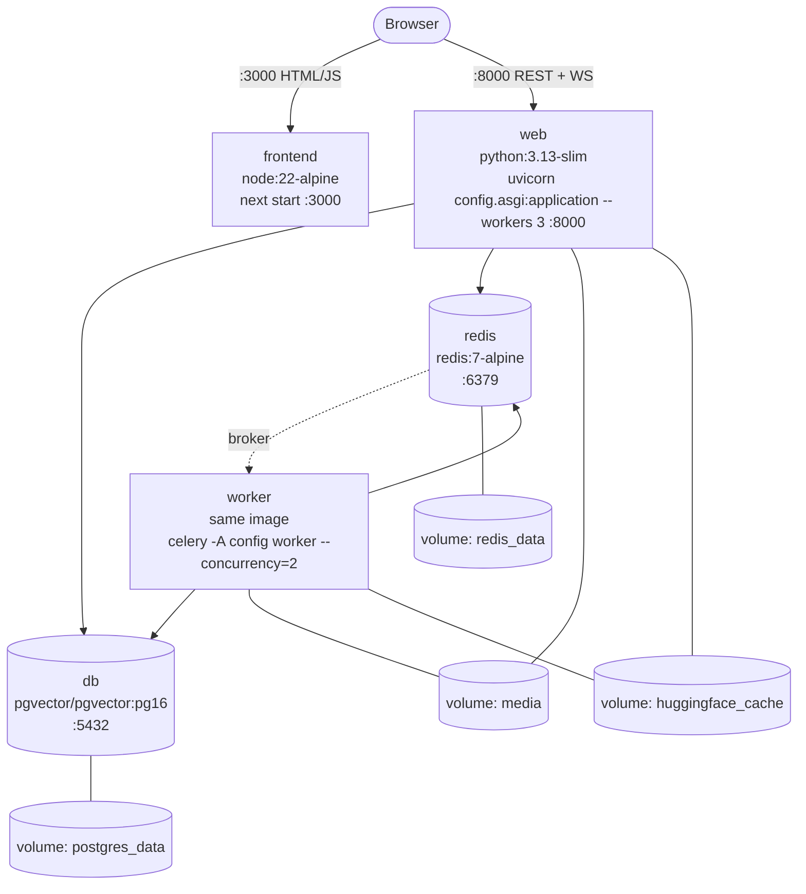

# 22 — Production Deployment

[← Back to index](README.md)

**What exists is Docker + docker compose + GitHub Actions CI.** There is no
Nginx config, no systemd unit, no Kubernetes manifest, no Terraform, no cloud
provider configuration and no deploy script anywhere in this repository. This
file documents what is real and states plainly what is missing.

---

## 1. The deployment artefacts that exist

| File | Purpose |
|---|---|
| `docker-compose.yml` | Five services, four volumes, healthchecks, start ordering |
| `backend/Dockerfile` | One image for **both** `web` and `worker` |
| `frontend/Dockerfile` | Three-stage build: deps → builder → runner |
| `.github/workflows/ci.yml` | Backend tests, frontend checks, Docker image builds |
| `.env.docker.example` | Committed configuration template |
| `backend/.dockerignore`, `frontend/.dockerignore` | Build context trimming |

---

## 2. The runtime topology



### Start ordering

`web` and `worker` both declare:

```yaml
depends_on:
  db:    { condition: service_healthy }
  redis: { condition: service_healthy }
```

so neither starts against a database that is still initialising. `frontend`
depends on `web` with `condition: service_started`.

### Healthchecks

| Service | Check |
|---|---|
| `db` | `pg_isready -U $POSTGRES_USER -d $POSTGRES_DB`, 5s interval |
| `redis` | `redis-cli ping` |
| `web` | `curl -fsS http://localhost:8000/api/v1/health/`, 15s interval, 30s start period |
| `worker` | `celery -A config inspect ping -d celery@$$(hostname)` |

The worker check uses `CMD-SHELL`, not `CMD` — the exec form does no variable
expansion, so `celery@$HOSTNAME` would be pinged literally and never answer
(comment at `docker-compose.yml:120-121`).

### Migrations on start

```yaml
command: >
  sh -c "python manage.py migrate --noinput &&
  uvicorn config.asgi:application --host 0.0.0.0 --port 8000 --workers 3"
```

The YAML comment warns that the continuation line must stay at the **same
indentation** as the first: in a folded (`>`) block a more-indented line keeps
its newline instead of folding to a space, which would hand `sh -c` the arguments
as separate commands and leave uvicorn on its `127.0.0.1` default — unreachable
through the port map.

> This is a real limitation at scale: with N replicas, all N run `migrate`
> concurrently on start. Django takes an advisory lock so it is usually safe, but
> the correct pattern is a separate migration job.

---

## 3. The backend image

`backend/Dockerfile`

```
FROM python:3.13-slim AS base
  ENV PYTHONDONTWRITEBYTECODE=1 PYTHONUNBUFFERED=1 PIP_NO_CACHE_DIR=1
  apt-get install libpq5 curl            ← runtime deps only
  COPY requirements.txt                  ← copied alone, so app changes don't
                                            invalidate the slow dependency layer
  pip install torch --index-url https://download.pytorch.org/whl/cpu
  apt-get install build-essential libpq-dev
    && pip install -r requirements.txt
    && apt-get purge build-essential libpq-dev    ← same layer, so it's removed
  COPY . .
  useradd --uid 1000 nexora; mkdir media staticfiles; chown -R
  USER nexora                            ← non-root
  CMD uvicorn config.asgi:application --host 0.0.0.0 --port 8000 --workers 3
```

Three decisions worth knowing:

1. **CPU-only torch is installed first.** `sentence-transformers` depends on
   torch, and PyPI's default wheel bundles the entire CUDA runtime — gigabytes of
   GPU libraries a CPU embedding worker never loads. Installing the CPU build
   first satisfies the dependency so the requirements install leaves it alone.
2. **Build tools are purged in the same RUN layer** they were installed in, so
   they do not persist in the image.
3. **uvicorn directly, not gunicorn.** The Dockerfile comment explains: an ASGI
   server is required for the websocket routes, uvicorn manages its own worker
   processes, and gunicorn's `uvicorn.workers` shim is deprecated upstream. Note
   `gunicorn==23.0.0` is still in `requirements.txt` and unused by any command in
   the repository.

**One image, two commands.** `web` and `worker` build from the same context and
share the `&backend_env` anchor, so their code and dependencies are identical by
construction.

---

## 4. The frontend image

`frontend/Dockerfile` — three stages:

```
deps    → pnpm install --frozen-lockfile         (fails rather than drifting)
builder → COPY . . ; ARG NEXT_PUBLIC_API_URL ; pnpm build
runner  → node:22-alpine, non-root nextjs:1001
          copies public/, .next/, node_modules/, package.json
          CMD node_modules/.bin/next start
```

**The critical detail:** `NEXT_PUBLIC_API_URL` is an `ARG`, consumed at build
time, because Next.js inlines `NEXT_PUBLIC_*` into the client bundle. It cannot
be supplied at run time. Compose passes it under `build.args`:

```yaml
frontend:
  build:
    args:
      NEXT_PUBLIC_API_URL: ${NEXT_PUBLIC_API_URL:-http://localhost:8000/api/v1}
```

with the comment *"it must be the URL a browser can reach — not the internal
service name."* Changing the API URL therefore requires a **rebuild**, not a
restart.

**Not using `output: "standalone"`.** `next.config.ts` is an empty config object,
so the runtime stage copies the full `node_modules`. Adding `output: "standalone"`
would cut the image substantially.

---

## 5. CI pipeline

`.github/workflows/ci.yml` — triggers on push and PR to `main`/`develop`, with
`concurrency: cancel-in-progress` so a new push supersedes the run in flight.

### Job 1 — `backend`

Services: `pgvector/pgvector:pg16` and `redis:7-alpine`, both healthchecked.

```
setup-python 3.13 (pip cache keyed on backend/requirements.txt)
pip install -r requirements.txt
python manage.py check --fail-level WARNING          ← warnings fail the build
python manage.py makemigrations --check --dry-run    ← model change without a migration fails
python manage.py test --verbosity 2
```

The `makemigrations --check` step is the most valuable one — it makes it
impossible to merge a model change whose migration was forgotten.

Note the env sets `DJANGO_SETTINGS_MODULE=config.settings.development` for the
checks; `manage.py test` overrides it with `config.settings.test` automatically.

### Job 2 — `frontend`

```
pnpm/action-setup v4 (version 11)
setup-node 22 (pnpm cache)
pnpm install --frozen-lockfile
pnpm typecheck        ← tsc --noEmit
pnpm lint             ← eslint
pnpm test             ← vitest run
pnpm build            ← with NEXT_PUBLIC_API_URL set
```

### Job 3 — `docker`

`if: github.event_name == 'push'` only — the comment explains that building the
backend image pulls torch, which is too slow for every pull request. Builds both
images with buildx and GitHub Actions cache (`cache-from/to: type=gha`).
`push: false` — **images are built but never published to a registry.**

### What CI does not do

- No deployment step of any kind.
- No coverage reporting or threshold.
- No security scanning (`pip-audit`, `npm audit`, Trivy).
- No image publishing.

---

## 6. Production gaps — the honest list

### 🔴 Uploaded files are not served

`config/urls.py:54-55` serves `/media/` **only when `DEBUG=True`**. In production
`DEBUG` is `False`, there is no Nginx, and no object-storage backend is
configured. `STORAGES` is left at Django's default `FileSystemStorage`.

**Result: `document.file_url` returns a URL that 404s in production.**

Fix: either add `django-storages` + S3 (`STORAGES["default"]`) — which the
`Document` model docstring already anticipates — or put a reverse proxy in front
that serves `/media/` from the volume.

### 🔴 No reverse proxy / TLS termination

`production.py` sets `SECURE_SSL_REDIRECT = True` and
`SECURE_PROXY_SSL_HEADER = ("HTTP_X_FORWARDED_PROTO", "https")` — both of which
assume something upstream terminates TLS and sets that header. Nothing in the
repository is that something. Compose defaults `SECURE_SSL_REDIRECT` to `False`
with the comment *"TLS terminates at the proxy in front of this, not here."*

You must supply the proxy. It also needs to forward the WebSocket upgrade for
`/ws/`.

### 🔴 No static file serving for Django

`STATIC_ROOT` is set but **`collectstatic` is never run** — not in the Dockerfile,
not in the compose command. WhiteNoise is not installed. So the Django admin at
`/admin/` will render without CSS in production.

The API itself does not need static files, so this only affects the admin.

### 🟠 Migrations run per replica

Covered above. Move to a one-shot job before rolling out new app containers.

### 🟠 No log aggregation or error tracking

No `LOGGING` config (verified absent), no Sentry. Logs go to stdout and are only
as durable as the container.

### 🟠 No backup strategy

`postgres_data` is a Docker named volume. No `pg_dump` schedule, no snapshot
policy, nothing. `docker compose down -v` destroys everything.

### 🟠 No scheduler

No Celery beat service. That means `flushexpiredtokens` never runs, so the JWT
blacklist tables grow forever, and nothing sweeps expired invitations.

### 🟡 Compose is not an orchestrator

No replicas, no rolling deploys, no resource limits, no restart budgets. Fine for
a single-host demo or staging box; not a production platform.

---

## 7. What a real production setup would need

Ordered by necessity, all derived from gaps above:

1. **Reverse proxy** (Nginx / Caddy / a cloud load balancer) terminating TLS,
   setting `X-Forwarded-Proto`, forwarding `/ws/` upgrades, and serving `/media/`
   (or hand media to S3 instead).
2. **Object storage** for uploads — `django-storages` + S3, so `web` and `worker`
   stop sharing a local volume.
3. **`collectstatic`** in the image build, plus WhiteNoise or proxy-served
   statics.
4. **Managed PostgreSQL with pgvector** and automated backups.
5. **Managed Redis** — required the moment there is more than one process, for
   both the channel layer and the throttle cache.
6. **A migration job** separate from app start.
7. **A Celery beat service** for `flushexpiredtokens` and any future periodic
   work.
8. **Log shipping + error tracking.**
9. **Image publishing** in CI, then a deploy step.
10. **Secrets management** — the compose setup reads a `.env` file; production
    wants a real secret store.

---

## 8. Deployment checklist

**Before deploying:**

- [ ] `SECRET_KEY` generated with `secrets.token_urlsafe(64)` (no `$`), stored in a secret manager
- [ ] `DJANGO_SETTINGS_MODULE=config.settings.production`
- [ ] `DEBUG=False` (it is forced in `production.py`, but verify the env agrees)
- [ ] `ALLOWED_HOSTS` = the API's real hostnames
- [ ] `CORS_ALLOWED_ORIGINS` = the frontend's real origin — **also gates websockets**
- [ ] `FRONTEND_URL` = the frontend's real origin — **every email link uses it**
- [ ] `DATABASE_URL` points at a PostgreSQL with `vector` available
- [ ] `REDIS_URL` set — required for multi-process channels and throttling
- [ ] `NEXT_PUBLIC_API_URL` passed as a **build arg**, set to the browser-reachable API URL
- [ ] `AI_FIELD_ENCRYPTION_KEY` set to a dedicated Fernet key, so rotating `SECRET_KEY` does not invalidate stored provider keys
- [ ] `EMAIL_*` configured, or invitations and password resets silently do not arrive
- [ ] Media storage decided (S3 or proxy-served volume)
- [ ] TLS terminating proxy in place, forwarding `X-Forwarded-Proto` and `/ws/` upgrades

**After deploying:**

- [ ] `GET /api/v1/health/` returns 200 with `"database":"ok"`
- [ ] `/api/docs/` loads
- [ ] Register, log in, land on `/dashboard`
- [ ] DevTools → Network → WS shows `/ws/notifications/` open
- [ ] Upload a document; `embedding_status` reaches `completed`
- [ ] Download that document's file URL (this is the gap most likely to fail)
- [ ] Trigger a password reset and confirm the email arrives with a working link
- [ ] Export a handover PDF

---

**Next:** [23 — Troubleshooting](23-troubleshooting.md)
