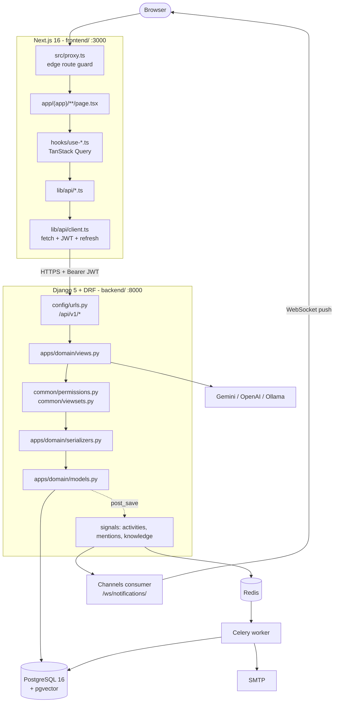

# Nexora — Internal Engineering Documentation

> **Private internal documentation.** Reverse-engineered from the source code on
> 2026-09-10 (branch `main`, commit `5ba9465`). Every claim here was checked
> against a file in this repository. Where the code could not confirm something,
> it says so explicitly.

---

## 1. What this project is

**Nexora** is a multi-tenant team workspace. A company (a *workspace*) manages
projects, tasks and documents; members hand tasks over to each other through a
formal, manager-reviewed workflow; everything is written to an audit trail; and
an AI assistant answers questions over the workspace's own documents using
retrieval-augmented generation (RAG).

The single organising idea in the whole codebase:

> **Everything belongs to a workspace.** Nearly every table has a `workspace_id`
> column, and nearly every query filters on it. That one rule explains the
> permission classes, the base viewset, the models, and most of the AI code.

---

## 2. Technology stack

Verified against `backend/requirements.txt` and `frontend/package.json`.

| Layer | Technology | Version |
|---|---|---|
| Frontend framework | Next.js (App Router) | 16.2.9 |
| UI runtime | React | 19.2.4 |
| Language | TypeScript | ^5 |
| Styling | Tailwind CSS 4 + shadcn/ui (Radix) | ^4 |
| Server state | TanStack Query | ^5.62.7 |
| Forms | react-hook-form + zod | ^7.54 / ^4.0 |
| HTTP transport | **native `fetch`** (hand-written wrapper) | no Axios |
| Backend framework | Django | 5.1.4 |
| API layer | Django REST Framework | 3.15.2 |
| Auth | djangorestframework-simplejwt | 5.3.1 |
| Database | PostgreSQL + pgvector | pg16 / pgvector 0.3.6 |
| Realtime | Django Channels + channels-redis | 4.3.2 / 4.3.0 |
| Background jobs | Celery + Redis | 5.6.3 / 8.1.0 |
| Embeddings | sentence-transformers (`all-MiniLM-L6-v2`, 384-dim) | 5.6.0 |
| LLM providers | Gemini / OpenAI / Ollama, behind one interface | — |
| PDF export | reportlab | 4.4.10 |
| API schema | drf-spectacular (OpenAPI 3) | 0.28.0 |
| ASGI server | uvicorn (daphne in dev) | 0.52.4 |
| Containers | Docker + docker compose (6 services) | — |
| CI | GitHub Actions | `.github/workflows/ci.yml` |

---

## 3. Architecture in one diagram

Full walkthrough: **[02-system-architecture.md](02-system-architecture.md)**.

---

## 4. Documentation map

### Core (read in order)

| # | File | What it answers |
|---|---|---|
| 01 | [Project overview](01-project-overview.md) | What is this, who uses it, what does it do |
| 02 | [System architecture](02-system-architecture.md) | Every layer, its inputs/outputs/dependencies |
| 03 | [Folder structure](03-folder-structure.md) | What each folder is, who depends on it |
| 04 | [Frontend architecture](04-frontend-architecture.md) | Startup, providers, hooks, API layer |
| 05 | [Backend architecture](05-backend-architecture.md) | Django app layout, the shared base classes |
| 06 | [Routing](06-routing.md) | Every URL to page to components to API calls |
| 07 | [API architecture](07-api-architecture.md) | Conventions: pagination, filtering, errors |
| 08 | [Authentication & authorization](08-authentication-authorization.md) | Login, JWT, refresh, roles, permissions |
| 09 | [Database architecture](09-database-architecture.md) | Engine, connection, ER diagram, indexes |
| 10 | [Database tables](10-database-tables.md) | Every table, column by column |
| 11 | [Data flow](11-data-flow.md) | Seven complete request traces |
| 12 | [Business modules](12-business-modules.md) | Index of the eight modules |
| 13 | [Business logic](13-business-logic.md) | Every non-CRUD rule, and where it lives |
| 14 | [Algorithms](14-algorithms.md) | Chunking, vector search, weekly buckets, slugs |
| 15 | [File uploads & integrations](15-file-uploads-integrations.md) | Upload path, SMTP, LLM providers |
| 16 | [State management](16-state-management.md) | Where every piece of state actually lives |
| 17 | [Error handling](17-error-handling.md) | Every error path, both sides |
| 18 | [Security](18-security.md) | Implemented / partial / missing |
| 19 | [Performance & scalability](19-performance-scalability.md) | Real bottlenecks found in the code |
| 20 | [Configuration & environment](20-configuration-environment.md) | Every environment variable |
| 21 | [Local development](21-local-development.md) | Setup and run commands |
| 22 | [Production deployment](22-production-deployment.md) | Docker, CI, ASGI, what is missing |
| 23 | [Troubleshooting](23-troubleshooting.md) | Symptom, cause, fix |
| 24 | [Technical decisions](24-technical-decisions.md) | Why it is built this way |
| 25 | [Known limitations](25-known-limitations.md) | Technical debt, severity-rated |
| 26 | [Testing](26-testing.md) | What is tested, what is not |

### Modules

[`modules/`](modules/) — one file per business domain:
[workspaces](modules/workspaces.md) ·
[projects & tasks](modules/projects-tasks.md) ·
[handovers](modules/handovers.md) ·
[documents & knowledge](modules/documents-knowledge.md) ·
[AI assistant](modules/ai-assistant.md) ·
[collaboration](modules/collaboration.md) ·
[activity & audit](modules/activity-audit.md) ·
[dashboard & analytics](modules/dashboard-analytics.md)

### API reference

[`api/README.md`](api/README.md) — endpoint by endpoint, with the full call chain
for each:
[authentication](api/authentication.md) ·
[workspaces](api/workspaces.md) ·
[projects & tasks](api/projects-tasks.md) ·
[handovers](api/handovers.md) ·
[documents](api/documents.md) ·
[collaboration](api/collaboration.md) ·
[AI](api/ai.md) ·
[core](api/core.md)

### Database

[schema overview](database/schema-overview.md) ·
[relationships](database/relationships.md) ·
[queries](database/queries.md)

### Interview preparation

[`interviews/README.md`](interviews/README.md) — 200+ questions derived from this
codebase, plus prepared explanations, follow-up chains, a whiteboard guide and a
memorisation sheet.

### Quick reference

- **[project-cheat-sheet.md](project-cheat-sheet.md)** — the whole system on one page
- **[learning-roadmap.md](learning-roadmap.md)** — a 10-stage study plan

---

## 5. Authentication in six lines

1. `POST /api/v1/auth/login/` returns `{access, user}` in the body and sets the
   refresh token as an **httpOnly** cookie — script can never read it.
2. The access token is held **in memory only** (`lib/auth/token-storage.ts`).
3. Every request gets `Authorization: Bearer <access>` plus
   `credentials: "include"` from `lib/api/client.ts`.
4. On a `401` the client refreshes with an *empty body* (the browser attaches
   the cookie) and retries once; concurrent 401s share one in-flight refresh.
5. `src/proxy.ts` bounces logged-out users at the edge using `nexora.session`, a
   marker cookie containing `"1"` and no secret.
6. `app/(app)/layout.tsx` is the real client gate; **DRF permissions are the
   only security boundary**.

Details: **[08-authentication-authorization.md](08-authentication-authorization.md)**.

---

## 6. Database in six lines

- One PostgreSQL database, configured from a single `DATABASE_URL`.
- **17 application tables**, all created by the Django ORM. No hand-written DDL.
- Every domain table carries `workspace_id` (the tenant boundary) plus a UUID
  `id`, `created_at`, `updated_at`, and usually `created_by` / `updated_by`.
- Comments and the activity log point at any object through a **generic foreign
  key** (`content_type` + `object_id`).
- `knowledge_documentchunk.embedding` is a **384-dimension pgvector column** with
  an HNSW cosine index.
- Plus SimpleJWT's `token_blacklist` tables and Django's own `auth` /
  `contenttypes` / `sessions` tables.

Details: **[09-database-architecture.md](09-database-architecture.md)** and
**[10-database-tables.md](10-database-tables.md)**.

---

## 7. Recommended reading order

**20 minutes** — [project-cheat-sheet.md](project-cheat-sheet.md), then
[02-system-architecture.md](02-system-architecture.md).

**One afternoon**

1. [01-project-overview.md](01-project-overview.md)
2. [02-system-architecture.md](02-system-architecture.md)
3. [03-folder-structure.md](03-folder-structure.md)
4. [08-authentication-authorization.md](08-authentication-authorization.md)
5. [11-data-flow.md](11-data-flow.md)
6. [10-database-tables.md](10-database-tables.md)
7. [modules/handovers.md](modules/handovers.md)
8. [interviews/project-explanation.md](interviews/project-explanation.md)

**Interview tomorrow** — [interviews/memorize.md](interviews/memorize.md), then
[interviews/project-explanation.md](interviews/project-explanation.md), then
[interviews/difficult-followups.md](interviews/difficult-followups.md), then
[25-known-limitations.md](25-known-limitations.md).

---

## 8. Ground rules used when writing this

- **Implementation wins over prose.** Where the root `README.md` and the code
  disagree, this documentation follows the code and flags the difference.
- Known discrepancies are collected in
  [25-known-limitations.md](25-known-limitations.md).
- No secret values appear anywhere in `docs/`. Variable *names* are documented;
  values are shown as `<hidden>`.
- Anything not provable from the source is marked
  *"Not confirmed from the current codebase."*

### Pre-existing files in this folder

`docs/codebase-walkthrough.html` and `docs/schema.svg` existed before this
documentation package was written and were left untouched. Their content has not
been verified against the current code.
