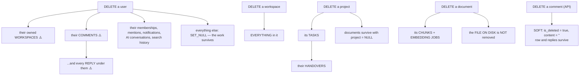

# Database — Relationships

[← Schema overview](schema-overview.md) · [Table detail](../10-database-tables.md)
· [Docs index](../README.md)

Every foreign key in the application schema, its cardinality, its `on_delete`
behaviour, and why.

---

## 1. Full ER diagram

```mermaid
erDiagram
    ACCOUNTS_USER ||--o{ WORKSPACES_WORKSPACEMEMBER : "user"
    WORKSPACES_WORKSPACE ||--o{ WORKSPACES_WORKSPACEMEMBER : "members"
    ACCOUNTS_USER ||--o{ WORKSPACES_WORKSPACE : "owned_workspaces"
    WORKSPACES_WORKSPACE ||--o{ INVITATIONS_INVITATION : "invitations"
    ACCOUNTS_USER ||--o{ INVITATIONS_INVITATION : "sent_invitations"

    WORKSPACES_WORKSPACE ||--o{ PROJECTS_PROJECT : "projects"
    PROJECTS_PROJECT ||--o{ TASKS_TASK : "tasks"
    WORKSPACES_WORKSPACE ||--o{ TASKS_TASK : "tasks"
    ACCOUNTS_USER ||--o{ TASKS_TASK : "assigned_tasks"
    ACCOUNTS_USER ||--o{ TASKS_TASK : "reported_tasks"

    WORKSPACES_WORKSPACE ||--o{ DOCUMENTS_DOCUMENT : "documents"
    PROJECTS_PROJECT ||--o{ DOCUMENTS_DOCUMENT : "documents"
    ACCOUNTS_USER ||--o{ DOCUMENTS_DOCUMENT : "uploaded_documents"

    TASKS_TASK ||--o{ HANDOVERS_HANDOVER : "handovers"
    WORKSPACES_WORKSPACE ||--o{ HANDOVERS_HANDOVER : "handovers"
    ACCOUNTS_USER ||--o{ HANDOVERS_HANDOVER : "handovers_sent"
    ACCOUNTS_USER ||--o{ HANDOVERS_HANDOVER : "handovers_received"
    ACCOUNTS_USER ||--o{ HANDOVERS_HANDOVER : "handovers_reviewed"

    WORKSPACES_WORKSPACE ||--o{ COMMENTS_COMMENT : "comments"
    ACCOUNTS_USER ||--o{ COMMENTS_COMMENT : "comments"
    COMMENTS_COMMENT ||--o{ COMMENTS_COMMENT : "replies"
    COMMENTS_COMMENT ||--o{ MENTIONS_MENTION : "mentions"
    ACCOUNTS_USER ||--o{ MENTIONS_MENTION : "mentions_received"
    WORKSPACES_WORKSPACE ||--o{ MENTIONS_MENTION : "mentions"

    ACCOUNTS_USER ||--o{ NOTIFICATIONS_NOTIFICATION : "notifications"
    WORKSPACES_WORKSPACE ||--o{ NOTIFICATIONS_NOTIFICATION : "notifications"
    WORKSPACES_WORKSPACE ||--o{ ACTIVITIES_ACTIVITY : "activities"
    ACCOUNTS_USER ||--o{ ACTIVITIES_ACTIVITY : "actor"

    DOCUMENTS_DOCUMENT ||--o{ KNOWLEDGE_DOCUMENTCHUNK : "chunks"
    WORKSPACES_WORKSPACE ||--o{ KNOWLEDGE_DOCUMENTCHUNK : "document_chunks"
    DOCUMENTS_DOCUMENT ||--o{ KNOWLEDGE_EMBEDDINGJOB : "embedding_jobs"

    WORKSPACES_WORKSPACE ||--o{ AI_AICONVERSATION : "aiconversations"
    ACCOUNTS_USER ||--o{ AI_AICONVERSATION : "ai_conversations"
    AI_AICONVERSATION ||--o{ AI_AIMESSAGE : "messages"
    WORKSPACES_WORKSPACE ||--|| AI_AISETTINGS : "ai_settings"
    WORKSPACES_WORKSPACE ||--o{ AI_SEARCHHISTORY : "search_history"
    ACCOUNTS_USER ||--o{ AI_SEARCHHISTORY : "ai_search_history"
    WORKSPACES_WORKSPACE ||--o{ AI_PROMPTTEMPLATE : "prompttemplates"
```



Not shown (the notation cannot express them): the **generic** relations from
`comments_comment` and `activities_activity` to any of project / task / document
/ handover / comment / workspace.

---

## 2. Every foreign key

### From `accounts_user`

| Table.column | on_delete | `related_name` | Note |
|---|---|---|---|
| `workspaces_workspace.owner_id` | **CASCADE** | `owned_workspaces` | ⚠️ deleting a user destroys their workspaces |
| `workspaces_workspacemember.user_id` | CASCADE | `workspace_memberships` | |
| `invitations_invitation.invited_by_id` | CASCADE | `sent_invitations` | |
| `projects_project.owner_id` | SET_NULL | `owned_projects` | |
| `tasks_task.assignee_id` | SET_NULL | `assigned_tasks` | |
| `tasks_task.reporter_id` | SET_NULL | `reported_tasks` | |
| `documents_document.uploaded_by_id` | SET_NULL | `uploaded_documents` | |
| `handovers_handover.from_user_id` | SET_NULL | `handovers_sent` | |
| `handovers_handover.to_user_id` | SET_NULL | `handovers_received` | |
| `handovers_handover.reviewer_id` | SET_NULL | `handovers_reviewed` | |
| `comments_comment.author_id` | **CASCADE** | `comments` | ⚠️ inconsistent with the rest |
| `mentions_mention.mentioned_user_id` | CASCADE | `mentions_received` | |
| `notifications_notification.recipient_id` | CASCADE | `notifications` | |
| `notifications_notification.actor_id` | SET_NULL | `+` | |
| `activities_activity.actor_id` | SET_NULL | `+` | |
| `ai_aiconversation.user_id` | CASCADE | `ai_conversations` | |
| `ai_searchhistory.user_id` | CASCADE | `ai_search_history` | |
| every `AuditModel.created_by_id` / `updated_by_id` | SET_NULL | `+` | |

### From `workspaces_workspace`

**All CASCADE.** Deleting a workspace removes every child:
`workspacemember`, `invitation`, `project`, `task`, `document`, `handover`,
`comment`, `mention`, `notification`, `activity`, `documentchunk`,
`embeddingjob`, `aiconversation`, `aisettings`, `searchhistory`,
`prompttemplate`.

### Other

| Relationship | on_delete | Why |
|---|---|---|
| `tasks_task.project_id` → project | CASCADE | A task cannot exist without its project |
| `documents_document.project_id` → project | **SET_NULL** | A document can be workspace-level |
| `handovers_handover.task_id` → task | CASCADE | A handover has no meaning without its task |
| `comments_comment.parent_id` → comment | CASCADE | Deleting a comment removes its replies (though API delete is soft) |
| `mentions_mention.comment_id` → comment | CASCADE | |
| `knowledge_documentchunk.document_id` → document | CASCADE | Vectors die with the document |
| `knowledge_embeddingjob.document_id` → document | CASCADE | |
| `ai_aimessage.conversation_id` → conversation | CASCADE | |
| `ai_aisettings.workspace_id` | CASCADE, **OneToOne** | One config per workspace |
| `comments_comment.content_type_id` → ContentType | CASCADE | Django default |
| `activities_activity.content_type_id` → ContentType | **SET_NULL** | Keeps the audit row when a content type disappears |

---

## 3. Delete cascade map



### The two problems

**`Workspace.owner` is CASCADE.** Deleting one user destroys every workspace they
own and all its content — projects, tasks, documents, handovers, comments,
embeddings. There is no ownership-orphan path and no "block deletion if you own
workspaces" check.

**`Comment.author` is CASCADE**, while every other user reference on a content
table is `SET_NULL`. Deleting a user erases their comments **and**, via the
`parent` cascade, other people's replies underneath them. The serializer already
tolerates a null-ish author shape, so `SET_NULL` would be the consistent choice.

Both are logged in [25-known-limitations.md](../25-known-limitations.md).

---

## 4. The generic relations

Two tables point at *any* model:

```python
content_type = models.ForeignKey(ContentType, on_delete=...)
object_id    = models.UUIDField()
target       = GenericForeignKey("content_type", "object_id")
```

| Table | Points at | Constrained by | `object_id` nullable? |
|---|---|---|---|
| `comments_comment` | project, task, document | `ALLOWED_TARGETS` whitelist in the serializer | No |
| `activities_activity` | project, task, document, handover, comment, workspace | whatever the signal handlers register | **Yes — null for deletes** |

`object_id` is a `UUIDField` rather than the usual `PositiveIntegerField`, because
every domain model uses UUID primary keys
(`apps/comments/models.py:38-39`).

**The cost:** PostgreSQL cannot enforce that `object_id` points at a live row.
Delete a task by raw SQL and its comments become orphans pointing at nothing.
Django's cascade does not follow generic relations — only the **workspace**
cascade cleans them up.

On the comments side, the whitelist bounds the damage: `target_type` can only name
one of three known models.

---

## 5. Self-referential threading

```python
parent = models.ForeignKey("self", on_delete=CASCADE, null=True, blank=True,
                           related_name="replies")
```

- `parent IS NULL` → a top-level comment.
- `parent` set → a reply, which **inherits the parent's workspace, content_type
  and object_id** (`views.py:64-71`).
- Nothing limits nesting depth. The API allows a reply to a reply to a reply.
  *Whether the UI renders arbitrary depth is not confirmed — that would need
  reading `comment-item.tsx` in full.*
- Soft delete exists precisely so a deleted parent does not take its replies with
  it.

---

## 6. Denormalisation, and why

Three columns are stored redundantly. Each has a stated reason.

| Column | Duplicates | Reason (from the code) |
|---|---|---|
| `knowledge_documentchunk.workspace_id` | `document.workspace_id` | *"so the tenant boundary can be enforced with a single indexed filter on similarity queries — the hot path for semantic search"* |
| `mentions_mention.workspace_id` | `comment.workspace_id` | *"for cheap 'my mentions in workspace X' reads"* |
| `notifications_notification.title` / `link` | derivable from the target | A notification records what was true when it happened; rendering the feed needs no joins |

The first is the important one. Without it, every vector search would join
through `documents_document` — turning a single indexed filter into a join on the
hottest query in the system.

---

## 7. The tenancy join

Almost every query in the backend contains this shape:

```python
.filter(workspace__members__user=self.request.user).distinct()
```

which becomes:

```sql
SELECT ... FROM <table> t
JOIN workspaces_workspace w  ON t.workspace_id = w.id
JOIN workspaces_workspacemember m ON m.workspace_id = w.id
WHERE m.user_id = %s
```

`DISTINCT` is required because the join can duplicate rows when a user somehow
has multiple membership rows — which the unique constraint prevents, but the ORM
cannot know that.

**The alternative** (a subquery, no `DISTINCT`) is discussed in
[19-performance-scalability.md](../19-performance-scalability.md#-28-distinct-on-every-scoped-queryset).

---

## 8. Cardinality quick reference

| Relationship | Cardinality |
|---|---|
| User ↔ Workspace | many-to-many **through** `WorkspaceMember` (which carries `role`) |
| Workspace → Project | 1:N |
| Project → Task | 1:N |
| Task → Handover | 1:N (**not** 1:1 — nothing prevents multiple pending handovers) |
| Workspace → Document | 1:N |
| Project → Document | 1:N, optional |
| Document → DocumentChunk | 1:N |
| Document → EmbeddingJob | 1:N (one per index run) |
| Comment → Comment | 1:N self-referential |
| Comment → Mention | 1:N, unique per mentioned user |
| Workspace → AISettings | **1:1** |
| AIConversation → AIMessage | 1:N |

The `WorkspaceMember` through-table is the classic "many-to-many with extra
data" pattern — the role has to live on the relationship, not on either side.

---

## 9. Reverse accessors you will use

```python
workspace.members          workspace.projects        workspace.tasks
workspace.documents        workspace.handovers       workspace.comments
workspace.activities       workspace.notifications   workspace.invitations
workspace.document_chunks  workspace.embedding_jobs  workspace.ai_settings
project.tasks              project.documents
task.handovers
document.chunks            document.embedding_jobs
comment.replies            comment.mentions
conversation.messages
user.workspace_memberships user.owned_workspaces     user.assigned_tasks
user.reported_tasks        user.handovers_sent       user.handovers_received
user.handovers_reviewed    user.comments             user.notifications
user.mentions_received     user.ai_conversations
```

`workspace.projects`, `.tasks`, `.documents`, `.handovers`, `.aiconversations`
and `.prompttemplates` are generated automatically by
`related_name="%(class)ss"` on `WorkspaceScopedModel`.

**`created_by` and `updated_by` have no reverse accessor** — `related_name="+"`
disables it, so `user.project_set` does not exist. That is deliberate: a dozen
models share those FKs and would otherwise clash.
