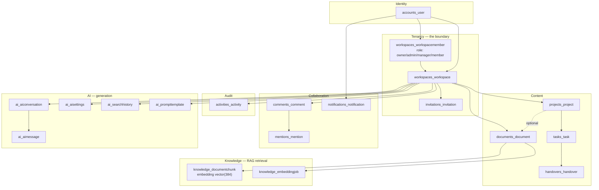

# Database — Schema Overview

[← Docs index](../README.md) · [Architecture](../09-database-architecture.md) ·
[Table detail](../10-database-tables.md) · [Relationships](relationships.md) ·
[Queries](queries.md)

---

## 1. At a glance

| | |
|---|---|
| Engine | PostgreSQL 16 |
| Extension | `vector` (pgvector), created by a migration operation |
| Application tables | 19 |
| Framework tables | ~10 (auth, contenttypes, sessions, admin, migrations, JWT blacklist) |
| Primary keys | UUID v4 on every application table |
| Raw SQL | **none** — verified: no `.raw(`, no `cursor.execute` outside the health check |
| Views / procedures / triggers | **none** |
| Migrations | Django, one initial per app plus a few alters |

---

## 2. Schema map



---

## 3. Naming and shape conventions

**Table names** are Django's default `<app_label>_<modelname>`, all lowercase, no
underscore inside the model name: `workspaces_workspacemember`,
`knowledge_documentchunk`, `ai_aiconversation`.

The one explicit override is `accounts_user`
(`apps/accounts/models.py:65`) — pinned so a future app rename cannot move the
table.

**Every application table has:**

| Column | Type | From |
|---|---|---|
| `id` | `uuid` PK, default generated in Python | `UUIDModel` |
| `created_at` | `timestamptz`, `auto_now_add` | `TimeStampedModel` |
| `updated_at` | `timestamptz`, `auto_now` | `TimeStampedModel` |

**Most have:**

| Column | From |
|---|---|
| `created_by_id`, `updated_by_id` | `AuditModel` |
| `workspace_id` | `WorkspaceScopedModel`, or declared directly |

**Default ordering is `-created_at`** everywhere, with three deliberate
exceptions:

| Table | Ordering | Why |
|---|---|---|
| `comments_comment` | `created_at` **ascending** | A thread reads oldest-first |
| `ai_aimessage` | `created_at` ascending | Same |
| `ai_aiconversation` | `-updated_at` | Most recently used thread first |
| `ai_prompttemplate` | `name` | Alphabetical library |
| `workspaces_workspacemember` | `joined_at` | Join order |
| `knowledge_documentchunk` | `document`, `chunk_index` | Document order |

---

## 4. The abstract base hierarchy

```
models.Model
├── TimeStampedModel        created_at, updated_at        (abstract)
├── UUIDModel               id: UUID pk                   (abstract)
└── BaseModel(UUIDModel, TimeStampedModel)                (abstract)
    └── AuditModel          + created_by, updated_by      (abstract)
        └── WorkspaceScopedModel  + workspace             (abstract)
```

`backend/apps/common/models.py`. All four are `abstract = True` — they create no
tables of their own.

| Base | Concrete models |
|---|---|
| `WorkspaceScopedModel` | `Project`, `Task`, `Document`, `Handover`, `AIConversation`, `PromptTemplate` |
| `BaseModel` + own `workspace` FK | `Comment`, `Mention`, `Activity`, `Notification`, `Invitation`, `DocumentChunk`, `EmbeddingJob`, `SearchHistory` |
| `BaseModel`, no workspace | `Workspace`, `WorkspaceMember`, `AIMessage` |
| `BaseModel` + OneToOne workspace | `AISettings` |
| `AbstractUser` | `User` |

The middle row is a deliberate choice: those models declare `workspace`
themselves because they do not want the `created_by`/`updated_by` audit columns.

Two `related_name` tricks worth knowing:

```python
created_by = models.ForeignKey(..., related_name="+")     # disables the reverse accessor
workspace  = models.ForeignKey(..., related_name="%(class)ss")   # workspace.projects, .tasks, ...
```

The first lets a dozen models share FKs to `User` without name clashes; the
second auto-names the reverse relation per concrete model.

---

## 5. Constraints

### Unique

| Name | Table | Fields |
|---|---|---|
| (implicit) | `accounts_user` | `email` |
| (implicit) | `workspaces_workspace` | `slug` — **globally** |
| `unique_workspace_member` | `workspaces_workspacemember` | `(workspace, user)` |
| `unique_project_slug_per_workspace` | `projects_project` | `(workspace, slug)` — **per tenant** |
| `unique_comment_mention` | `mentions_mention` | `(comment, mentioned_user)` |
| `unique_document_chunk_index` | `knowledge_documentchunk` | `(document, chunk_index)` |
| (implicit) | `invitations_invitation` | `token` |
| (implicit) | `ai_aisettings` | `workspace` (OneToOne) |

The workspace/project slug contrast is worth noticing: workspace slugs must be
globally unique because they are the top-level namespace; project slugs only need
to be unique within their tenant, which is the multi-tenant-correct choice.

### Check constraints

**None.** All enum validation is Django `TextChoices` — enforced by the ORM and
the serializer, **not by the database**. A direct `psql` UPDATE could write
`status = 'banana'` into `tasks_task`.

### Not-null

Django's defaults. Notably `Handover.summary` is `TextField` with no `blank=True`
and no default, so it is genuinely required.

---

## 6. Indexes

Beyond the automatic PK and FK indexes:

| Table | Index | Query it serves |
|---|---|---|
| `tasks_task` | `(workspace, status)` | Dashboard counts, status filters |
| `tasks_task` | `(project, status)` | Project detail task lists |
| `handovers_handover` | `(workspace, status)` | `/handovers/reviews` |
| `handovers_handover` | `(task, status)` | "Any pending handover on this task?" |
| `comments_comment` | `(content_type, object_id)` | Loading a thread |
| `comments_comment` | `(workspace, created_at)` | Workspace-wide ordering |
| `activities_activity` | `(workspace, created_at)` | Audit log default view |
| `activities_activity` | `(content_type, object_id)` | Per-object timeline |
| `notifications_notification` | `(recipient, is_read)` | Unread badge |
| `invitations_invitation` | `(workspace, status)` | Pending invites |
| `knowledge_documentchunk` | `(workspace)` | Tenant filter before the vector scan |
| `knowledge_documentchunk` | **HNSW** `(embedding)` `vector_cosine_ops` `m=16` `ef_construction=64` | Semantic search |
| `knowledge_embeddingjob` | `(document, -created_at)` | "Latest job for this document" |
| `ai_aiconversation` | `(workspace, user, -updated_at)` | Conversation list |
| `ai_aimessage` | `(conversation, created_at)` | Thread rendering |
| `ai_searchhistory` | `(workspace, user, -created_at)` | Recent queries |
| `ai_prompttemplate` | `(workspace, category)` | Template filter |

Every one maps to a query that exists in the code — this is not speculative
indexing.

**Missing:** `projects_project(workspace, status, archived)` and
`documents_document(workspace, project)`, both of which are filtered that way.
Low impact at current sizes.

---

## 7. Special column types

| Column | Type | Notes |
|---|---|---|
| `knowledge_documentchunk.embedding` | `vector(384)` | Nullable so a chunk can exist pre-embedding. Dimension is **baked in at migration time** |
| `tasks_task.labels` | `jsonb` | String list. Not queried with JSON operators anywhere — so no GIN index, and **not filterable** |
| `activities_activity.metadata` | `jsonb` | Human-readable snapshot |
| `knowledge_documentchunk.metadata` | `jsonb` | `{"title": ...}` |
| `ai_aimessage.sources` | `jsonb` | The cited chunks |
| `ai_aimessage.metadata` | `jsonb` | confidence, top_score, model |
| `comments_comment.object_id` | `uuid` | Generic FK — a UUID, not the usual integer, because every model uses UUID PKs |
| `activities_activity.object_id` | `uuid`, nullable | Null for delete rows |
| `documents_document.file` | `varchar(100)` | A **path**, not the bytes |

---

## 8. Migration inventory

| App | Migrations |
|---|---|
| `accounts` | `0001_initial` |
| `workspaces` | `0001_initial`, `0002_alter_workspacemember_role` |
| `projects`, `tasks`, `handovers`, `comments`, `mentions`, `activities` | `0001_initial` |
| `documents` | `0001_initial`, `0002_initial` |
| `invitations` | `0001_initial`, `0002_alter_invitation_role` |
| `notifications` | `0001_initial`, `0002_alter_notification_type` |
| `knowledge` | `0001_initial` — **includes `VectorExtension()`** |
| `ai` | `0001_initial`, `0002_bump_retired_gemini_model` |
| `common`, `core` | `__init__.py` only — no tables |

The three `0002_alter_*` migrations are enum additions (a role, an invitation
role, a notification type). `ai/0002_bump_retired_gemini_model` is a data
migration updating a model name that the provider retired.

**CI enforces migration completeness:**

```bash
python manage.py makemigrations --check --dry-run
```

A model change without its migration fails the build.

---

## 9. Transactions

`ATOMIC_REQUESTS` is **not** enabled — verified. Each request runs in autocommit,
with four explicit transactions:

| Location | Why |
|---|---|
| `WorkspaceViewSet.perform_create` | Workspace + owner membership must land together |
| `WorkspaceViewSet.transfer_ownership` | Three role/owner writes must not half-apply |
| `processor._store_chunks` | Delete-then-bulk-insert must be atomic on re-index |
| (three `on_commit` hooks) | Ordering between the DB and Celery/websockets, not atomicity |

**Notably missing:** `HandoverViewSet.review` performs two saves — the handover
and the task — with no transaction. A crash between them leaves an approved
handover and an unassigned task.

---

## 10. What the database does NOT enforce

Worth knowing before an interview:

| Rule | Enforced where instead |
|---|---|
| Enum validity (`status`, `priority`, `role`) | Django `TextChoices` + serializers |
| A task's workspace matching its project's | `TaskSerializer.validate` |
| An assignee being a workspace member | `TaskSerializer._resolve_member` |
| Only one pending handover per task | **Nowhere** — this is a gap |
| Comment targets being one of three models | `ALLOWED_TARGETS` whitelist |
| `activities_activity` being append-only | Convention only — nothing revokes UPDATE/DELETE |
| Generic FK `object_id` pointing at a live row | Nothing — the cost of generic relations |

Everything in the left column is application-level. A direct database write
bypasses all of it — which is also why the audit log misses non-ORM writes.
