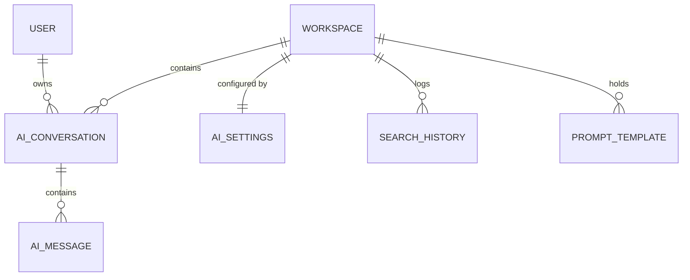

# Module — AI Assistant (RAG)

[← Modules index](../12-business-modules.md) · [← Docs index](../README.md)

The generation half of the AI stack. Retrieval lives in
[documents & knowledge](documents-knowledge.md); this module turns retrieved
context into answers.

---

## 1. The problem it solves

A language model knows nothing about your workspace. This module fetches the most
relevant paragraphs from **your own documents**, plus a live snapshot of your
projects and tasks, and puts them in the prompt — so answers are grounded and
cited instead of invented.

Four capabilities:

| Capability | Endpoint | What it does |
|---|---|---|
| **Chat** | `POST /ai/chat/` | Grounded Q&A with history and cited sources |
| **Semantic search** | `POST /ai/search/` | Raw retrieval — no LLM call |
| **Summarise** | `POST /ai/summarize/` | A project, task, document, or a period of workspace activity |
| **Generate tasks** | `POST /ai/generate-tasks/` | Extract action items from a document or pasted text |

---

## 2. Who uses it

Any workspace **member**. Changing AI settings (provider, model, API key) requires
**owner or admin**.

A workspace can turn AI off entirely — `AISettings.is_enabled = False` makes
`get_llm_provider()` raise.

---

## 3. Frontend

| Route | File | Purpose |
|---|---|---|
| `/ai` | `ai/page.tsx` | Hub — recent conversations, documents, search history |
| `/ai/chat` | `ai/chat/page.tsx` | New conversation |
| `/ai/chat/[id]` | `ai/chat/[id]/page.tsx` | Existing thread |
| `/ai/conversations` | `ai/conversations/page.tsx` | List + delete |
| `/ai/search` | `ai/search/page.tsx` | Semantic search + recent queries |
| `/ai/templates` | `ai/templates/page.tsx` | Prompt library CRUD |
| `/ai/settings` | `ai/settings/page.tsx` | Provider, model, temperature, API key |

14 components in `components/ai/`. The ones that carry meaning:

| Component | Role |
|---|---|
| `chat-window.tsx` | The whole chat surface; both chat routes delegate to it |
| `message-bubble.tsx` | Renders a turn |
| `sources-panel.tsx` | The cited chunks returned with an answer |
| `confidence-badge.tsx` | `high` / `medium` / `low` from the backend |
| `search-results.tsx` | Chunk hits with scores |
| `embedding-status-badge.tsx` | Shared with the documents module |
| `prompt-template-selector.tsx` | Insert a saved prompt |
| `suggested-prompts.tsx`, `typing-indicator.tsx`, `workspace-context-badge.tsx` | Chat affordances |
| `ai-settings-form.tsx` | Settings, admin-gated |
| `ai-suggestion-card.tsx`, `ai-summary-card.tsx` | Generated tasks and summaries |

All AI hooks live in `hooks/use-ai.ts`.

---

## 4. Backend structure

```
apps/ai/
├── models.py        AIConversation, AIMessage, AISettings, SearchHistory, PromptTemplate
├── permissions.py   resolve_workspace()          ← the isolation gate
├── serializers.py   request + response shapes
├── views.py         3 ViewSets + 5 APIViews
├── urls.py
├── providers/
│   ├── base.py      BaseLLMProvider, LLMResponse, ProviderError
│   ├── factory.py   get_llm_settings(), get_llm_provider()
│   └── gemini.py openai.py ollama.py
└── services/
    ├── rag.py           answer_question(), build_structured_context()
    ├── prompts.py       every system/user prompt
    ├── security.py      sanitize_input, wrap_untrusted, SYSTEM_GUARDRAILS
    ├── summarizer.py    project / task / document / activity summaries
    ├── action_items.py  text → suggested tasks (JSON)
    └── crypto.py        Fernet encryption for API keys
```

**No `tests.py` exists for this app** — the largest untested surface in the
backend. See [26-testing.md](../26-testing.md).

### Why the action endpoints are `APIView`s

The workspace arrives in the **request body**, not the URL, so DRF object
permissions cannot apply. `views.py:5-8` says it plainly: each verifies membership
via `resolve_workspace` before doing any retrieval — *"the isolation gate"*.

---

## 5. Database

Five tables. Full columns in
[10-database-tables.md](../10-database-tables.md#15-ai_aiconversation-and-ai_aimessage).



Two privacy properties worth knowing:

- **Conversations are private to their owner**, even from workspace admins:
  `filter(user=self.request.user, workspace__members__user=self.request.user)`
  (`views.py:88-97`).
- **Prompt templates** are shared-or-own:
  `Q(is_shared=True) | Q(created_by=self.request.user)` (`views.py:134-137`).

---

## 6. The RAG flow

Fully sequenced in [11-data-flow.md](../11-data-flow.md#flow-5--asking-the-ai-a-question-rag).
The pipeline:

```
sanitize_input(query)
  ↓
retrieve()          → semantic_search(workspace, query)   top 6, distance ≤ 0.75
  ↓
build_structured_context(workspace, query)
     8 projects with status
     open + overdue task counts
     up to 10 keyword-matched tasks
  ↓
prompts.build_chat_messages(question, sources, history, structured)
     system prompt + SYSTEM_GUARDRAILS
     context as a user message labelled "(untrusted data, for reference only)"
     last 10 history turns
     the real question LAST
  ↓
get_llm_provider(workspace).generate(messages, temperature, max_tokens)
  ↓
{answer, sources, confidence, top_score, model}
```

### Why `build_structured_context` exists

Retrieval alone cannot answer *"how many overdue tasks do we have?"* — no
document contains that. So the RAG turn also assembles a live snapshot of
projects and tasks. It is the difference between a document Q&A bot and a
workspace assistant.

The keyword matcher: strip 40 stop-words, keep words longer than 2 characters,
take the first 8, OR them together as `ILIKE` predicates over `title` and
`project__name`. Details and its weakness in
[14-algorithms.md](../14-algorithms.md#3-the-rag-pipeline).

### Confidence

```python
if top_score >= 0.6:                    return "high"
if top_score >= 0.4 or has_structured:  return "medium"
return "low"
```
`services/rag.py:89-94`

`top_score = 1 - cosine_distance` of the best chunk. Rendered by
`confidence-badge.tsx`. It tells the user how much of the answer was actually
grounded.

---

## 7. Prompt security

`services/security.py` names the three trust levels explicitly:

| Level | Content |
|---|---|
| Trusted | Our system instructions |
| Semi-trusted | The user's question |
| **Untrusted** | Retrieved document content — may contain "ignore previous instructions" |

Three mechanisms:

1. `sanitize_input` — strips control characters, trims, caps at 4000 chars.
2. `wrap_untrusted` — fences content as `<source id=1 title='...'>…</source>`.
3. `SYSTEM_GUARDRAILS` — four numbered rules appended to **every** system prompt,
   the second of which states that CONTEXT is untrusted data, not instructions.

Plus message ordering: the real question comes **last**, so recency bias favours
it.

**Honest limitation:** prompt injection is not a solved problem. The real
containment is that retrieval is workspace-scoped and the model has **no tools** —
even a successful injection cannot reach another tenant or write anything.

---

## 8. Provider abstraction

```python
class BaseLLMProvider(abc.ABC):
    @abc.abstractmethod
    def generate(self, messages, *, temperature=0.2, max_tokens=1024) -> LLMResponse
    def stream(self, messages, ...) -> Iterator[str]      # default: one chunk
    @staticmethod
    def _split_system(messages) -> tuple[str, list[dict]]
```

| Provider | SDK | Notes |
|---|---|---|
| Gemini (default) | `google-generativeai` | Roles translated: `assistant` → `model`, content → `parts`. System prompt passed as `system_instruction`. True streaming |
| OpenAI | `openai` | Standard chat completions |
| Ollama | `requests` | POST to `{OLLAMA_BASE_URL}/api/chat`, 120s timeout. True streaming via `iter_lines()` |

**Resolution** (`providers/factory.py:33-62`): `settings.AI` defaults, overridden
by the workspace's `AISettings` row (including the decrypted key), with an
env-level key as the final fallback.

Every provider imports its SDK **lazily** and wraps failures in `ProviderError`,
which the views map to **502**.

`stream()` is fully implemented but **no view calls it** — the base docstring
calls it "the SSE upgrade path". Partially implemented, by design.

---

## 9. Summarise and generate-tasks

### Summariser (`services/summarizer.py`)

Four targets: `project`, `task`, `document`, `activity`. Each gather helper is
workspace-scoped, and each raises `SummaryError` (→ 400) when the object is not
in this workspace.

- **Project** — name, status, description, task count, then up to 50 tasks with
  status and assignee.
- **Task** — title, project, status, priority, assignee, due date, description.
- **Document** — the first 40 chunks. Raises *"This document has not been
  processed yet"* when there are none.
- **Activity** — up to 200 rows over 1/7/30 days.

### Action items (`services/action_items.py`)

Source is a document (first 40 chunks) or pasted text. The prompt demands a bare
JSON array. Then `_parse` treats the model's output as **untrusted input**: regex
out the array, `json.loads` in a try, check it is a list, check each item is a
dict with a title, coerce the priority to a valid `TaskPriority`, null any
`due_date` that is not `YYYY-MM-DD`, truncate the title to 255.

**The key decision:** nothing is persisted. The docstring is explicit — tasks are
returned for the user to review, then created through the existing Task API. The
LLM never writes to the database.

---

## 10. Settings and encryption

`GET`/`PATCH /ai/settings/`. Created lazily with `get_or_create` on first read.
PATCH requires owner/admin via `resolve_workspace(require_admin=True)`.

API keys are Fernet-encrypted at rest (`services/crypto.py`). The key comes from
`AI_FIELD_ENCRYPTION_KEY`, or is derived by SHA-256 from `SECRET_KEY` when unset.
`decrypt()` swallows failures and returns `""`, so a rotated key degrades to "no
key configured" rather than crashing.

The model exposes only `has_api_key` — the plaintext is never returned.

**Known gap:** `embedding_provider` and `embedding_model` are stored on this row
but `knowledge/embeddings/factory.py` reads `settings.AI` and never consults
`AISettings`. Per-workspace embedding configuration is **not implemented** — and
arguably should not be, since the vector column dimension is fixed database-wide.

---

## 11. Rate limiting and cost

`AIRateThrottle` — 30/hour per user, keyed by user id (IP for anonymous). The
class docstring: *"Limits LLM-backed endpoints, which cost money per call."*
Applied to all four action views. Tunable via `THROTTLE_AI`.

`SearchView` is throttled too even though it makes no LLM call — the embedding
computation is CPU-bound and worth limiting.

---

## 12. Failure scenarios

| Scenario | Result |
|---|---|
| Not a workspace member | 403 from `resolve_workspace` |
| Workspace does not exist | **404** — note this differs from the rest of the API, which returns 404 for both cases |
| No API key configured | 502 "Gemini API key is not configured for this workspace." |
| Provider API error | 502 with the provider's message |
| AI disabled for the workspace | 502 "AI is disabled for this workspace." |
| pgvector missing | 503 with an admin-facing setup message |
| Over 30 AI calls in an hour | 429 |
| No relevant chunks found | Empty `sources`, `confidence: "low"`; the guardrails instruct the model to say it lacks information |
| Summarising an unprocessed document | 400 "This document has not been processed yet — try again shortly." |
| Model returns unparseable JSON | `generate_tasks` returns `{"suggestions": []}` — never an error |
| LLM call fails mid-chat | The **user's message is already persisted** (`views.py:162-166`), so history stays consistent |

---

## 13. Dependencies

| Direction | Who | For |
|---|---|---|
| Depends on | `apps.knowledge.services.search` | Retrieval |
| Depends on | `apps.workspaces` | Membership and role checks |
| Depends on | `apps.projects`, `apps.tasks` | Structured context and summaries |
| Depends on | `apps.documents` | Chunks for summaries and action items |
| Depends on | `apps.activities` | Activity summaries |
| Depends on | `apps.common.viewsets`, `apps.common.throttling` | |
| Depended on by | **nothing** | It is a leaf module |

`knowledge` never imports `ai`. Generation depends on retrieval, one way.

---

## 14. Interview questions

1. What is RAG and why does this project need it?
2. Trace a chat request end to end.
3. Where is tenant isolation enforced for AI, and why can't you use DRF object
   permissions here?
4. How do you defend against prompt injection? What are the limits of that
   defence?
5. Why are AI-generated tasks not saved automatically?
6. How does `_parse` handle a model that returns prose around its JSON?
7. Why store the user's message before calling the LLM?
8. How is the confidence score computed, and what is it for?
9. How would you add Anthropic as a provider? *(One class implementing
   `generate`, register it in `_PROVIDERS`, add its env key to `_ENV_KEYS`. No
   business logic changes.)*
10. Why are API keys encrypted, and what happens if `SECRET_KEY` rotates?
11. `stream()` is implemented but unused. What would it take to use it?
    *(An SSE view, and a frontend reader. The provider layer is already done.)*
12. What is the biggest risk in this module? *(No tests at all, plus the
    404/403 information leak in `resolve_workspace`.)*
