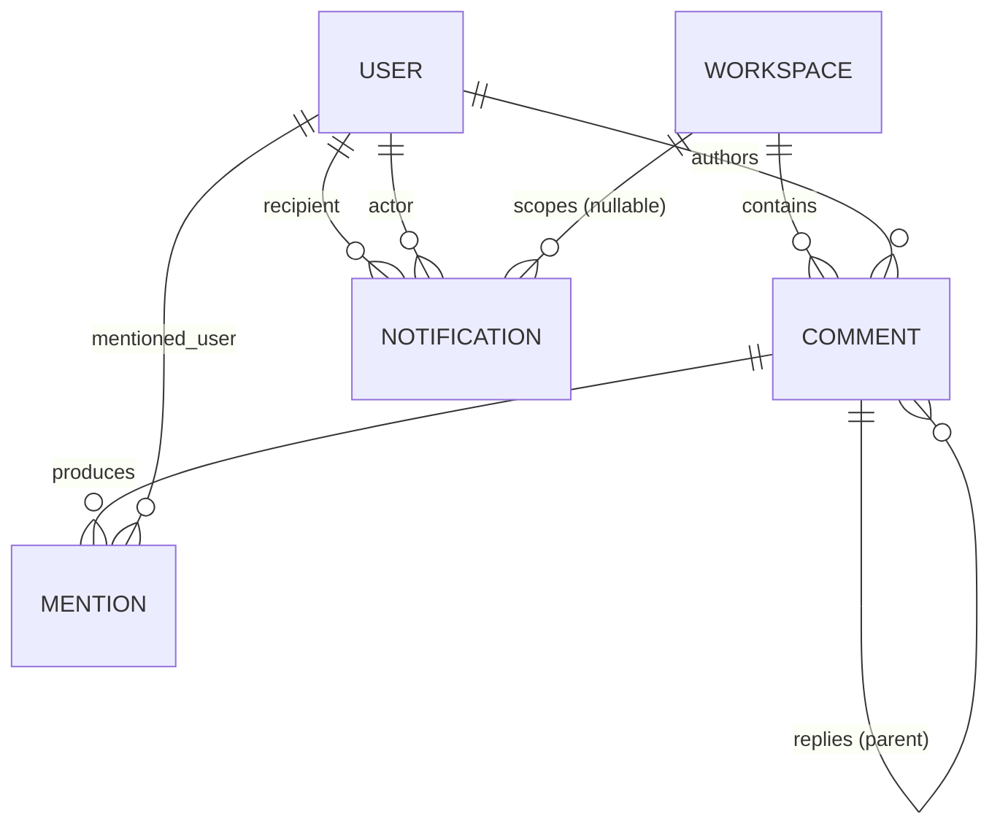
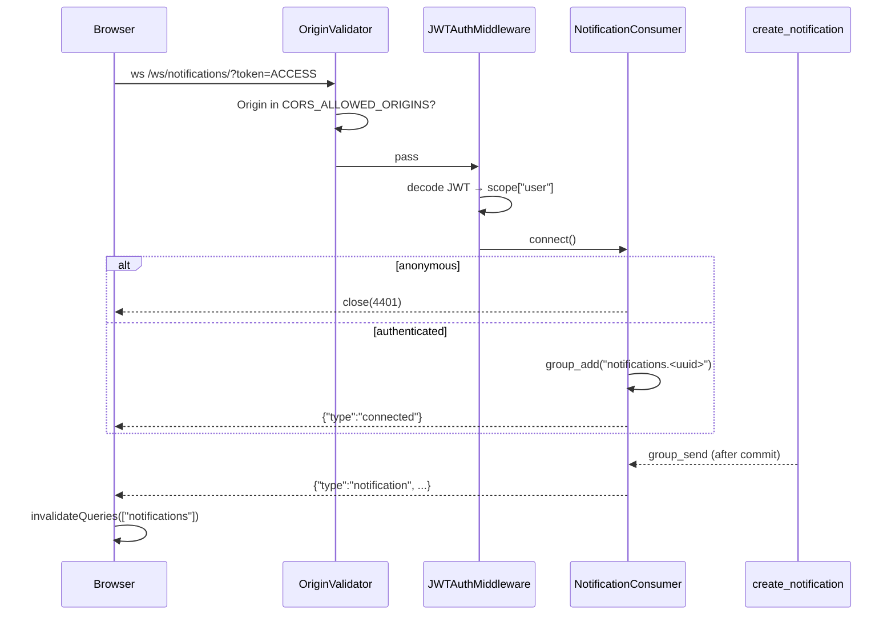

# Module — Collaboration (Comments · Mentions · Notifications)

[← Modules index](../12-business-modules.md) · [← Docs index](../README.md)

Three Django apps that form one feature: discussion, attention, and awareness.
This is where **signals** do the most work in the codebase.

---

## 1. The problem it solves

Work needs conversation attached to it. Conversation needs a way to pull a
specific person in. Being pulled in needs to reach them **now**, not when they
next refresh.

---

## 2. Frontend

Comments are **inline** — there is no `/comments` route. They appear on task,
project and document detail pages via `CommentSection`.

| Component | Role |
|---|---|
| `components/comments/comment-section.tsx` | The thread container |
| `components/comments/comment-item.tsx` | One comment + its replies |
| `components/comments/comment-form.tsx` | New comment / reply |
| `components/comments/mention-textarea.tsx` | Autocomplete that emits `@[Name](uuid)` tokens |
| `components/comments/comment-content.tsx` | Renders mention tokens as chips |
| `components/comments/collaboration-tabs.tsx` | Comments + activity tabs on detail pages |
| `components/notifications/notification-bell.tsx` | Header bell, badge, popover |
| `components/notifications/notification-list.tsx` | Rows with links |

| Route | File |
|---|---|
| `/notifications` | `app/(app)/notifications/page.tsx` |

Hooks: `hooks/use-comments.ts` (list/create/reply/update/delete, all invalidating
`["comments", targetType, targetId]`), `hooks/use-notifications.ts`, and
`hooks/use-notification-socket.ts`.

### The mention token contract

`mention-textarea.tsx` produces `@[Display Name](<user-uuid>)`, and
`backend/apps/mentions/services.py:23` parses exactly that with a regex.

**Nothing type-checks this contract.** Change the format on one side and mentions
silently stop being detected. It is the most fragile coupling in the project.

---

## 3. Backend

```
apps/comments/
├── models.py        Comment (generic FK, self-referential parent, soft delete)
├── serializers.py   CommentSerializer + ALLOWED_TARGETS whitelist
├── permissions.py   IsAuthorOrWorkspaceAdmin
├── views.py         CommentViewSet + reply action
└── tests.py         EMPTY

apps/mentions/
├── models.py        Mention
├── signals.py       user_mentioned  (a custom Signal)
├── services.py      extract_mentioned_ids(), sync_comment_mentions()
├── handlers.py      post_save(Comment) → sync
├── views.py         MentionViewSet (read-only)
└── tests.py         EMPTY

apps/notifications/
├── models.py        Notification, NotificationType
├── services.py      create_notification(), link_for()
├── handlers.py      user_mentioned → notify;  Comment reply → notify
├── consumers.py     NotificationConsumer, push_to_user()
├── routing.py       ws/notifications/
├── views.py         NotificationViewSet + read / read-all / unread-count
└── tests.py         12 tests
```

---

## 4. Database



`comments_comment` points at its target through a **generic foreign key**
(`content_type` + `object_id`), whitelisted to project, task and document.
`object_id` is a `UUIDField` because every domain model uses UUID keys.

Ordering is `("created_at",)` — **ascending**, unlike every other table, because
a thread reads oldest-first.

Columns: [10-database-tables.md](../10-database-tables.md#8-comments_comment).

---

## 5. API

### Comments

| Method | Endpoint | Who |
|---|---|---|
| GET | `/comments/?target_type=task&target_id=<uuid>` | member |
| POST | `/comments/` | member |
| PATCH | `/comments/{id}/` | **author only** |
| DELETE | `/comments/{id}/` | author, or workspace owner/admin |
| POST | `/comments/{id}/reply/` | member |

### Mentions

| Method | Endpoint |
|---|---|
| GET | `/mentions/?workspace=<id>` — read-only, only where **you** are mentioned |

### Notifications

| Method | Endpoint |
|---|---|
| GET | `/notifications/?is_read=&type=&workspace=` |
| GET | `/notifications/unread-count/` |
| PATCH | `/notifications/{id}/read/` |
| PATCH | `/notifications/read-all/` |
| WS | `/ws/notifications/?token=<access>` |

---

## 6. How a comment resolves its target

```python
def _resolve_target(self, serializer):
    parent = serializer.validated_data.get("parent")
    if parent is not None:
        if parent.is_deleted:
            raise ValidationError({"parent": "Cannot reply to a deleted comment."})
        workspace, content_type, object_id = parent.workspace, parent.content_type, parent.object_id
    else:
        target_type = serializer.validated_data.pop("target_type", None)
        object_id   = serializer.validated_data.pop("target_id", None)
        if not target_type or not object_id:
            raise ValidationError({"target_type": "target_type and target_id are required."})
        content_type = self._content_type(target_type)      # whitelist → natural key
        target       = content_type.get_object_for_this_type(pk=object_id)
        workspace    = target.workspace
    if not workspace.members.filter(user=self.request.user).exists():
        raise PermissionDenied("You are not a member of this workspace.")
    ...
```
`backend/apps/comments/views.py:61-89`

Three things happen here:

1. **A reply inherits its parent's target** — you cannot reply to a comment on
   task A and have it attach to task B.
2. **The whitelist is the security boundary.** `ALLOWED_TARGETS` maps a public
   string to a `ContentType` natural key, so `target_type` cannot name an
   arbitrary table.
3. **Membership is checked against the *target's* workspace**, not a
   client-supplied one.

---

## 7. Soft delete

```python
def destroy(self, request, *args, **kwargs):
    comment = self.get_object()
    comment.is_deleted = True
    comment.content = ""                      # ← content is actually blanked
    comment.save(update_fields=["is_deleted", "content", "updated_at"])
    return Response(status=204)
```

```python
def to_representation(self, instance):
    data = super().to_representation(instance)
    if instance.is_deleted:
        data["content"] = "[deleted]"
    return data
```

The row survives so reply chains stay intact (model docstring, line 6). The
content is genuinely erased, not merely hidden — so a deleted comment cannot leak
through a serializer that forgets the override.

**Side effect:** blanking the content means the next mention sync finds no
tokens, so the comment's `Mention` rows are cleaned up automatically
(`mentions/handlers.py:12`).

---

## 8. The mention pipeline

```python
_MENTION_RE = re.compile(r"@\[[^\]]+\]\(([0-9a-fA-F]{8}-...-[0-9a-fA-F]{12})\)")

def sync_comment_mentions(comment):
    ids = extract_mentioned_ids(comment.content)
    valid_users = (User.objects
        .filter(id__in=ids, workspace_memberships__workspace=comment.workspace)
        .exclude(id=comment.author_id)
        .distinct())
    valid_ids = {u.id for u in valid_users}
    existing  = {m.mentioned_user_id: m for m in comment.mentions.all()}

    for user in valid_users:                    # add + notify only genuinely new ones
        if user.id in existing: continue
        mention = Mention.objects.create(comment=comment, mentioned_user=user,
                                         workspace=comment.workspace)
        user_mentioned.send(sender=Mention, mention=mention, comment=comment,
                            actor=comment.author, recipient=user)

    for user_id, mention in existing.items():   # remove ones deleted by an edit
        if user_id not in valid_ids: mention.delete()
```
`backend/apps/mentions/services.py:31-68`

**Idempotency is the point.** Editing a comment ten times does not send ten
notifications — only genuinely new mentions fire the signal. Removing a mention
from the text deletes its row.

Two filters enforce the rules: the workspace-membership join means you cannot
mention an outsider, and `.exclude(id=comment.author_id)` means you cannot
mention yourself into a notification.

### Why a custom signal

```python
user_mentioned = Signal()     # apps/mentions/signals.py
```

`mentions` does not import `notifications`. It emits a domain event; whoever cares
subscribes. `notifications/handlers.py:21` is the only subscriber today.

---

## 9. Notification creation

```python
def create_notification(*, recipient, type, title, actor=None, workspace=None,
                        message="", link=""):
    if recipient is None: return None
    if actor is not None and recipient.pk == actor.pk: return None    # no self-notify
    notification = Notification.objects.create(...)
    _push(notification)
    return notification
```
`backend/apps/notifications/services.py:22-52`

**Six call sites** in the whole codebase: three in `handovers/views.py`, two in
`notifications/handlers.py` (mention, reply), one in `invitations/views.py`.

### The push, deferred

```python
def _push(notification):
    from apps.notifications.consumers import push_to_user      # lazy: no Channels needed to import
    from apps.notifications.serializers import NotificationSerializer
    recipient_id = notification.recipient_id
    unread  = Notification.objects.filter(recipient_id=recipient_id, is_read=False).count()
    payload = NotificationSerializer(notification).data

    def deliver():
        push_to_user(recipient_id, {"type": "notification.created", "data": payload})
        push_to_user(recipient_id, {"type": "unread.count", "count": unread})

    transaction.on_commit(deliver)
```

The docstring gives the reason: *"pushing inside the transaction can beat the
write to the database, and a client that then refetches would not yet see the
row. On a rollback nothing is sent at all, which is the point."*

`link` is a **frontend route** — `link_for()` maps a content type to `/tasks/`,
`/projects/`, `/documents/` or `/handovers/`.

---

## 10. Realtime



Four design points:

1. **Push-only.** Marking read still goes through REST — *"keeps one code path
   for permissions and auditing"* (`consumers.py:8-9`).
2. **The message is a signal, not data.** The client refetches over REST rather
   than trusting the pushed copy, because *"the list is paginated and filtered
   server-side"* (`use-notification-socket.ts:75-77`). One source of truth.
3. **Push failure is swallowed** (`consumers.py:74-80`) — realtime must never
   break the write that triggered it.
4. **Polling is the fallback**, disabled while the socket is live
   (`use-notifications.ts:37`).

The client's reconnection logic — backoff, close-code handling, token retry — is
in [04-frontend-architecture.md](../04-frontend-architecture.md#9-realtime-on-the-client).

---

## 11. Business rules

Complete lists in [13-business-logic.md](../13-business-logic.md). Summary:

| Area | Key rules |
|---|---|
| Comments | Whitelisted targets; no empty content; replies inherit the target; cannot reply to a deleted comment; edit marks `is_edited`; author-edit, author-or-admin-delete |
| Mentions | Members only; not yourself; unique per (comment, user); idempotent sync |
| Notifications | Never self-notify; null recipient is a no-op; push deferred to commit; mark-read is idempotent; read-all uses `.update()` (no signals) |

---

## 12. Failure scenarios

| Scenario | Result |
|---|---|
| Comment on a workspace you are not in | 403 "You are not a member of this workspace." |
| `target_type=user` | Not in `ALLOWED_TARGETS` → the filter ignores it, and create raises a validation error |
| Reply to a deleted comment | 400 "Cannot reply to a deleted comment." |
| Edit someone else's comment | 403 "You can only modify your own comments." |
| Delete someone else's comment as admin | Allowed |
| Mention a non-member | Silently ignored — no row, no notification |
| Mention yourself | Ignored twice over |
| Channel layer down | Notification row still created; push logged and swallowed; client polls |
| Multiple web processes with the in-memory channel layer | Pushes reach only sockets on the same process. **Set `REDIS_URL`** |
| Delete a **user** | `Comment.author` is `CASCADE` — their comments and, via `parent` cascade, replies underneath are destroyed |

---

## 13. Dependencies

```
comments ──post_save──► mentions ──user_mentioned──► notifications
comments ──post_save──────────────────────────────► notifications  (replies)
handovers ─────────────────────────────────────────► notifications  (3 calls)
invitations ───────────────────────────────────────► notifications  (1 call)
comments ──post_save──► activities                                   (audit)
```

`mentions` imports `comments`. `notifications` imports `comments` and
`mentions.signals`. **`comments` imports neither** — it has no idea any of this
happens. That is the decoupling.

---

## 14. Interview questions

1. Why a generic foreign key for comments? What did it cost?
   *(One table for every commentable type; cost is no DB-level referential
   integrity, bounded by the whitelist.)*
2. Why is comment delete soft?
3. Walk me through what happens when I @mention someone.
4. How do you stop an edit from re-notifying? *(The sync compares existing rows
   and fires only for genuinely new mentions.)*
5. Why does `mentions` emit a custom signal instead of calling
   `create_notification` directly?
6. Why is the websocket push deferred to `transaction.on_commit`?
7. Why does the client refetch instead of using the pushed payload?
8. Notifications work locally but not in production. Where do you look first?
   *(The channel layer — `InMemoryChannelLayer` is per-process.)*
9. `read_all` uses `queryset.update()`. What are the implications?
   *(One UPDATE, no `post_save`, so no signals and no audit rows. Intentional
   here, but it is the pattern to watch.)*
10. The mention token format is duplicated between a React component and a Python
    regex. How would you make that safe? *(Share it through the API, or at
    minimum add tests on both sides. Today nothing catches a drift.)*
