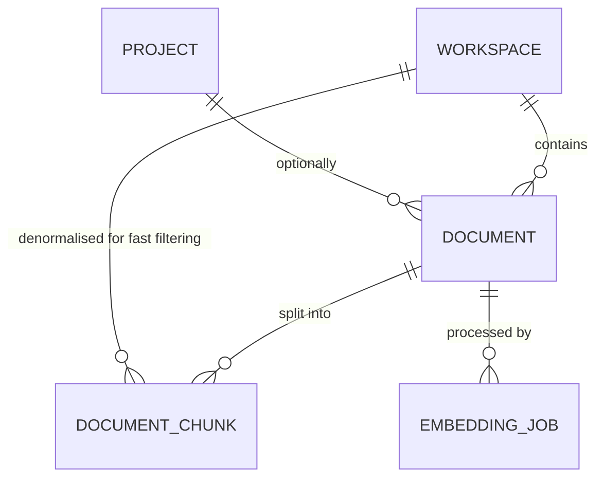
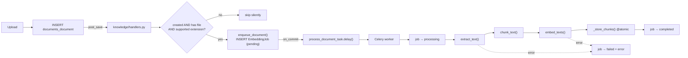

# Module — Documents & Knowledge

[← Modules index](../12-business-modules.md) · [← Docs index](../README.md)

Two Django apps, one pipeline: **`documents` stores files, `knowledge` makes them
searchable by meaning.**

---

## 1. The problem it solves

A team's real knowledge sits in PDFs and Word documents nobody re-reads. Uploading
a file to Nexora automatically extracts its text, splits it into overlapping
chunks, embeds each chunk as a 384-dimension vector, and stores those vectors in
PostgreSQL — so the AI assistant can retrieve the right paragraph from a plain
English question.

---

## 2. Frontend

| Route | File | Hooks |
|---|---|---|
| `/documents` | `documents/page.tsx` | `useDocuments`, `useProjects` |
| `/documents/new` | `documents/new/page.tsx` | `useUploadDocument` |
| `/documents/[id]` | `documents/[id]/page.tsx` | `useDocument`, `useReindexDocument` |

| Component | Role |
|---|---|
| `components/shared/file-upload.tsx` | Drag-and-drop picker. Controlled: `{value: File\|null, onChange, accept}`. **Calls no API** |
| `components/documents/document-upload-form.tsx` | Wraps it with title/description/project fields |
| `components/ai/embedding-status-badge.tsx` | Renders `pending` / `processing` / `completed` / `failed` |

The form builds the `FormData` itself:

```ts
const form = new FormData();
form.append("workspace", activeWorkspaceId);
form.append("file", values.file);
if (values.project) form.append("project", values.project);
...
await uploadDocument.mutateAsync(form);
```
`app/(app)/documents/new/page.tsx:30-38`

`apiClient` detects `FormData` and omits `Content-Type` so the browser adds the
multipart boundary — see
[15-file-uploads-integrations.md](../15-file-uploads-integrations.md).

---

## 3. Backend

```
apps/documents/
├── models.py       Document, document_upload_path()
├── serializers.py  DocumentSerializer (+ file_url, embedding_status, chunk_count)
├── filters.py      DocumentFilter
├── views.py        DocumentViewSet + reindex action
└── tests.py        EMPTY (0 lines)

apps/knowledge/
├── models.py                    DocumentChunk (vector), EmbeddingJob
├── handlers.py                  post_save(Document) → enqueue; ingestion_disabled()
├── tasks.py                     Celery: process_document_task
├── services/
│   ├── extractor.py             PDF / DOCX / TXT / MD → text
│   ├── chunker.py               word-window split with overlap
│   ├── processor.py             enqueue_document, process_document, _store_chunks
│   └── search.py                semantic_search()
├── embeddings/{base,factory,sentence_transformer}.py
├── management/commands/reindex_documents.py
└── tests.py                     8 tests
```

`DocumentViewSet` is short but adds two things to the base:

```python
parser_classes = (MultiPartParser, FormParser, JSONParser)   # accepts uploads AND JSON edits

@action(detail=True, methods=["post"])
def reindex(self, request, pk=None):
    from apps.knowledge.services.processor import enqueue_document   # local import
    document = self.get_object()
    job = enqueue_document(document)
    return Response({...}, status=202)
```

The local import keeps `documents` importable without the AI stack installed.

---

## 4. Database



Three tables — columns in [10-database-tables.md](../10-database-tables.md).

**The vector column:**

```python
embedding = VectorField(dimensions=384, null=True, blank=True)

indexes = [
    models.Index(fields=["workspace"]),
    HnswIndex(name="documentchunk_embedding_hnsw", fields=["embedding"],
              m=16, ef_construction=64, opclasses=["vector_cosine_ops"]),
]
```

`workspace_id` is **denormalised** onto the chunk. The model docstring gives the
reason: the tenant boundary can then be enforced with a single indexed filter on
similarity queries — the hot path for semantic search.

The extension itself is created by a migration operation, `VectorExtension()` in
`knowledge/migrations/0001_initial.py:24`.

---

## 5. API

| Method | Endpoint | Notes |
|---|---|---|
| GET | `/documents/` | Filters: `workspace`, `project`, `file_type` (`exact`, `icontains`) |
| POST | `/documents/` | **multipart** — `file` required |
| GET | `/documents/{id}/` | Includes `file_url`, `embedding_status`, `chunk_count` |
| PATCH | `/documents/{id}/` | Metadata only — `file` is optional on update |
| DELETE | `/documents/{id}/` | Cascades to chunks and jobs |
| POST | `/documents/{id}/reindex/` | 202 with the new job's state |

`file` is `write_only`; the response exposes `file_url` instead
(`serializers.py:51`).

---

## 6. The ingestion pipeline



### The five design decisions in this pipeline

**1. Trigger on create only**

```python
if not created or not instance.file: return
```
`handlers.py:26` — *"File replacements and manual re-runs go through the
documents `reindex` action instead, so metadata-only edits (title/description)
never trigger expensive re-embedding."*

**2. Unsupported files are skipped silently**

```python
if not extractor.is_supported(instance.file.name, instance.file_type):
    return          # "Nothing to embed (e.g. an image or archive) — skip silently"
```

**3. Ingestion must never break the upload**

```python
try:    enqueue_document(instance)
except Exception:
    logger.exception("Failed to enqueue embedding for document %s", instance.pk)
```
`handlers.py:31-34` — and `process_document` records failures on the job row
rather than raising.

**4. Queue after commit**

```python
transaction.on_commit(dispatch)
```
*"Queued after commit so the worker cannot read the document row before it exists
— the upload is still inside its transaction at this point."*

**5. Broker down → run inline**

```python
try:    process_document_task.delay(document_id, job_id)
except Exception:
    logger.exception("Could not queue embedding for document %s; running inline", document_id)
    process_document(document, job=job)
```
*"broker down: better slow than lost."*

### Re-index safety

```python
@transaction.atomic
def _store_chunks(document, chunks, vectors):
    DocumentChunk.objects.filter(document=document).delete()
    rows = [DocumentChunk(...) for chunk, vector in zip(chunks, vectors)]
    DocumentChunk.objects.bulk_create(rows, batch_size=200)
```

Delete-then-insert inside one transaction, so a document is never left with zero
chunks mid-reindex.

### The seeder's escape hatch

`knowledge/handlers.py` exports `ingestion_disabled()`, a context manager that
temporarily disconnects the signal. The demo seeder uses it so bulk-loading
hundreds of documents does not launch hundreds of embedding jobs. Its docstring
notes it restores the signal on the way out.

---

## 7. Text extraction

`apps/knowledge/services/extractor.py`

| Extension | Library | Behaviour |
|---|---|---|
| `.pdf` | `pypdf` | Page by page; empty pages skipped. **No OCR** — a scanned PDF yields nothing |
| `.docx` | `python-docx` | Paragraphs **plus table cells** joined with ` \| ` — *"meeting notes often live in tables"* |
| `.txt` `.md` `.markdown` | plain read | `decode("utf-8", errors="replace")` — forgiving |
| anything else | — | `UnsupportedDocumentError` |

Both heavy parsers are imported lazily inside their functions.

`is_supported()` checks **the extension only** and ignores the passed
`content_type` — deliberate, since client-supplied MIME types are not
trustworthy.

---

## 8. Chunking and search

Both are covered in depth in [14-algorithms.md](../14-algorithms.md):

- [Chunking](../14-algorithms.md#1-document-chunking--overlapping-word-windows) —
  220-word windows, 40-word overlap, deterministic, dependency-free.
- [Vector search](../14-algorithms.md#2-vector-similarity-search) — workspace
  filter first, `CosineDistance`, `distance <= 0.75`, top 6, HNSW index.

---

## 9. Job status surfaced to the UI

```python
def get_embedding_status(self, obj):
    job = obj.embedding_jobs.order_by("-created_at").first()
    return job.status if job else None

def get_chunk_count(self, obj):
    return obj.chunks.count()
```
`documents/serializers.py:60-66`

That is **two extra queries per document row** — the worst N+1 in the codebase.
See [19-performance-scalability.md](../19-performance-scalability.md#-21-n1-on-the-document-list)
for the `annotate` + `Prefetch` fix.

The index `(document, -created_at)` on `knowledge_embeddingjob` exists precisely
for the "latest job" lookup.

---

## 10. Failure scenarios

| Scenario | Result |
|---|---|
| Upload with no file | 400 `{"file": ["A file is required."]}` |
| Upload a `.png` | Stored; **no** EmbeddingJob; `embedding_status` is `null` |
| Upload a scanned PDF | Job completes with `chunk_count = 0` — pypdf extracts nothing, and there is no OCR |
| Corrupt PDF | Job → `failed`, `error` holds the exception text. The upload still succeeded |
| Hugging Face unreachable on first embed | Job → `failed`. Upload unaffected |
| Broker down | Runs inline — the upload is slow but completes |
| Document deleted mid-job | The task logs "no longer exists; skipping" and returns None |
| Two reindexes race | `unique_document_chunk_index` may raise; `_store_chunks` is atomic so no partial state |
| pgvector missing | Search returns 503 with a clear admin message |
| `DEBUG=False` in production | **`file_url` 404s** — no media serving is configured. See [22](../22-production-deployment.md) |

---

## 11. Dependencies

| Direction | Who | For |
|---|---|---|
| `documents` depends on | `apps.common` | Base model, base viewset |
| `documents` depends on | `apps.knowledge` (lazily) | `enqueue_document` in the reindex action |
| `knowledge` depends on | `apps.documents` | The `Document` FK and the signal |
| `knowledge` depends on | `sentence-transformers`, `pypdf`, `python-docx`, `pgvector` | |
| Depended on by | `apps.ai` | `semantic_search`, and chunks for summaries and action items |
| Depended on by | `apps.activities` | Documents are registered for audit logging |
| Depended on by | frontend `/projects/[id]`, `/ai`, `/search` | |

`ai` imports `knowledge`. `knowledge` **never** imports `ai`. That one-way edge
is the layering.

---

## 12. Interview questions

1. Walk me through what happens between clicking Upload and the document being
   searchable.
2. Why is embedding asynchronous? *(Model load plus N vector computations — far
   too slow to hold an upload request open. The docstring says exactly this.)*
3. Why is `workspace_id` on `DocumentChunk` when the document already has one?
4. Why 384 dimensions, and what breaks if you change it? *(The pgvector column;
   it needs a migration. `base.py:336-338` warns about it in capitals.)*
5. Why HNSW and not IVFFlat?
6. Why does re-index delete then bulk-create inside a transaction?
7. Why is the embedding trigger `created`-only?
8. A user says search finds nothing in their PDF. How do you debug it?
   *(Chunk count → embedding null → distance threshold → wrong workspace →
   scanned PDF with no OCR.)*
9. What is the N+1 in this module and how would you fix it?
10. How would you support a 1500-dimension OpenAI embedding provider?
    *(Add the provider class, register it in the factory, **and** migrate the
    column. The factory already records the required dimension per provider so
    the mistake is obvious.)*
