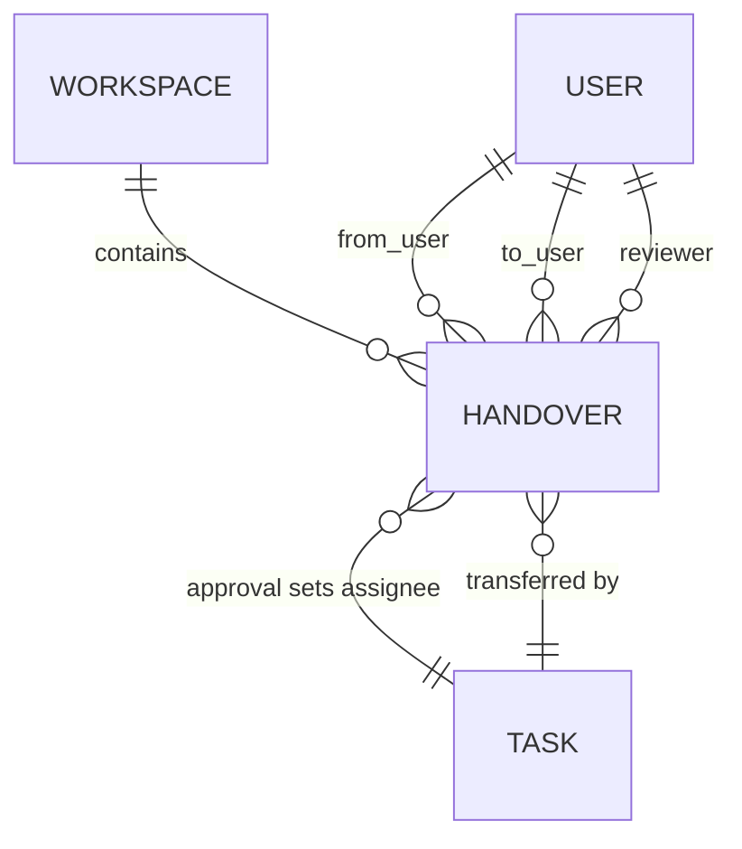
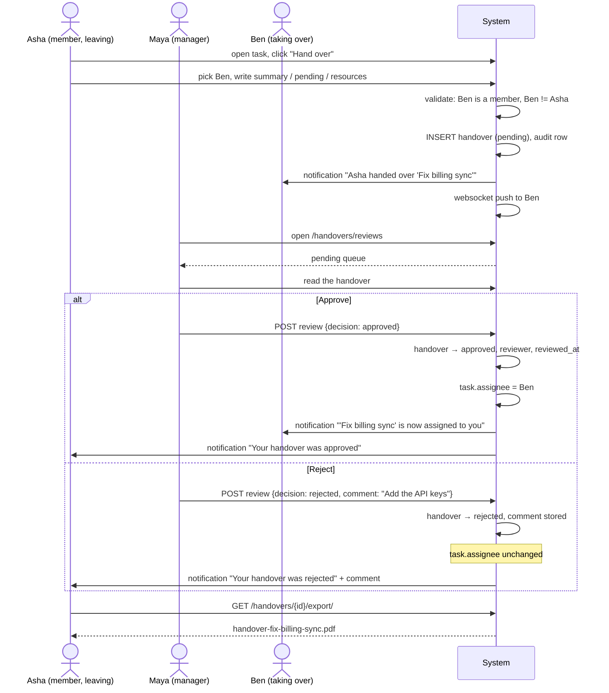

# Module — Handovers ⭐

[← Modules index](../12-business-modules.md) · [← Docs index](../README.md)

**The flagship module.** The richest business logic in the project, the only
cross-module write, and the thing that makes Nexora more than a task tracker.

---

## 1. The problem it solves

In an ordinary tracker, reassigning a task is one click and no explanation. The
new assignee inherits a title and a status, and everything the previous person
knew — what was actually done, what is half-finished, which credentials or links
matter — is lost.

Nexora makes handing work over a **formal, reviewed artefact**:

1. The outgoing member writes a **work summary**, **pending items** and
   **resources**.
2. A workspace manager, admin or owner **reviews** it.
3. Only on approval does the task's assignee actually change.
4. Rejection requires a written reason and sends it back.
5. Every handover is exportable as a **PDF** record.

---

## 2. Who uses it

| Role | Can |
|---|---|
| Member | Submit a handover, edit their own while pending, delete their own while pending, export the PDF |
| Manager | All of the above **plus review** (approve/reject) |
| Admin | Same as manager |
| Owner | Same as manager |

`REVIEWER_ROLES = (OWNER, ADMIN, MANAGER)` — `backend/apps/workspaces/models.py:25`.
This is the **only** capability that distinguishes `manager` from `member`
anywhere in the product.

---

## 3. Frontend

| Route | File | Purpose |
|---|---|---|
| `/handovers` | `app/(app)/handovers/page.tsx` | List; uses `useAuth` to separate mine from others' |
| `/handovers/new` | `app/(app)/handovers/new/page.tsx` | Submit form; reads `?task=<uuid>` from the URL |
| `/handovers/reviews` | `app/(app)/handovers/reviews/page.tsx` | Reviewer queue — `useHandovers({status:"pending"})` |
| `/handovers/[id]` | `app/(app)/handovers/[id]/page.tsx` | Detail, review card, delete, PDF export |

| Component | Role |
|---|---|
| `components/handovers/handover-form.tsx` | Task picker, recipient picker, three text areas |
| `components/handovers/handover-review-card.tsx` | Approve / reject + comment, shown only to reviewers |
| `components/shared/status-badge.tsx` | `pending` / `approved` / `rejected` |
| `components/shared/confirm-dialog.tsx` | Delete confirmation |

| Hook | Endpoint |
|---|---|
| `useHandovers(params)` | `GET /handovers/` |
| `useHandover(id)` | `GET /handovers/{id}/` |
| `useCreateHandover()` | `POST /handovers/` |
| `useUpdateHandover(id)` | `PATCH /handovers/{id}/` |
| `useDeleteHandover()` | `DELETE /handovers/{id}/` |
| `useReviewHandover(id)` | `POST /handovers/{id}/review/` |

The review mutation invalidates **three** caches, because approval reassigns a
task:

```ts
qc.invalidateQueries({ queryKey: KEYS.all });
qc.invalidateQueries({ queryKey: KEYS.detail(id) });
qc.invalidateQueries({ queryKey: ["tasks"] });   // approval reassigns the task
```
`frontend/src/hooks/use-handovers.ts:69-74`

### UI role gating

```ts
const canReview = !!activeWorkspace?.role && REVIEWER_ROLES.includes(activeWorkspace.role);
const isSubmitter = !!user && handover.from_user?.id === user.id;
const isPending = handover.status === "pending";
```
`app/(app)/handovers/[id]/page.tsx:80-83`

Used to decide whether to render `<HandoverReviewCard/>` (line 198) and the
Delete button (line 122). The sidebar hides "Reviews" the same way
(`app-sidebar.tsx:71-74`).

**This is convenience, not security.** The server re-checks everything.

---

## 4. Backend

```
apps/handovers/
├── models.py        Handover, HandoverStatus
├── serializers.py   HandoverSerializer, HandoverReviewSerializer
├── filters.py       HandoverFilter (adds a `project` filter via task__project_id)
├── views.py         HandoverViewSet + review + export actions
├── pdf.py           render_handover_pdf() — reportlab
├── urls.py          DefaultRouter
└── tests.py         16 tests
```

`HandoverViewSet` extends `WorkspaceScopedViewSet`, so tenancy, membership checks
and audit stamping are inherited.

```python
queryset = Handover.objects.select_related(
    "workspace", "task", "task__project", "from_user", "to_user",
    "reviewer", "created_by", "updated_by")
search_fields   = ("summary", "pending_items", "task__title")
ordering_fields = ("created_at", "updated_at", "status", "reviewed_at")
```

Note `task__project` in `select_related` — the serializer exposes `project_id`
from the task, so without it every row would issue an extra query.

---

## 5. Database

**One table: `handovers_handover`.** Full column list in
[10-database-tables.md](../10-database-tables.md#7-handovers_handover).



Indexes: `(workspace, status)` for the reviewer queue, `(task, status)` for
"does this task have a pending handover".

`from_user`, `to_user` and `reviewer` are all `SET_NULL` — the historical record
survives a user deletion. That is why `views.py:116` guards with
`if approved and handover.to_user is not None`.

---

## 6. API

| Method | Endpoint | Who | Purpose |
|---|---|---|---|
| GET | `/handovers/` | member | List, filterable |
| POST | `/handovers/` | member | Submit |
| GET | `/handovers/{id}/` | member | Detail |
| PATCH | `/handovers/{id}/` | **submitter only, pending only** | Edit |
| DELETE | `/handovers/{id}/` | submitter or reviewer, pending only | Remove |
| POST | `/handovers/{id}/review/` | **reviewer roles only** | Approve or reject |
| GET | `/handovers/{id}/export/` | member | PDF download |

**Filters:** `?workspace=` `?task=` `?project=` `?status=` `?from_user=`
`?to_user=` `?search=` `?ordering=` `?page=`

The `project` filter is custom — the model has no such field:
```python
project = django_filters.UUIDFilter(field_name="task__project_id")
```

Full request/response detail: [api/handovers.md](../api/handovers.md).

---

## 7. Business rules — the complete set

### Submission

| Rule | Where |
|---|---|
| `task` required; `workspace` derived from it | `serializers.py:81-86` |
| Recipient must be a workspace member | `serializers.py:90-98` |
| **Cannot hand a task to yourself** | `serializers.py:99-102` |
| `from_user` = the requesting user, always | `serializers.py:107-111` |
| `summary` is required | model field, no `blank=True` |
| Status starts `pending` | model default |
| Recipient is notified | `views.py:49-58` |

### While pending

| Rule | Where |
|---|---|
| Only the submitter may edit | `views.py:60-64` |
| Editing only while `pending` | `serializers.py:69-72` |
| **The task can never be swapped** | `serializers.py:73-78` |
| Delete only while `pending` | `views.py:67-68` |
| Delete by submitter or reviewer role | `views.py:69-73` |

### Review

| Rule | Where |
|---|---|
| Reviewer roles only | `views.py:87-90` |
| **Exactly once** | `views.py:91-92` |
| Decision ∈ {approved, rejected} | `serializers.py:117-119` |
| **Rejection requires a comment** | `serializers.py:124-129` |
| Approval sets `task.assignee` | `views.py:116-120` |
| Rejection leaves the task untouched | the `if approved` branch |
| Approval notifies the recipient | `views.py:121-129` |
| Both notify the submitter | `views.py:131-142` |

### Not enforced (gaps)

- **Two pending handovers on the same task are possible.** No constraint, no
  check.
- The submitter is **not required to be the task's current assignee**.

---

## 8. The main user journey



---

## 9. Dependencies

**Depends on:**

| On | For |
|---|---|
| `apps.common.viewsets` | Tenancy, membership, audit stamping |
| `apps.tasks` | The FK, and the assignee write on approval |
| `apps.workspaces` | `REVIEWER_ROLES` |
| `apps.notifications` | `create_notification()` ×3 |
| `reportlab` | PDF rendering — imported **inside** the action so the app works without it |

**Depended on by:**

| By | For |
|---|---|
| `apps.core` | Dashboard `pending_handovers`, analytics review metrics |
| `apps.activities` | Registered for audit logging |
| Frontend `/dashboard` | Pending handovers card |
| Frontend `/analytics` | Review metrics chart |
| Frontend `/search` | One of four searched entities |

---

## 10. The PDF export

`backend/apps/handovers/pdf.py` — reportlab `SimpleDocTemplate`, A4, 18 mm
margins.

Contents: a title, a metadata table (task, project, from, to, status, submitted,
and reviewer/reviewed-at when present), then the summary, pending items,
resources and review comment as sections.

Two implementation details:

```python
from apps.handovers.pdf import render_handover_pdf     # local import
```
*"so the app works even before reportlab is installed"* (`views.py:153-154`).

```python
filename = f"handover-{slugify(handover.task.title) or handover.pk}.pdf"
```

The frontend fetches it through `lib/api/download.ts`, which reads the
`Content-Disposition` header to recover the filename.

`xml.sax.saxutils.escape` is imported in `pdf.py` — user text is escaped before
being put into reportlab `Paragraph` markup, which parses a small HTML-like
syntax. Without it, a summary containing `<b>` would corrupt the document.

---

## 11. Failure scenarios

| Scenario | Result |
|---|---|
| Recipient is not a member | 400 `{"to_user_id": ["User is not a member of this workspace."]}` |
| Handing over to yourself | 400 `"You can't hand a task over to yourself."` |
| A member tries to review | 403 with the specific message |
| Reviewing an already-reviewed handover | 400 `"This handover has already been reviewed."` |
| Rejecting with no comment | 400 `{"comment": ["A comment is required when rejecting a handover."]}` |
| Someone else tries to edit | 403 `"Only the submitter can edit a handover."` |
| Deleting a reviewed handover | 400 `"Only pending handovers can be deleted."` |
| Recipient's account was deleted | `to_user` is null; approval skips the reassignment and only notifies the submitter |
| reportlab not installed | `ImportError` at export time only — the rest of the app is unaffected |
| Notification push fails | Swallowed and logged; the review still succeeds |

---

## 12. Interview questions on this module

1. Walk me through what happens when a handover is approved. *(Two table writes,
   two notifications, three cache invalidations, two audit rows.)*
2. Why does approval change `task.assignee` rather than the submitter doing it
   directly? *(Approval is the authorisation point — the assignment is the
   consequence of a decision, not a separate action that could be taken without
   review.)*
3. How do you stop a plain member from approving their own handover?
   *(Three layers: the sidebar hides the link, the detail page hides the card, and
   `_reviewer_membership()` returns None → 403. Only the third matters.)*
4. Why is `workspace` read-only on the serializer?
5. Why can't the task be changed after submission? *(The whole record — summary,
   pending items, notification — refers to a specific task. Swapping it would
   silently invalidate the review.)*
6. What happens if two people submit handovers for the same task?
   *(Both are allowed. Nothing prevents it. This is a real gap.)*
7. Why is `select_related("task__project")` in the queryset?
8. Why is reportlab imported inside the action?
9. Why is `to_user` `SET_NULL` and not `CASCADE`?
10. The review endpoint does two `save(update_fields=...)` calls without a
    transaction. What could go wrong? *(A crash between them leaves the handover
    approved but the task unassigned. Should be `@transaction.atomic`.)*

Model answers and follow-up chains:
[interviews/scenario-questions.md](../interviews/scenario-questions.md) and
[interviews/difficult-followups.md](../interviews/difficult-followups.md).
