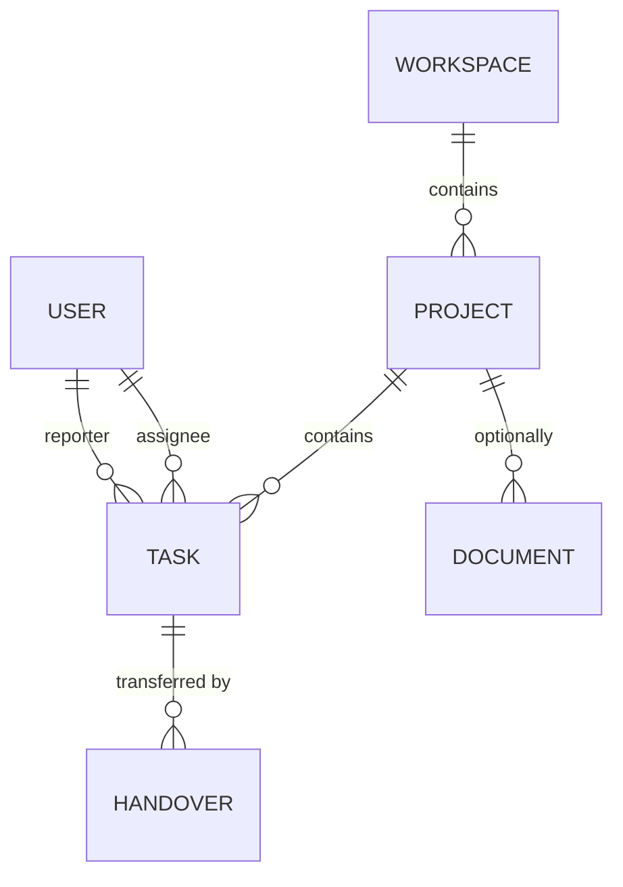

# Module — Projects & Tasks

[← Modules index](../12-business-modules.md) · [← Docs index](../README.md)

The CRUD core. Read this module to see the shared base classes doing their job
with almost no per-module code.

---

## 1. The problem it solves

Organising work inside a workspace. A **project** is a container; a **task** is a
unit of work inside a project. Documents may optionally belong to a project too.

---

## 2. Frontend

| Route | File | Hooks |
|---|---|---|
| `/projects` | `projects/page.tsx` | `useProjects` |
| `/projects/new` | `projects/new/page.tsx` | `useCreateProject` |
| `/projects/[id]` | `projects/[id]/page.tsx` | `useProject`, `useTasks`, `useDocuments` |
| `/projects/[id]/edit` | `projects/[id]/edit/page.tsx` | `useProject`, `useUpdateProject` |
| `/tasks` | `tasks/page.tsx` | `useTasks`, `useProjects`, `useWorkspaceMembers` |
| `/tasks/new` | `tasks/new/page.tsx` | `useCreateTask` (+ `?project=`) |
| `/tasks/[id]` | `tasks/[id]/page.tsx` | `useTask`, `useUpdateTask`, `CommentSection` |
| `/tasks/[id]/edit` | `tasks/[id]/edit/page.tsx` | `useTask`, `useUpdateTask` |

The list pages load **three** things: the list itself, the projects (for the
filter dropdown) and the workspace members (for the assignee dropdown). All three
are separate cached queries, so the dropdowns are shared with other pages for
free.

| Component | Purpose |
|---|---|
| `components/projects/project-form.tsx` | Create/edit |
| `components/tasks/task-form.tsx` | Create/edit; project, assignee, status, priority, dates, labels |
| `components/shared/status-badge.tsx` | Enum → label + colour, from `lib/constants.ts` |
| `components/shared/priority-badge.tsx` | Same for priority |
| `components/shared/data-pagination.tsx` | Page controls over the DRF envelope |
| `components/shared/search-input.tsx` | Debounced `?search=` (has a test) |
| `components/comments/collaboration-tabs.tsx` | Comments + activity on the task detail page |

---

## 3. Backend

Both apps have the identical five-file shape, and both viewsets are ~15-40 lines.

```python
class TaskViewSet(WorkspaceScopedViewSet):
    queryset = Task.objects.select_related(
        "workspace", "project", "assignee", "reporter", "created_by", "updated_by")
    serializer_class = TaskSerializer
    filterset_class  = TaskFilter
    search_fields    = ("title", "description")
    ordering_fields  = ("created_at","updated_at","due_date","priority","status","title")
    ordering         = ("-created_at",)
```
`backend/apps/tasks/views.py` — **the entire file, 25 lines including imports.**

Everything else — tenancy, membership checks, `created_by`/`updated_by`,
pagination, search, ordering, filtering, audit logging — is inherited or attached
by signals.

`ProjectViewSet` adds two actions:

```python
def _set_archived(self, request, archived: bool):
    project = self.get_object()
    project.archived = archived
    project.updated_by = request.user
    project.save(update_fields=["archived","updated_by","updated_at"])
    return Response(self.get_serializer(project).data)

@action(detail=True, methods=["post"]) def archive(...):  return self._set_archived(request, True)
@action(detail=True, methods=["post"]) def restore(...):  return self._set_archived(request, False)
```

Two endpoints, one implementation. Why an action rather than
`PATCH {archived: true}`: it expresses a distinct, auditable intent and gives the
frontend a single-purpose endpoint.

---

## 4. Database



Columns: [10-database-tables.md](../10-database-tables.md#4-projects_project) and
[§5](../10-database-tables.md#5-tasks_task).

**Delete behaviour worth knowing:**
- `Task.project` is `CASCADE` — a task cannot outlive its project.
- `Document.project` is `SET_NULL` — a document *can*, because it may be
  workspace-level.
- `Task.assignee` / `reporter` are `SET_NULL` — deleting a person never deletes
  work.

Indexes: `tasks_task(workspace, status)` and `(project, status)`.
`projects_project` has **no** composite index despite being filtered by
`(workspace, status, archived)` — noted in
[19-performance-scalability.md](../19-performance-scalability.md).

---

## 5. API

| Endpoint | Notes |
|---|---|
| `/projects/` CRUD | Filters: `workspace`, `status`, `archived`, `owner` |
| `POST /projects/{id}/archive/` | |
| `POST /projects/{id}/restore/` | |
| `/tasks/` CRUD | Filters: `workspace`, `project`, `status`, `priority`, `assignee`, `due_before`, `due_after` |

`due_before` / `due_after` are custom filters over `due_date`:

```python
due_before = django_filters.DateFilter(field_name="due_date", lookup_expr="lte")
due_after  = django_filters.DateFilter(field_name="due_date", lookup_expr="gte")
```

Both support `?search=`, `?ordering=`, `?page=`.

Detail: [api/projects-tasks.md](../api/projects-tasks.md).

---

## 6. Business rules

### Projects

| Rule | Where |
|---|---|
| Creator owns it by default | `ProjectSerializer.create:41-46` |
| Slug is unique **per workspace** | `unique_project_slug_per_workspace` + `_generate_unique_slug` |
| `archived` and `status` are independent | Dashboard counts them separately |
| Archive/restore stamp `updated_by` | `_set_archived` |

### Tasks — the serializer is where the work happens

```python
def validate(self, attrs):
    project = attrs.get("project") or getattr(self.instance, "project", None)
    if project is None:
        raise ValidationError({"project": "This field is required."})
    attrs["workspace"] = project.workspace          # ← derived, never client-supplied
    if "assignee_id" in attrs:
        attrs["assignee"] = self._resolve_member(project.workspace, attrs.pop("assignee_id"), "assignee_id")
    if "reporter_id" in attrs:
        attrs["reporter"] = self._resolve_member(project.workspace, attrs.pop("reporter_id"), "reporter_id")
    return attrs
```
`backend/apps/tasks/serializers.py:70-86`

Three rules in one method:

1. `project` is mandatory.
2. **`workspace` is derived from the project.** Combined with
   `workspace = PrimaryKeyRelatedField(read_only=True)`, a client cannot create a
   task whose workspace disagrees with its project. Without this, scoped queries
   could be poisoned.
3. Assignee and reporter must be **members of that workspace**, checked with a
   real query.

Plus `create()` defaults `reporter` to the requesting user.

### The nested-read / id-write pattern

```python
assignee    = UserSerializer(read_only=True)                       # response
assignee_id = serializers.UUIDField(write_only=True, required=False, allow_null=True)  # request
```

The client sends a UUID; the response carries the whole user object so the UI can
render an avatar and name without a second request. This pattern repeats in
handovers (`to_user` / `to_user_id`).

### Derived definitions used elsewhere

```python
OPEN_TASK_STATUSES = (TaskStatus.TODO, TaskStatus.IN_PROGRESS, TaskStatus.REVIEW)
```
`backend/apps/core/views.py:66-70` — defined **once** and used for
`pending_tasks`, `overdue_tasks`, `my_tasks` and the analytics workload.

**Overdue** = open **and** `due_date < today`. A completed task with a past due
date is not overdue.

### No state machine

`TaskStatus` and `ProjectStatus` are flat enums. Any status can move to any
other. There are no transition rules anywhere in the code — worth knowing before
an interviewer asks.

---

## 7. The main journey — creating a task

Fully traced in [11-data-flow.md](../11-data-flow.md#flow-2--creating-a-task-the-canonical-write).
Short form:

```
tasks/new/page.tsx → useCreateTask → tasksApi.create → apiClient.post("/tasks/")
  → TaskViewSet → TaskSerializer.validate (workspace derived, members checked)
  → perform_create (membership + created_by/updated_by) → INSERT
  → post_save signal → activities_activity "task.created"
  → 201 → invalidateQueries(["tasks"]) → router.replace(/tasks/<id>)
```

---

## 8. Dependencies

| Direction | Who | For |
|---|---|---|
| Depends on | `apps.common` | Base model, base viewset, permissions |
| Depends on | `apps.workspaces` | Membership validation |
| Depended on by | `apps.handovers` | Task FK, and the assignee write on approval |
| Depended on by | `apps.documents` | Optional project FK |
| Depended on by | `apps.comments` | `ALLOWED_TARGETS` includes both |
| Depended on by | `apps.core` | Every dashboard and analytics number |
| Depended on by | `apps.ai` | `build_structured_context` reads projects and tasks; the summariser gathers both |
| Depended on by | `apps.activities` | Registered for audit logging |

Tasks are read by more modules than anything else in the system.

---

## 9. Failure scenarios

| Scenario | Result |
|---|---|
| Create a task with no project | 400 `{"project": ["This field is required."]}` |
| Assignee is not a workspace member | 400 `{"assignee_id": ["User is not a member of this workspace."]}` |
| Project belongs to another workspace | 404 when fetching the project (queryset filter), or the derived workspace fails the membership check |
| Delete a project | All its tasks cascade away. Documents survive with `project = NULL` |
| Delete the assignee's user account | `assignee` becomes NULL; the task survives |
| Two people rename a project to the same name simultaneously | Slug race → `IntegrityError` → 500 (see [14-algorithms.md](../14-algorithms.md#7-unique-slug-generation)) |

---

## 10. Interview questions

1. Why is `workspace` read-only on `TaskSerializer`, and what breaks without it?
2. Explain the `assignee` / `assignee_id` split.
3. `apps/tasks/views.py` is 25 lines. Where is the rest of the behaviour?
   *(`WorkspaceScopedViewSet`, the serializer, the FilterSet, and signals.)*
4. Why is archive a POST action rather than a PATCH field?
5. `Task.project` cascades but `Document.project` is `SET_NULL`. Why?
6. How is "overdue" defined, and where? Why in one place?
7. `Task.labels` is a JSONField. Can I filter by label? *(No — there is no
   FilterSet entry. It would need a `__contains` lookup on jsonb.)*
8. There are no status transition rules. Is that a problem? *(Depends on the
   product. If "completed → todo" should be blocked, it must be added to
   `validate()`.)*
9. Why `select_related` on six relations?
10. `start_date` and `estimated_hours` are stored but never used. What would you
    do? *(Remove them, or use them. Dead columns become confusing defaults.)*
