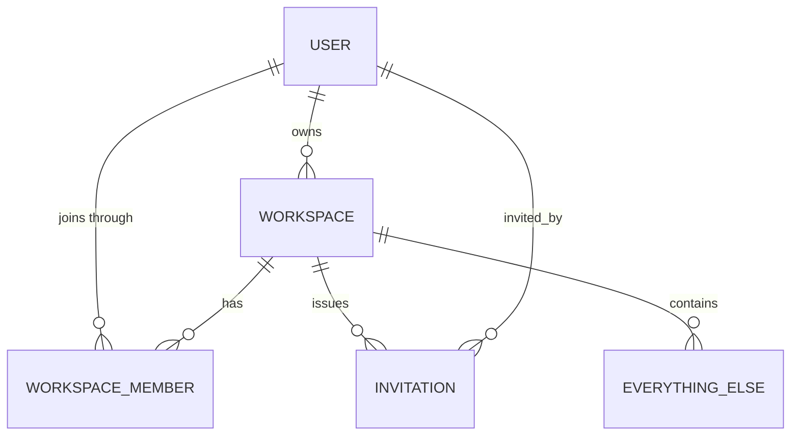

# Module — Workspaces & Membership

[← Modules index](../12-business-modules.md) · [← Docs index](../README.md)

**The foundation.** Nothing else in Nexora makes sense until this does.

---

## 1. The problem it solves

Multiple independent teams use one deployment, and none of them may see another's
data. A workspace is the tenant boundary. A person can belong to several
workspaces with a **different role in each**.

---

## 2. Who uses it

| Role | Capabilities |
|---|---|
| **Owner** | Everything, plus transfer ownership and delete the workspace |
| **Admin** | Edit the workspace, manage members and invitations, moderate comments, review handovers, change AI settings |
| **Manager** | Member capabilities **plus** handover review |
| **Member** | Create and edit content, submit handovers, comment, use AI |

```python
class WorkspaceRole(models.TextChoices):
    OWNER = "owner"; ADMIN = "admin"; MANAGER = "manager"; MEMBER = "member"

REVIEWER_ROLES = (WorkspaceRole.OWNER, WorkspaceRole.ADMIN, WorkspaceRole.MANAGER)
```
`backend/apps/workspaces/models.py:17-25`

The frontend mirrors `REVIEWER_ROLES` by hand in
`frontend/src/types/workspace.ts:8`.

---

## 3. Frontend

| Route | File |
|---|---|
| `/workspaces` | `app/(app)/workspaces/page.tsx` — `useWorkspaces()` |
| `/workspaces/new` | `app/(app)/workspaces/new/page.tsx` — `useCreateWorkspace()` |
| `/workspaces/[id]/settings` | `app/(app)/workspaces/[id]/settings/page.tsx` — members, roles, rename, delete |
| `/invitations` | `app/(app)/invitations/page.tsx` — accept/reject |

| Component | Role |
|---|---|
| `providers/workspace-provider.tsx` | **The most important file in this module.** Owns the active workspace |
| `components/layout/workspace-switcher.tsx` | Sidebar dropdown |
| `components/members/*` (4 files) | Member table, role controls |
| `components/shared/no-workspace.tsx` | Rendered when the user belongs to none |

### The active-workspace mechanism

Documented fully in
[16-state-management.md](../16-state-management.md#4-workspace-state--the-three-source-resolution).
In short: `selectedId` (this tab) ?? `storedId` (localStorage, cross-tab via
`useSyncExternalStore`) ?? `workspaces[0]` ?? null, resolved **during render** to
avoid an effect race.

**The consequence that matters:** `activeWorkspaceId` is a parameter on nearly
every query key, so switching workspace refetches the entire UI automatically.

---

## 4. Backend

```
apps/workspaces/
├── models.py        Workspace, WorkspaceMember, WorkspaceRole, REVIEWER_ROLES
├── serializers.py   WorkspaceSerializer, WorkspaceMemberSerializer
├── views.py         WorkspaceViewSet + members / manage_member / transfer_ownership
├── urls.py
└── tests.py         15 tests — the role matrix

apps/invitations/
├── models.py        Invitation, InvitationStatus, INVITABLE_ROLES, generate_token
├── serializers.py   InvitationSerializer
├── views.py         InvitationViewSet + accept / reject / resend
└── tests.py         9 tests
```

`WorkspaceViewSet` is a plain `ModelViewSet` — **not** `WorkspaceScopedViewSet` —
because a workspace *is* the scope. It defines its own queryset and a per-action
permission matrix:

```python
def get_permissions(self):
    if   self.action in ("update", "partial_update"): perms = [IsAuthenticated, IsWorkspaceAdminOrReadOnly]
    elif self.action == "destroy":                    perms = [IsAuthenticated, IsWorkspaceOwner]
    elif self.action in ("retrieve", "members"):      perms = [IsAuthenticated, IsWorkspaceMember]
    else:                                             perms = [IsAuthenticated]   # list, create
    return [perm() for perm in perms]
```
`views.py:50-59`

This is the only per-action permission matrix in the codebase, and the clearest
example of DRF's `get_permissions` hook.

---

## 5. Database



Three tables — full columns in
[10-database-tables.md](../10-database-tables.md).

**`workspaces_workspacemember` is the single most-read table in the system.**
Every permission check and every scoped query joins it:

- `WorkspaceScopedViewSet.get_queryset()` → `filter(workspace__members__user=...)`
- `_membership()` in `apps/common/permissions.py`
- `resolve_workspace()` in `apps/ai/permissions.py`
- `_reviewer_membership()` in `apps/handovers/views.py`
- `_is_admin()` in `apps/invitations/views.py`
- `_resolve_member()` in the task and handover serializers

Constraint: `unique_workspace_member` on `(workspace, user)` — a person joins
once, enforced in the database.

---

## 6. API

### Workspaces

| Method | Endpoint | Who |
|---|---|---|
| GET | `/workspaces/` | any authenticated user (returns only their own) |
| POST | `/workspaces/` | any authenticated user |
| GET | `/workspaces/{id}/` | member |
| PATCH | `/workspaces/{id}/` | owner / admin |
| DELETE | `/workspaces/{id}/` | **owner only** |
| GET | `/workspaces/{id}/members/` | member |
| PATCH | `/workspaces/{id}/members/{member_id}` | owner / admin |
| DELETE | `/workspaces/{id}/members/{member_id}` | owner / admin |
| POST | `/workspaces/{id}/transfer-ownership/` | **owner only** |

The member sub-route uses a regex `url_path`:

```python
@action(detail=True, methods=["patch","delete"],
        url_path=r"members/(?P<member_id>[0-9a-fA-F-]+)")
```
`views.py:87-91`

One action handling two verbs on a nested resource — an unusual but compact DRF
pattern.

### Invitations

| Method | Endpoint | Who |
|---|---|---|
| GET | `/invitations/` | mine, or ones for workspaces I administer |
| POST | `/invitations/` | owner / admin |
| DELETE | `/invitations/{token}/` | owner / admin (sets status `cancelled`) |
| POST | `/invitations/{token}/accept/` | the invited email only |
| POST | `/invitations/{token}/reject/` | the invited email only |
| POST | `/invitations/{token}/resend/` | owner / admin |

`lookup_field = "token"` — the URL **is** the credential.

The list queryset is an OR of two conditions:

```python
Invitation.objects.filter(
    Q(email__iexact=user.email)
    | Q(workspace__members__user=user,
        workspace__members__role__in=(OWNER, ADMIN))
).distinct()
```
`invitations/views.py:49-55`

---

## 7. Business rules

### Workspace lifecycle

| Rule | Where |
|---|---|
| Creating a workspace makes you the **owner member**, atomically | `perform_create` (`views.py:61-69`) |
| Slug auto-generates and de-duplicates with `-2`, `-3`… | `_generate_unique_slug` |
| Slug is **globally** unique (unlike project slugs, which are per-workspace) | model constraint |
| `role` in the API response is *your* role, computed per request | `WorkspaceSerializer.get_role` (`serializers.py:45-50`) |
| Only the owner may delete — which cascades into everything | `IsWorkspaceOwner` |

### Membership

| Rule | Where |
|---|---|
| Owners and admins may manage members | `views.py:99-101` |
| **The owner's membership cannot be edited here** — "use transfer-ownership" | `views.py:104-107` |
| Assignable roles: admin, manager, member. Never owner | `views.py:114-115` |
| A person joins a workspace once | DB constraint |
| Removing a member logs `member.removed` via signal | comment at `views.py:110` |

### Ownership transfer

```python
with transaction.atomic():
    target.role = OWNER;  target.save(update_fields=["role","updated_at"])
    actor.role  = ADMIN;  actor.save(update_fields=["role","updated_at"])
    workspace.owner_id = target.user_id
    workspace.save(update_fields=["owner","updated_at"])
```
`views.py:145-151`

Three writes, one transaction — a partial application would leave the workspace
with two owners or none. Guards: owner only, target must be a member, cannot
transfer to yourself.

### Invitations

Complete rule list in
[13-business-logic.md](../13-business-logic.md#3-invitation-rules). Highlights:

- Token is `secrets.token_urlsafe(32)` — ~256 bits.
- 7-day expiry, checked lazily at accept time.
- Cannot invite an existing member, or duplicate a pending invite.
- `owner` is not an invitable role.
- Accept uses `get_or_create` on the membership, so it is idempotent.
- Cancel is a status change, not a delete.

---

## 8. The invitation journey

```mermaid
sequenceDiagram
    actor A as Admin
    participant S as System
    participant E as Email
    actor I as Invitee

    A->>S: POST /invitations/ {workspace, email, role}
    S->>S: _is_admin() check
    S->>S: validate: not already a member, no pending invite
    S->>S: INSERT invitation (token, expires_at = now+7d)
    alt the invitee already has an account
        S->>I: in-app notification WORKSPACE_INVITE → /invitations
    end
    S->>E: queue_templated_email("invitation") on_commit
    E->>I: email with accept_url = FRONTEND_URL/invitations?token=...
    S->>S: log_activity("member.invited")

    I->>S: POST /invitations/{token}/accept/
    S->>S: _require_recipient(): email must match, case-insensitive
    S->>S: status must be pending; not expired
    S->>S: WorkspaceMember.get_or_create(role=invitation.role)
    S->>S: invitation → accepted
    Note over S: post_save on WorkspaceMember → activity row
    S-->>I: 200
```

The email is what reaches someone with no account yet — the in-app notification
can only be created for a user that already exists (comment at
`invitations/views.py:79-81`). The email template branches on `is_new_user` to
show a register link instead of an accept link.

---

## 9. Dependencies

**Depended on by: everything.** `apps.workspaces` is imported by
`apps.common.permissions` (lazily, to break a cycle), by every model through
`WorkspaceScopedModel`, and by handovers, invitations and AI for role checks.

**Depends on:** `apps.common.models` (`BaseModel`), `apps.common.permissions`,
and — for invitations — `apps.notifications`, `apps.activities` and
`apps.common.email`.

The circular-import break is worth knowing:

```python
def _resolve_workspace(obj):
    from apps.workspaces.models import Workspace   # local import
```
`apps/common/permissions.py:20-21` — `workspaces` depends on `common`, so a
top-level import would be circular.

---

## 10. Failure scenarios

| Scenario | Result |
|---|---|
| Not a member, request the workspace | 404 — the queryset filter |
| Admin tries to delete the workspace | 403 "Only the workspace owner can perform this action." |
| Admin tries to change the owner's role | 400 "The owner's membership can't be changed here — use transfer-ownership." |
| Transfer to a non-member | 400 "That user is not a member of this workspace." |
| Transfer to yourself | 400 "You already own this workspace." |
| Invite an existing member | 400 `{"email": ["That person is already a member of this workspace."]}` |
| Second pending invite for the same email | 400 with a similar message |
| Accept someone else's invitation | 403 "This invitation was sent to a different email." |
| Accept an expired invitation | Status flips to `expired`, then 400 "This invitation has expired." |
| Delete a workspace | Cascades into **everything**. Activity logging is suppressed during the cascade to avoid FK violations |
| Delete a **user** who owns a workspace | `Workspace.owner` is `CASCADE` — the workspace and all its content are destroyed |

---

## 11. Interview questions

1. How does multi-tenancy work here? Where is it enforced?
   *(One `workspace_id` column, one base queryset filter, plus the create check,
   the AI gate and the vector-search filter.)*
2. Why does a cross-tenant read return 404 instead of 403?
3. Why is `WorkspaceViewSet` not a `WorkspaceScopedViewSet`?
4. Why is ownership transfer wrapped in a transaction?
5. Why can't `manage_member` change the owner's role?
6. Why is the invitation token the URL lookup field?
7. What is the risk of `Workspace.owner` being `CASCADE`?
8. Workspace slugs are globally unique but project slugs are per-workspace. Why
   the difference? *(Workspace slugs are the top-level namespace; project slugs
   only need to be unique within their tenant — the multi-tenant-correct choice.)*
9. Why does the frontend duplicate `REVIEWER_ROLES` instead of fetching it?
10. How would you support a user belonging to 500 workspaces? *(The switcher
    loads all of them unpaginated; `member_count` is an N+1. Both would need
    fixing.)*
